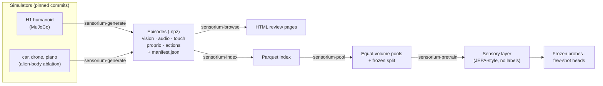

# sensorium

Research code for a **sensory layer**: one latent state learned from a simulated
humanoid's vision, sound, touch, proprioception and actions. It is pretrained with no
rewards, labels or text, and then tested on whether it makes new skills few-shot. It is
for researchers in embodied and multisensory representation learning. Language is only a
readout of that state.

**Question:** do the *senses* and the *kind of experience* behind a sensory layer matter
more than the number of skills it was shown? The body is a Unitree H1 with whole-body
skin, head cameras, a vestibular sense, and Shadow hands or Robotiq pincers.



The model never sees privileged simulator state or text. Those are used only for analysis
and probe labels (see [docs/data-generation.md](docs/data-generation.md)).

## Quickstart

You need Python 3.13 and [uv](https://docs.astral.sh/uv/). Everything here runs on CPU.

```sh
make setup            # uv env with simulators and model extras
make h1-assets        # H1 + hand/pincer assets at pinned commits (~120 MB, data/external/)
make sample-h1        # 8 humanoid episodes and their review pages (~45 s)
open data/sample_h1/index.html
make pretrain-smoke   # 300 steps of the tiny sensory layer on that sample (~40 s)
```

To build the car, drone and piano sample, run `make rp1m-toy && make sample && make browse`.
The [review checklist](docs/review-sample.md) says what to look for in the pages.

## Code

| Path | What |
|---|---|
| `src/sensorium/episode.py`, `codec.py` | The episode format (save, load, validate, H.264 frames) and the allow-list of model inputs |
| `src/sensorium/bodies/` | `humanoid.py` with the `h1_*` modules (scene, skin, cameras, props, policies, babbling, experiment programs), plus `car.py`, `drone.py` and `piano.py` |
| `src/sensorium/generate.py`, `browse.py` | Turn a config into episodes and a manifest; turn episodes into review pages |
| `src/sensorium/registry.py`, `index.py`, `pool.py` | Source registry, parquet index, pretraining pools |
| `src/sensorium/caused_change.py`, `a1_gate.py`, `babble_stats.py` | Data-quality measures: what the robot caused, and pass/fail gates |
| `src/sensorium/model/` | The sensory layer, its pretraining loop, probes and controls |
| `configs/` | Generation configs, `sources.toml`, `splits/`, `pools/`, `model/` |
| `scripts/` | Asset fetchers and the scripts for individual studies |

## Status

- **Data (Track A, Experientia):** the H1 is in the episode format with dense skin and
  256 px vision. Scripted experiments now record what the robot caused. Hand lifts and the
  BiGym and LocoMuJoCo adapters are next.
- **Model (Track B):** v0 is built and tested on CPU. So far no self-supervised encoder
  beats its random-init floor on the probe battery. The data-scale study (B-scale-0) and the
  label-efficiency study (B-ft-curve) are pre-registered. The GPU smoke test is prepared
  but has not run.

The current plan, next steps and the decision log are in [docs/roadmap.md](docs/roadmap.md).
Results are in [docs/model.md](docs/model.md).

## Docs

| Doc | What |
|---|---|
| [roadmap.md](docs/roadmap.md) | Status, next steps, decision log. Start here |
| [thesis.md](docs/thesis.md) | Goal, hypotheses H1–H4, evidence, research ladder (D0, E1–E4) |
| [tracks.md](docs/tracks.md) | The two research tracks (A: dataset, B: model) and where each stops |
| [dataset-proposal.md](docs/dataset-proposal.md) | D0 Experientia: the dataset and its held-out few-shot benchmark |
| [experiment-01.md](docs/experiment-01.md) | E1: senses × kind of experience. Design, protocol, compute |
| [experiments.md](docs/experiments.md) | Experiments with outcomes: props, programs, caused-change measures, held-out tasks |
| [model.md](docs/model.md) | Sensory layer v0: architecture, objectives, every study and its results |
| [data-generation.md](docs/data-generation.md) | Episode format, synthetic audio, templated language, quality gates |
| [touch.md](docs/touch.md), [vision.md](docs/vision.md) | How skin contacts and camera frames become model inputs |
| [pools.md](docs/pools.md) | Source registry, frozen split, equal-volume pools |
| [datasets.md](docs/datasets.md) | Simulators and datasets, and what each one covers |
| [literature-review.md](docs/literature-review.md), [references.md](docs/references.md) | Prior work and a verdict for each hypothesis; papers |
| [review-sample.md](docs/review-sample.md) | How to review a generated sample |

## Development

```sh
make check            # lint + typecheck + test
make format
make smoke            # one tiny episode per body, end to end (~1 min; needs make h1-assets and make rp1m-toy)
make a1-gate A1_DIR=data/a1   # quality gates on a babbling run
make measure          # parameters, FLOPs and speed of configs/model/v0.toml
```

Generated data and runs go under `data/` and `runs/`, which git ignores.
