# The sensory layer v0 (M3)

Code: `src/sensorium/model/`. Config: `configs/model/`. The design memo with the
literature check is not in the repo. Results below cite runs by the number of the
pull request that produced them in the pre-publication history ("PR #18"); those
numbers are labels, not links. Status: v0
built and tested on CPU; no GPU run yet (the supervisor decides compute).

```sh
make pretrain-smoke    # 300 steps of the tiny model on data/sample_h1, ~40 s on an M-series CPU
make measure           # parameters, tokens, FLOPs, CPU speed, loader throughput of configs/model/v0.toml
uv run sensorium-pretrain configs/model/v0.toml   # full size; needs a pool (data.pool) and a GPU
```

## What it is

```
 per model step (K = 4 observations, 0.2 s on the 20 Hz H1)
 vision  last frame, 128 px crop ─ ViT-Tiny (192 wide, 12 layers) ─ pool ─► 8 tokens ┐
 touch   54 skin regions (hands) ─ per-region linear ─ 2-layer transformer ─ pool ─► 6 ┤
 audio   4 x 32 log-mel ─ MLP ─► 1                                                     ├─► fusion encoder ─► state s_t (512)
 proprio body / vestibular / effector, 4 sub-steps each ─ MLP ─► 1 each                ┘     (4 layers, + summary token)
                                                                                             │
 action chunk (4 actions) ─ MLP ─► conditioning c_t ──► causal predictor (AdaLN-zero) ──► ŝ_{t+1}
 objective "sigreg":      MSE(ŝ_{t+1}, s_{t+1}) + 0.1 · SIGReg(s) + 0.5 · recon(z)   no EMA, no stop-gradient
                          (one masked pass; z = the pre-projector summary; recon_weight = 0 is "A0")
 objective "ema_vicreg":  MSE(ŝ_{t+1}, EMA-encoder s_{t+1}) + var(s) + 0.04 · cov(s)   (see below)
```

* **Default since B-fix-1: JEPA + reconstruction in one masked pass.**
  * The input window is masked once, and the encoder runs once on it.
  * The next-state MSE and SIGReg act on the projected state s.
  * An MAE-style decoder reads the pre-projector summary z and reconstructs the hidden patches and
    proprio channels, with weight `model.recon_weight` = 0.5.
  * This is the default for `sigreg` with vision (`recon_weight` unset). `recon_input = "separate"`
    is B-fix-0's two-pass form.
  * `recon_weight = 0` is the plain JEPA ("A0") of every study before B-fix-0.
    `configs/model/cpu_tiny_a0.toml` keeps that recipe for the historical study scripts, so their
    results reproduce.
  * Checkpoints store the weight in use. A checkpoint from before the option existed loads as A0.
* **Two objectives**, `model.objective`. `sigreg` is LeWorldModel's (above). `ema_vicreg`
  has the predictor regress the states of an **EMA copy of the whole state encoder** (stems,
  fusion, projector; stop-gradient; momentum `ema_momentum` to `ema_momentum_end`, linear over
  the run, default 0.99 to 0.999), with VICReg's **variance** (hinge on each dimension's std over
  the B x T online states, target 1) and **covariance** (squared off-diagonal covariance / D)
  terms on the online states as the anti-collapse part, weighted 1 : 0.04 against the prediction
  error (VICReg's 25 : 25 : 1; arXiv:2105.04906 Sec. 4.1-4.2, App. D.4). The target sees all
  senses (no sense dropout) and uses batch statistics in its BatchNorm. `pred` is measured
  against different targets in the two objectives, so it is not comparable across them.
* **One state per step.** `s_t` depends only on the window of observations ending at
  `e_t`; the predictor sees the sequence of states and the action chunks. So
  `SensoryLayer.encode(episode, stride)` is cheap and any stride is allowed.
* **Timing.** The window of `s_t` ends at `e_t`; the action chunk `a_t` is the K actions from
  `e_t` on, so `(s_t, a_t) -> s_{t+1}` is one transition (`episode.py` convention). A body with
  another control rate gets the observation spacing nearest 0.05 s (`data.spacing`: the car at
  10 Hz gets 0.4 s steps, the drone at 40 Hz subsamples by 2).
* **Senses are configuration.** `model.senses` is any subset of `vision, touch, audio,
  proprio_body, vestibular, proprio_effector`; `action` is always present. A sense that is
  not configured has no stem and no token (`SensoryModel.n_tokens`); a sense an episode does
  not have (a car has no skin) is masked in the fusion. `model.sense_dropout` drops each
  configured sense for a whole sequence at random, so a layer trained with all senses can run
  with fewer. A pool's `senses` (input keys) restrict the model senses (`senses_for_pool`).
* **Channel space** (`layout.py`). Proprio groups are chosen by name (`vest_*`, `gravity_*`,
  `pelvis_height` = vestibular; `q_lh_*`, `dq_rp_*` ... = effector; the rest body). Touch is cut
  into 54 regions (hands) / 24 (pincers) by name: taxels `hand/left/palm/7` and the dynamics
  `dynamics/hand/left/palm/slip` fall in one region (the body's `_link` suffix is dropped to
  join them). The model keeps the **union** of channel names over its dataset, so the hand and
  pincer episodes share the body channels' weights and the effector channels are separate.
  The touch stem's weights are per channel; its tokens carry an embedding of the region's
  block / side / segment, not of "hand" vs "pincer", so the trunk is not told the effector.
* **Loader** (`data.py`). Only `episode.model_inputs` reaches a batch; the tests plant a
  tripwire on `privileged` and `text`. Touch gets `touch_noise.perturb_touch` (once per
  sequence, not per episode) then `log1p`; frames get `vision.train_view` (one crop per
  sequence, centre crop in `encode`); proprio and audio are standardised with statistics fitted
  on the first 64 episodes (stored in the checkpoint). Each episode pick yields `reuse = 8`
  sequences, because decoding an episode costs more than cutting a sequence.

## Sources and what is verified

| Piece | Source | Status |
|---|---|---|
| Objective: next-state MSE + SIGReg, no EMA, AdaLN-zero predictor, projector with BatchNorm, frame-skip as action chunk | LeWorldModel, arXiv:2603.19312, github.com/lucas-maes/le-wm (MIT) | loss and SIGReg read in `train.py` / `module.py` (verified); paper numbers via a summarising fetch tool. `SIGReg` is copied from LeWM's statistic (attribution in `modules.py`) |
| Learned-query pooling to a fixed number of tokens | HPT, arXiv:2409.20537, github.com/liruiw/HPT (MIT) | Sec. 3.1 / App. A.2 via a summarising fetch tool |
| EMA target + VICReg terms | VICReg (Bardes et al. 2022, arXiv:2105.04906); V-JEPA 2 EMA 0.99925 or a ramp 0.999 to 1.0 (App. A.1, Tables 9-10) | VICReg term definitions and weights read via a fetch tool; our momentum 0.99 to 0.999 is shorter-run, not tuned |
| Fusion of sense tokens with a summary token | standard; Sparsh-X (arXiv:2506.14754) fuses touch modalities with bottleneck tokens | not copied |
| Region tokens from a skin layout | Tactile-JEPA (arXiv:2609.24385) uses a token per taxel and a taxel graph | idea only; our per-region linear is simpler |
| Frame stride / action chunks | V-JEPA 2-AC (4 fps, 16 frames), LeWM (frame-skip 5) | Sec. 3.1 of V-JEPA 2 via a fetch tool |

**Unverified or deviating** (also listed in the PR):

* LeWM's config uses `sigreg.weight` 0.09 while its paper says 0.1; we use 0.1.
* **SIGReg needs a large batch.** Its statistic compares the B samples of a time step with a
  Gaussian; it scores about 1 for any isotropic Gaussian and about B/2 for a collapsed
  embedding (measured with `tests/test_model.py::test_sigreg_*`), so at B = 8 it hardly tells them
  apart. LeWM trains with B = 128. `model.sigreg_pool_time` compares all B x T states at once;
  the tiny CPU config uses it. Whether the pooled statistic gives the same representation at
  B = 128 is untested.
* Applying SIGReg to a fused 512-d state is an extension of LeWM, which regularises one
  `[CLS]` embedding per frame.
* The predictor has 4 layers (the memo said 6): the AdaLN-zero modulation adds 1.6M parameters
  per layer, which put the model at 55M.
* Touch is stacked over K = 4 sub-steps, so the touch stem has K x 3.7k x 256 weights.
* The EMA objective's weights (1 : 1 : 0.04) and momentum are VICReg's / a guess, untuned.
  Checkpoints written before the EMA objective (state-dict keys without the `encoder.` prefix)
  do not load; none was kept.
* `train.save_steps`, `model.teacher`, `model.sense_dropout_senses` are used by the teacher test;
  the loader sees `model.data_senses` (the state encoder's senses plus touch for a teacher).
* Probe ridge uses one SVD per fold for all strengths and labels (same numbers as the closed form,
  tested); `train.save_steps` keeps numbered checkpoints.
* The DINOv2 vision-stem option of the memo is **not implemented** (no runs are planned yet).
* Not tested at scale: sense dropout, mixed bodies in one batch (car, drone, piano are supported
  by the channel space and tested only through the layout), `num_workers > 0`.

## Measurements (this Mac, 8 CPU threads, `make measure`)

| | v0 default (128 px) | v0 at 224 px | tiny CPU config |
|---|---|---|---|
| Parameters | 45.8M (vision 5.7, touch 5.6, fusion 12.6, predictor 18.9, rest 2.9) | same | 2.4M |
| Tokens per step (fusion) | 19 (8 + 6 + 1 + 3 + summary) | 19 | 12 |
| Training FLOPs per sequence (16 steps) | 69 GFLOPs | 139 GFLOPs | not measured |
| CPU training speed | 3.9 to 4.9 sequences/s (batch 2); 6.9 in a batch-8 run | 3.1 (batch 2) | ~65 (batch 8) |
| Loader, one process, stream (8 sequences per decoded episode), after PR #12 | 90 sequences/s (54 before) | not re-measured | |
| Loader, one process, episodes cached | 150 sequences/s | 122 | |

The memo estimated 74 / 159 GFLOPs; the counted values are within 15%.

### CPU runs on the H1 sample (8 episodes, 2,400 steps)

Collapse is read from two numbers of the states in a batch: the mean per-dimension std (about 1
for a healthy SIGReg embedding) and the effective rank (`exp` of the entropy of the normalised
singular values; the width at best, 1 when collapsed).

| Run | Batch | SIGReg | Steps | Loss first -> last | std | Effective rank (of 128) |
|---|---|---|---|---|---|---|
| tiny, 2.4M | 8 | per step (LeWM) | 300 | 0.35 -> 0.22 | 0.44 | 42.8 at step 25 -> **7.5** |
| tiny, 2.4M | 32 | per step | 300 | 0.76 -> 0.37 | 0.76 | 41.6 -> 22.3 |
| tiny, 2.4M (`cpu_tiny.toml`) | 8 | pooled over time | 300 | 1.43 -> 0.62 | 0.81 | 32.8 -> 22.1 |
| v0 size, 45.8M (width 512) | 8 | pooled | 60 | 2.46 -> 1.23 | 0.82 | 47.7 (of 512) -> 29.1 |
| tiny, H1 + car + drone + piano (24 episodes) | 8 | pooled | 40 | 1.98 -> 1.58 | 0.44 | 25.8 -> 19.5 (of 64) |

The loss falls in every run. The per-step statistic at batch 8 lets the rank drop to 7.5 while
the next-state error looks best (0.019): a partial collapse the loss does not punish. Pooling
the time steps (64 samples instead of 8) or a batch of 32 keeps the rank near 22. The sample
is 8 episodes of seated babbling and holding, so its own dimensionality is low and these
ranks cannot say what a healthy value is at scale; the GPU smoke test at batch 128 does.

**GPU estimate** (not measured). Time per run = sequences x GFLOPs / (989 TFLOPS dense bf16 x
utilisation), with the pool of 5M env steps = 78k non-overlapping sequences per epoch. At 128
px and 20 epochs: 1.6M sequences x 69 GF = 1.1e17 FLOPs = 0.12 to 0.30 H100-hours at 10 to 25%
utilisation; at 100 epochs 0.6 to 1.5 h. At 224 px, double. Utilisation and the loader are the
unknowns: decoding one 256 px H1 episode takes 0.089 s here with `Episode.load(privileged=False)`
(0.166 s before PR #12, which skipped the privileged right eye the model never uses).

## SIGReg vs EMA + VICReg at CPU scale

`scripts/compare_objectives.py`: the tiny model (2.4M, width 128) on the 8-episode H1 sample,
1,000 steps, batch 8 and 32, 2 seeds each (the two seeds agree within about 10% except per-step SIGReg at batch 32: eval rank 22.4 and 17.9; per-run summaries are in `runs/compare/`, git-ignored). *In-batch* values are the last four logged steps; *eval* values are 512
windows of the data encoded in eval mode after training, the same sample for every run, so they
do not depend on the batch size. The effective rank is at most 128 (the width) and, in-batch, at
most B x T - 1 = 63 (B = 8) or 255 (B = 32).

| Objective | Batch | In-batch std | In-batch erank | Eval std | **Eval erank** (of 128) |
|---|---|---|---|---|---|
| SIGReg per step (LeWM) | 8 | 0.60 | 3.7 | 0.67 | **5.7** |
| SIGReg per step | 32 | 0.92 | 17.5 | 1.00 | **20.1** |
| SIGReg pooled over time | 8 | 0.91 | 20.2 | 0.94 | **32.4** |
| SIGReg pooled over time | 32 | 0.97 | 42.4 | 0.99 | **46.2** |
| EMA + VICReg | 8 | 0.93 | 39.1 | 0.96 | **63.0** |
| EMA + VICReg | 32 | 0.99 | 63.5 | 1.01 | **68.3** |

* **Rank depends on the batch size under SIGReg and hardly under EMA + VICReg.** Per-step
  SIGReg goes from 5.7 to 20.1 when the batch grows 4x; the pooled variant from 32 to 46;
  EMA + VICReg from 63 to 68. This is the dependence the pilot's objective check should look
  at again at batch 128.
* **Not a quality ranking.** A higher rank is not a better representation: nothing here asks
  whether the dimensions carry the information a task needs (that is the benchmark's probes),
  and part of the spread can be sensor noise. The prediction error `pred` is measured against the
  online states for SIGReg and against the EMA states for the other, so it cannot be compared
  across objectives; under EMA it does not have to fall (0.64 to 0.69 at batch 8, 0.60 to 0.46 at
  batch 32) because the target moves.
* Caveats: 8 episodes of seated babbling and holding (low intrinsic dimension), a 2.4M model,
  1,000 steps, two seeds, untuned EMA / VICReg weights. A batch of 128 might lift per-step SIGReg
  as LeWM's does; that is what the GPU smoke test measures first.

## Probes of the encoded states (evaluation only)

`sensorium.model.probes` fits **ridge probes from the encoded state to privileged simulator
labels** on the H1 episodes. `train.probes = true` runs them on the final states; `scripts/
compare_objectives.py --probe` runs them on saved runs.

* **Labels** (per window of K observations): `contact_left`, `contact_right` (any contact of a
  `lh_*`/`lp_*` or `rh_*`/`rp_*` body), `contact_object` (an `obj_*` body touching a hand or pincer body; PR #15's 8-episode runs counted any object contact, which is true in every window of the 100-episode data because objects rest on the table, so the label changed and the PR #15 tables use the old one), `log_force` (mean
  `log1p` of the summed normal force), `tip` (the two hand tips' world position, 6-d). From
  `privileged/contacts`, `meta.body_names`, `privileged/tip_position`.
* **Protocol.** Leave-one-**episode**-out: no window of a test episode is in its training set. Ridge
  on features centred and divided by one global scale (not per column: rarely active touch
  channels would get huge weights), strength chosen by an inner episode-grouped 3-fold on the training
  episodes. Binary labels are scored by AUROC of the ridge output (0.5 = chance; threshold-free
  because the classes are imbalanced: 37 to 74% positive), continuous ones by pooled held-out
  R^2. `mean` averages `2 * (AUROC - 0.5)` and the R^2 values, so 0 is chance for every term.
  The encoder was trained on the same 8 episodes (self-supervised, no labels).
* **References.** `floor` = the same encoder at its random initialisation. `raw` = the non-visual
  model inputs of the same windows (touch after `log1p`, proprio groups, audio, last observation of
  each window), fitted with the same probe: what a perfect-memory encoder of those senses could offer.
* **Leakage guard.** Privileged arrays are read in `probes.py` and nowhere else in
  `sensorium.model`; the training path loads episodes with `Episode.load(path, privileged=False)`
  and builds batches from `model_inputs`. Tests enforce it: a spy on `Episode.load` while
  `SequenceDataset` samples (every call has `privileged=False` and returns no privileged array;
  batch keys are a subset of the senses, `action`, `present`, `region_mask`), and a source check
  that no other module in the package touches `.privileged` or `"privileged/..."`, and that every
  `Episode.load(` call in `data.py` passes `privileged=False`.

### Results (tiny 2.4M model, 8-episode H1 sample, 1,000 steps, 2 seeds; 1,192 windows)

| Encoder | Batch | Eval erank | contact L | contact R | contact obj | log force R^2 | tip R^2 | **mean** |
|---|---|---|---|---|---|---|---|---|
| SIGReg per step | 8 | 5.7 | 0.58 | 0.56 | 0.98 | 0.45 | 0.12 | **0.36** |
| SIGReg per step | 32 | 20.1 | 0.73 | 0.51 | 0.89 | 0.34 | -0.16 | **0.29** |
| SIGReg pooled | 8 | 32.4 | 0.65 | 0.61 | 0.86 | 0.17 | -0.12 | **0.26** |
| SIGReg pooled | 32 | 46.2 | 0.68 | 0.70 | 0.95 | 0.44 | -0.05 | **0.41** |
| EMA + VICReg | 8 | 62.8 | 0.62 | 0.64 | 0.62 | 0.00 | -0.12 | **0.13** |
| EMA + VICReg | 32 | 68.3 | 0.71 | 0.62 | 0.78 | 0.02 | -0.04 | **0.24** |
| **Random initialisation (floor)** | - | - | 0.72 | 0.77 | 0.98 | 0.32 | 0.13 | **0.48** |
| Raw non-visual inputs | - | - | 0.83 | 0.80 | 0.98 | 0.59 | 0.58 | **0.68** |

(The EMA batch-8 row has 3 seeds, one run from the postdoc's reproduction. Per-run `mean`:
SIGReg step 0.37/0.36 (b8), 0.33/0.24 (b32); pooled 0.27/0.24, 0.38/0.44; EMA 0.11/0.16/0.12,
0.08/0.40; floor 0.47/0.50.)

Probe `mean` against training steps (seed 0, batch 8):

| Objective | 0 (floor) | 100 | 300 | 1000 |
|---|---|---|---|---|
| SIGReg per step | 0.47 | 0.44 (erank 49) | 0.43 (14) | 0.37 (6) |
| SIGReg pooled | 0.47 | 0.51 (40) | 0.29 (38) | 0.27 (32) |
| EMA + VICReg | 0.47 | 0.51 (47) | 0.46 (51) | 0.11 (63) |

Without frames (touch, audio, proprio only): pooled SIGReg 0.30/0.31, EMA + VICReg 0.13/0.11
after 1,000 steps; random-init floor 0.60/0.59.

**Reading.**
* **The sample cannot separate the objectives, and no trained encoder beats the random one.**
  The random-initialisation floor (0.48) is above every trained configuration's mean
  (0.13 to 0.41; the best, pooled SIGReg at batch 32, is within seed noise of it). The probe
  protocol itself works: the raw inputs reach 0.68, with contact flags at 0.80 to 0.98.
* **Training lowered the probe score.** All three objectives start at the floor after 100 steps
  and fall afterwards (EMA + VICReg most: 0.51 to 0.11, while its effective rank rises from 47 to 63;
  per-step SIGReg loses rank and probe score together). Rank is not information: EMA + VICReg has
  the highest rank and the lowest probe score.
* **It is not the frames.** Without vision the floor is higher (0.60) and the trained encoders are
  no better (0.11 to 0.31), so the per-episode look does not explain the loss.
* **Seed noise is large** (EMA + VICReg at batch 32: 0.08 and 0.40), with 8 episodes and
  leave-one-episode-out folds in which only a few episodes have the contact being tested.
* **Likely reasons, not tested:** 8 episodes of seated babbling and holding is enough for a model
  to fit its own episodes' dynamics without keeping contact in a form that transfers to another
  episode; the tiny encoder compresses, whereas a random one keeps a random projection of everything.
  The test that would tell is a held-out-episode pretraining split (pretrain on some episodes,
  probe on others) on data large enough to have one: Track A's babbling data, not this sample.
  Until then a rank statistic or this probe table cannot pick SIGReg or EMA.

## The decisive held-out-episode test (120 episodes)

Question: does pretraining keep less contact information than a random encoder only because the
sample had 8 episodes? `scripts/decisive_test.py`; data from `configs/probe_test.toml`, which runs
**Track A's generator** (not a new source) at `main` commit `b44057d` (seated babbling, PR #14): 120
episodes of 600 steps (60 hand, 60 pincer; 519 MB; `data/probe_test`, untracked). The encoder is
pretrained on 100 (50 + 50) and probed on the 20 it never saw (10 + 10; leave-one-episode-out
inside that set, 1,500 windows), plus the same probes on 20 pretraining episodes ("seen").
Tiny model (2.4M), batch 16, **2,000 steps** (not the 3,000 steps at batch 32 of the brief: the
CPU was shared with another job, 9 to 14 sequences/s per run), 2 seeds, checkpoints at 100 / 300 /
1,000 / 2,000 steps (the learning rate follows one cosine schedule over the 2,000).

Held-out probe mean (`mean +- sd` over 2 seeds; seen episodes in brackets):

| Encoder | 100 | 300 | 1,000 | 2,000 |
|---|---|---|---|---|
| SIGReg pooled | 0.27 +- 0.03 (0.33) | 0.25 +- 0.00 (0.29) | 0.20 +- 0.01 (0.22) | **0.17 +- 0.02** (0.21) |
| EMA + VICReg | 0.26 +- 0.02 (0.32) | 0.29 +- 0.02 (0.33) | 0.30 +- 0.02 (0.31) | **0.29 +- 0.00** (0.29) |
| SIGReg pooled + sense dropout 0.5 (1,000-step schedule) | 0.29 +- 0.03 (0.33) | 0.32 +- 0.02 (0.34) | **0.35 +- 0.04** (0.37) | - |
| **Random init (floor)** | **0.31 +- 0.00** (0.38) | | | |
| Raw non-visual inputs | 0.22 (0.48) | | | |

* **No encoder trained as before beats the floor on held-out episodes.** EMA + VICReg reaches 0.29
  to 0.30 against 0.31 (one seed touches 0.32); pooled SIGReg falls to 0.17.
* **Pooled SIGReg keeps falling with training** (0.27 to 0.17), also on seen episodes, so it is not
  a generalisation gap: the encoder loses contact information. EMA + VICReg rises to 0.30 by 1,000
  steps and then stays.
* **Diagnosis (sense reliance = how far masking a sense moves the state, relative to the states'
  spread).** For pooled SIGReg the next-state error falls (0.56 to 0.13) while the state becomes
  proprio-dominated: reliance on `proprio_body` 0.41 to 0.79, on touch 0.07 to 0.04, vision 0.13
  to 0.04, audio 0.15 to 0.00. Its probe terms keep tip position (R^2 0.29, the floor's is 0.27) but
  lose contact (AUROC 0.64 / 0.56 / 0.54, force R^2 0.08). Masking touch or vision does nothing to its
  score; masking proprio *raises* it (0.17 to 0.25). So touch is down-weighted, not lost at the
  stem. EMA + VICReg also uses touch little (0.06 to 0.09) but keeps contact AUROC 0.66 to 0.67.
* **Test of that diagnosis (an intervention, not asked for in the brief).** Pooled SIGReg with
  sense dropout 0.5 (each sense dropped for a whole sequence) stops falling and rises: 0.29 -> 0.32
  -> 0.35 +- 0.04, with touch reliance back at 1.4 and `proprio_body` at 0.62. Per seed at 1,000
  steps: 0.31 (the floor) and **0.39** (above it: force R^2 0.33 vs 0.16, contact right 0.70 vs 0.66,
  object 0.73 vs 0.66). One seed clearly above, one at the floor; two seeds and a different
  schedule length, so it is a lead, not a result. The same dropout made EMA + VICReg worse (0.22,
  one seed).
* **Not only a small-sample artefact:** with 12x more episodes pooled SIGReg still loses contact
  information, EMA + VICReg stays below the floor, and the floor is above the raw inputs (0.22).

Caveats: tiny model only (no v0-size run); 2 seeds; batch 16 and 2,000 steps; the sense ablations
mask senses the model was not trained without (except with dropout); reliance is not comparable in
absolute terms between encoders; the label `contact_object` changed (see above).

## Input or teacher? A probe-level test for touch (B-teach-0)

`scripts/teacher_test.py`; same 120 episodes, split (pretrain 100, probe the 20 never seen), tiny
model, pooled SIGReg, batch 16 and 2,000 steps as the decisive test, so the schedules match. Arms
(`model.teacher`, `model.sense_dropout_senses`, `src/sensorium/model/teacher.py`):

* **a-input**: vision + touch + proprio (no audio), touch dropped in 50% of sequences (3 seeds);
* **b-teacher**: vision + proprio only. A touch-only world model (touch stem, projector, small
  predictor, SIGReg) trains alongside; an **EMA copy** of its encoder gives the targets; two heads
  on the main model predict them (from the state, the current touch latent; from the predictor's
  output, the next one). Touch is never an input of the state encoder and the targets are detached
  (6 seeds);
* **c-none**: vision + proprio only, no touch anywhere (6 seeds);
* **d-placebo**: as b, but the targets are the EMA latents of *another sequence's* touch (a roll by
  one in the batch): same statistics, no information about this sequence (6 seeds);
* **sd-all**: all six senses, dropout 0.5 on every sense (PR #18's lead, 5 seeds); **sd-touch**:
  all six senses, dropout on touch only (1 seed).

Every arm is probed on its **vision + proprio state** (touch, and audio, masked at probe time),
held-out episodes only, against the random-init floor of the same encoder (5 seeds). Tests
(`tests/test_model.py`): touch never enters the state encoder of the teacher arms (the states do not
change when the touch tensor is scrambled; encoder and teacher parameters are disjoint); the aux
loss trains the main model and the heads but gives no gradient to the touch encoder or its EMA
copy; the placebo targets are the real ones of the rolled batch; the EMA copy follows the encoder.

Held-out probe mean of the V+P state at 2,000 steps (mean +- sd over seeds; 0 = chance):

| Arm | Seeds | Probe mean | contact L | contact R | contact obj | force R^2 | tip R^2 |
|---|---|---|---|---|---|---|---|
| sd-all | 5 | 0.26 +- 0.04 | 0.69 | 0.61 | 0.60 | 0.21 | 0.26 |
| a-input | 3 | 0.21 +- 0.03 | 0.62 | 0.60 | 0.60 | 0.15 | 0.25 |
| **b-teacher** | 6 | **0.25 +- 0.03** | 0.70 | 0.60 | 0.62 | 0.12 | 0.31 |
| **c-none** | 6 | **0.22 +- 0.04** | 0.66 | 0.60 | 0.60 | 0.13 | 0.26 |
| **d-placebo** | 6 | **0.24 +- 0.04** | 0.69 | 0.60 | 0.59 | 0.13 | 0.30 |
| floor (V+P, random init) | 5 | 0.22 +- 0.02 | 0.70 | 0.57 | 0.58 | 0.14 | 0.26 |

Contrasts (difference of means +- standard error of the difference): **b - c = +0.03 +- 0.02**,
**b - d = +0.01 +- 0.02**, d - c = +0.02 +- 0.03, b - floor = +0.03 +- 0.02, c - floor = 0.00 +-
0.02, sd-all - floor = +0.04 +- 0.02. Per term, b - c is +0.04 +- 0.01 on contact left and +0.05 +- 0.01
on tip position, and d - c is +0.03 +- 0.01 and +0.04 +- 0.01: the same, so those gains belong to the
extra heads, not to touch.

* **Teacher use.** Against the true touch latents of held-out episodes, the heads of b predict
  R^2 = 0.43 +- 0.03 from the state (next touch from the predictor: 0.46 +- 0.03); the placebo's
  heads 0.11 +- 0.01. So the state does carry information that predicts touch latents, which
  never turned into more linearly decodable contact labels.
* **The dropout lead is not confirmed.** Five seeds of dropout on every sense, 2,000-step schedule:
  0.26 +- 0.04 (seeds 0.20 to 0.32) against 0.20 +- 0.03 for the random floor of the same encoder
  (+0.04 +- 0.02 vs the V+P floor), mean the same with touch present or masked at probe time (0.26
  vs 0.26), and below the random encoder with every sense present (0.30). The 0.39 of PR #18 was a
  good seed of a 1,000-step schedule. Dropout on touch only (sd-touch, a-input) is no better than
  no touch (0.21; 0.21 vs 0.22).
* **Reliance.** Without dropout the state is proprio-led in every arm (`proprio_body` 0.76 to
  0.79); a-input and sd-touch rely on touch (1.4) but their V+P-masked probe scores are no higher.

Caveats: tiny model; one probe family (contact flags, force, tip); with 6 seeds a difference below
about 0.04 on the probe mean is not resolved (SE 0.02); the aux target is a learned touch latent
that may mostly encode posture-dependent contact (the seated body touches the seat all the time),
which is predictable from vision and proprio but is not what the contact labels measure
(untested); the placebo can only be compared at equal architecture, and the arms' parameter counts
differ slightly (the teacher adds heads); `sd-touch` has one seed.

## Positive controls for the probe battery (B-ctrl-0)

**Training-set size for every number in this section:** 100 pretraining episodes of 600 steps =
60,000 env steps (about 50 minutes of experience at 20 Hz); an SSL run sees about 32,000
sequences (2,000 steps x 16); the supervised ceilings 16,000 (1,000 x 16); fine-tunes 4,800
(300 x 16) on 4 or 16 labelled episodes. Probes use the 20 other episodes.

Can the yardstick see a good representation at all? `scripts/controls_test.py`,
`src/sensorium/model/controls.py`; the 120 episodes and split of PR #18, the same probes
(leave-one-episode-out ridge on windows at stride 8, 20 held-out episodes), now with out-of-fold
predictions so every number has a 95% bootstrap CI over the held-out episodes.

| Control | n | Probe mean [95% CI over episodes] | contact L | contact R | contact obj | force R^2 | tip R^2 |
|---|---|---|---|---|---|---|---|
| floor, V+P (random init) | 5 | 0.22 [0.17, 0.27], seed sd 0.02 | 0.70 | 0.57 | 0.58 | 0.14 | 0.26 |
| floor, all senses | 5 | 0.30 [0.23, 0.35], seed sd 0.02 | 0.76 | 0.63 | 0.64 | 0.17 | 0.26 |
| SSL c-none (V+P, PR #20) | 6 | 0.22 [0.17, 0.26], seed sd 0.04 | 0.66 | 0.60 | 0.60 | 0.13 | 0.26 |
| SSL b-teacher (V+P) | 6 | 0.25 [0.20, 0.29], seed sd 0.03 | 0.70 | 0.60 | 0.62 | 0.12 | 0.31 |
| **supervised ceiling, V+P** | 3 | **0.64** [0.56, 0.71], seed sd 0.00 | 0.83 | 0.84 | 0.76 | 0.51 | 0.85 |
| **supervised ceiling, all senses** | 3 | **0.74** [0.67, 0.79], seed sd 0.01 | 0.90 | 0.88 | 0.85 | 0.59 | 0.84 |
| fine-tuned from scratch, 4 labelled episodes | 3 | 0.42 [0.33, 0.49], seed sd 0.03 | 0.74 | 0.72 | 0.66 | 0.31 | 0.54 |
| fine-tuned from SSL (c-none), 4 episodes | 3 | 0.41 [0.33, 0.47], seed sd 0.05 | 0.74 | 0.70 | 0.66 | 0.28 | 0.55 |
| fine-tuned from scratch, 16 labelled episodes | 3 | 0.51 [0.42, 0.58], seed sd 0.01 | 0.78 | 0.75 | 0.71 | 0.40 | 0.67 |
| fine-tuned from SSL (c-none), 16 episodes | 3 | 0.49 [0.41, 0.56], seed sd 0.01 | 0.76 | 0.73 | 0.72 | 0.42 | 0.64 |
| DINOv2 ViT-S/14 (frozen) | 1 | 0.15 [0.05, 0.22] | 0.68 | 0.49 | 0.46 | -0.05 | 0.52 |
| **DINOv2 + proprio** | 1 | **0.28** [0.21, 0.34] | 0.72 | 0.59 | 0.51 | 0.16 | 0.63 |
| proprio only | 1 | 0.12 [-0.28, 0.35] | 0.75 | 0.63 | 0.58 | 0.17 | -0.52 |
| raw V+P, PCA 128 (vision 16 px) | 1 | 0.14 [0.07, 0.20] | 0.71 | 0.51 | 0.45 | -0.03 | 0.40 |
| raw non-visual (touch, audio, proprio), PCA 128 | 1 | 0.26 [0.19, 0.31] | 0.79 | 0.67 | 0.58 | 0.14 | 0.09 |
| raw all senses, PCA 128 | 1 | 0.26 [0.16, 0.34] | 0.80 | 0.66 | 0.49 | 0.12 | 0.28 |

* **Read the CIs as episode-sampling only.** The bracketed intervals bootstrap the 20 held-out
  episodes with each encoder fixed; they do not include training-seed variance. A paired contrast
  such as b-teacher minus c-none = +0.031 [+0.010, +0.050] is therefore **not** evidence for the
  teacher: the minimum detectable difference with 6 seeds per arm is 0.083.
* **Supervised ceiling.** The tiny encoder trained directly on the probe labels on the 100
  pretraining episodes (`train_supervised`: the one place training reads labels, isolated from
  `pretrain.train`; BCE on the contact flags, MSE on standardised force and tip; 1,000 steps, batch
  16 sequences) scores 0.64 on the vision + proprio state and 0.74 with every sense present,
  held-out: **+0.42 +- 0.03 over the floor** (paired bootstrap SE; 95% CI [0.36, 0.49]). The battery
  has a dynamic range far above the 0.15 asked for, and the information is in vision + proprio.
* **DINOv2.** `facebookresearch/dinov2` ViT-S/14 distilled (22.06M parameters, measured), hub code
  pinned at commit `7764ea0`, weights `dinov2_vits14_pretrain.pth`, **Apache-2.0** (the model card;
  the README's non-commercial licence line belongs to its X-ray model); evaluation transform: resize
  256, centre-crop 224, ImageNet mean/std (the stored 256 px frames are cropped to 224 px), features =
  class token and mean patch token (768). Alone it is below the floor (0.15, paired difference
  -0.08 +- 0.05); **with proprio 0.28, +0.06 +- 0.035 over the V+P floor (95% CI [-0.00, +0.14])**,
  almost all from tip position (0.63 vs 0.26); its contact terms are at or below the floor.
* **Raw inputs done right.** PCA fitted on windows of 50 pretraining episodes (blocks scaled to
  unit RMS); PCA size changes little (32 vs 128). Raw V+P reaches 0.14 (vision at 16 px), raw
  non-visual 0.26, above the earlier un-reduced "raw 0.22" and equal to the floor with all senses:
  the earlier figure was partly overfitting. None comes near the supervised encoders.
* **SSL gives no few-shot benefit either.** Fine-tuning the c-none SSL encoder on 4 or 16 labelled
  episodes is **not better than fine-tuning from random weights** (SSL minus scratch: -0.014 +- 0.011
  at 4 episodes, -0.013 +- 0.010 at 16, paired SE); both clearly improve with more labelled episodes
  (scratch: 0.42, 0.51, 0.64 for 4, 16, 100 episodes).
* **Few-shot probes** (ridge on k labelled held-out episodes, fixed strength 1 x features, no search):
  at k = 2 the supervised V+P encoder scores 0.54 while every unsupervised feature is at or below
  0.11 (floor 0.03, SSL 0.02, DINO + proprio 0.05, proprio 0.11); at k = 19 DINO + proprio reaches
  0.36 against 0.26 for the floor.

### At 128 px (the tiny model rendered vision at 64 px)

`cpu_tiny` encodes frames at 64 px (patch 8), the resolution rejected for the data because a finger
is 1 to 2 px. Re-running at **vision 128 px, patch 16** (64 tokens either way), pooled SIGReg, batch 16,
2,000 steps, 3 seeds (training set as above):

| Encoder | 64 px: probe mean (n) | 128 px: probe mean (n) | 128 - 64 (paired SE) | contact L / R / obj, force R^2, tip R^2 at 64 px | the same at 128 px |
|---|---|---|---|---|---|
| floor, V+P | 0.22 (5) | 0.21 (5) | -0.016 (0.011) | 0.70 / 0.57 / 0.58, 0.14, 0.26 | 0.70 / 0.58 / 0.54, 0.14, 0.24 |
| SSL, V+P | 0.22 (6) | 0.23 (3) | +0.011 (0.008) | 0.66 / 0.60 / 0.60, 0.13, 0.26 | 0.66 / 0.64 / 0.58, 0.18, 0.23 |
| supervised ceiling, V+P | 0.64 (3) | 0.65 (3) | +0.004 (0.003) | 0.83 / 0.84 / 0.76, 0.51, 0.85 | 0.83 / 0.84 / 0.76, 0.53, 0.85 |
| floor, all senses | 0.30 (5) | 0.30 (5) | | 0.76 / 0.63 / 0.64, 0.17, 0.26 | 0.75 / 0.64 / 0.64, 0.18, 0.26 |
| SSL, all senses | 0.17 (2) | 0.22 (3) | +0.048 (0.007) | 0.64 / 0.56 / 0.54, 0.08, 0.29 | 0.67 / 0.58 / 0.57, 0.14, 0.29 |

* **Resolution is not what limits the probe.** The supervised encoder reads contact equally well at 64 px
  (0.64 vs 0.65), so 64 px already holds the information it needs; the floor does not move; SSL V+P
  moves by +0.01 +- 0.01 and stays at the floor (+0.024 +- 0.021 over the 128 px floor). SSL with all
  senses gains +0.05 (the 64 px runs are the decisive test's two seeds) but is still **below its 128 px
  floor (-0.087 +- 0.020)**.
* **CPU cost per training step** (one process, 16 sequences, forward + backward + AdamW, tiny model):
  V+P 0.06 s at 64 px, 0.09 s at 128 px (+50%); all senses 0.11 s and 0.13 s (+18%); 0.5 to 0.6 and
  0.9 to 1.0 GFLOPs per sequence; parameters +0.03M. Full runs are loader-bound at about 20 sequences/s,
  so wall time barely changes (c128 19.9, a128 17.0 sequences/s under contention; 64 px 14 to 23).
* **DINOv2** was already run at its native 224 px crop (above), the stored frames being 256 px.
* The loss curves (training terms, held-out loss, held-out probe against steps, floor lines, every
  seed) are in `.tmp/phd-b/ctrl0_128px_curves.png`: the held-out SSL loss falls and the probe score
  does not rise.

**Variance.** Two components. Episode sampling: the paired-bootstrap SE of a difference between two
encoders on the same 20 episodes is 0.01 to 0.02 (0.020 between two floor seeds). Training seeds: sd
of the probe mean 0.02 (floor) to 0.04 (SSL), 0.00 to 0.01 for supervised encoders. Minimum
detectable difference (80% power, 5% two-sided, 2.8 x SE of the difference):

| seeds per arm | 20 held-out episodes | 80 held-out episodes |
|---|---|---|
| 1 | 0.16 | 0.15 |
| 3 | 0.10 | 0.09 |
| 6 | 0.083 | 0.067 |
| 12 | 0.071 | 0.051 |
| 24 | 0.064 | 0.042 |

Seeds, not episodes, dominate: quadrupling the held-out episodes (80, which would leave 40 for
pretraining of the 120) barely helps; 24 seeds per arm halves it.

**Ridge-strength sensitivity.** The probe's inner search (3 episode-grouped folds) is a weak point for
high-dimensional features: DINO + proprio scores 0.18, 0.33, 0.36, 0.24, 0.10 at fixed strengths 0.01,
0.1, 1, 10, 100 x the number of features (search: 0.28; 5 or 10 inner folds: 0.31); proprio alone
0.10 to 0.32 (search 0.12, tip R^2 -0.52). Encoder states of 128 dimensions are stable (floor 0.22 to
0.26 for strengths up to 10). `probes.INNER_FOLDS` makes it a constant; PR #18 to #20 numbers use 3.

**Reproducibility.** A run is bit-identical for the same thread count (tested with and without loader
workers, `tests/test_model.py::test_the_same_thread_count_gives_the_same_run`); a different count
changes BLAS reduction order by about 1e-6 and training amplifies that to a visible gap within 50
steps (b-teacher, 100 steps: 3.958 vs 3.950 at 2 vs 8 threads; the loader and RNG streams are seeded and
unaffected). `train.threads` sets it; `run.json` records it. There is no unseeded RNG in the teacher,
EMA or placebo path.

## Consequence-rich data, objective variants and a converged fine-tune yardstick (B-conseq-0)

**Training-set size for every number in this section:** 100 pretraining episodes of 600 steps =
60,000 env steps (about 50 minutes at 20 Hz); an SSL run is 1,000 steps x 16 sequences = 16,000
sequences (one sequence = 16 model steps of 4 observations, 32 env steps in the tiny config of 8 x 4);
fine-tunes use 16 labelled episodes (9,600 env steps), 600 steps x 16. Probes use the 20 other
episodes, same battery and split as before. Tiny model, 64 px, pooled SIGReg, batch 16, 3 seeds per
arm. Code: `scripts/objective_test.py`, `scripts/finetune_test.py`, `src/sensorium/model/subsets.py`;
figures `.tmp/phd-b/conseq_subsets.png`, `conseq_objectives.png`, `conseq_finetune.png`.

**New model options (all optional, defaults unchanged).** `model.proprio_dropout` drops every
proprio group together for a whole sequence (vision must carry the state). `model.surprise` weights
each step's next-state loss by the model's own signal, normalised to mean 1 and clipped to
[0.2, 5]: `error` (its own detached prediction error) or `touch` (the step-to-step change of the
touch input). Neither uses privileged data. `data.subset_index` / `subset_key` restrict the
sequences drawn to one class of start positions of an offline index.

**The consequence-rich subset.** `probes.consequence_steps` marks a step when a hand or pincer
body touches an object and that object has moved more than 1 cm 10 steps (0.5 s) later. This reads
privileged contacts and object poses **offline, only to choose which windows are drawn**; the
sampler loads episodes with `privileged=False` and a test checks both. A window start is
*consequence-rich* if at least 25% of its 32 steps are consequence steps, *contact-only* (the
control) if at least 25% have hand-object contact but fewer than 25% have a consequence. Over the
100 pretraining episodes: 56,900 valid starts, 6,811 consequence-rich (12%, from 90 episodes),
4,982 contact-only (93 episodes). Hand-object contact is in 14% of steps, a consequence in 8%.

### Frozen probe: held-out probe mean of the encoder's state (mean +- sd over 3 seeds)

| arm | 250 steps | 500 | 750 | 1,000 |
|---|---|---|---|---|
| sub-rand (V+P, uniform sequences) | 0.22 +- 0.04 | 0.24 +- 0.06 | 0.25 +- 0.04 | 0.25 +- 0.03 |
| sub-conseq (V+P, consequence-rich only) | 0.24 +- 0.02 | 0.27 +- 0.02 | 0.26 +- 0.03 | 0.27 +- 0.04 |
| sub-contact (V+P, contact without consequence) | 0.23 +- 0.01 | 0.26 +- 0.03 | 0.26 +- 0.03 | 0.27 +- 0.03 |
| c-pdrop (V+P, proprio dropout 50%) | 0.18 +- 0.04 | 0.08 +- 0.04 | 0.05 +- 0.06 | 0.07 +- 0.04 |
| c-err (V+P, error-weighted loss) | 0.24 +- 0.02 | 0.27 +- 0.01 | 0.27 +- 0.01 | 0.27 +- 0.01 |
| a-base (all senses) | 0.29 +- 0.02 | 0.26 +- 0.01 | 0.28 +- 0.02 | 0.28 +- 0.01 |
| a-touch (all senses, touch-change-weighted loss) | 0.31 +- 0.01 | 0.34 +- 0.02 | 0.32 +- 0.02 | 0.32 +- 0.03 |
| floor V+P (random init), n 5 | 0.22 +- 0.02 | | | |
| floor all senses, n 5 | 0.30 +- 0.02 | | | |
| supervised ceiling V+P, n 3 (B-ctrl-0) | 0.64 | | | |

Contrasts at 1,000 steps (difference of seed means +- its standard error; MDD = 2.8 SE, the smallest
difference this design resolves). The CI of B-ctrl-0 covers episode sampling only; these include
training-seed variance.

| contrast | difference | SE | MDD |
|---|---|---|---|
| sub-conseq - sub-rand | +0.015 | 0.034 | 0.095 |
| sub-contact - sub-rand | +0.020 | 0.029 | 0.081 |
| sub-conseq - sub-contact | -0.005 | 0.031 | 0.087 |
| c-err - sub-rand | +0.015 | 0.023 | 0.064 |
| **c-pdrop - sub-rand** | **-0.178** | 0.037 | 0.105 |
| a-touch - a-base | +0.036 | 0.022 | 0.063 |
| sub-conseq - floor V+P | +0.045 | 0.027 | |
| a-base - floor all | -0.016 | 0.013 | |
| a-touch - floor all | +0.021 | 0.024 | |

Terms of the probe at 1,000 steps (contact L / R / object AUROC, force R^2, tip R^2): sub-rand
0.69 / 0.60 / 0.61 / 0.20 / 0.27; sub-conseq 0.70 / 0.62 / 0.63 / 0.20 / 0.26; floor V+P 0.70 /
0.57 / 0.58 / 0.14 / 0.26. No term moves by more than its seed spread.

### Fine-tune yardstick, run to convergence (16 labelled episodes, held-out probe of the fine-tuned state)

| init | recipe | 100 steps | 200 | 400 | 600 |
|---|---|---|---|---|---|
| random | std | 0.47 +- 0.00 | 0.53 +- 0.01 | 0.55 +- 0.02 | 0.56 +- 0.02 |
| sub-rand | std | 0.44 +- 0.01 | 0.50 +- 0.01 | 0.53 +- 0.01 | 0.54 +- 0.01 |
| sub-conseq | std | 0.45 +- 0.01 | 0.51 +- 0.01 | 0.53 +- 0.02 | 0.54 +- 0.02 |
| random | lpft | 0.17 +- 0.02 | 0.33 +- 0.01 | 0.40 +- 0.01 | 0.42 +- 0.01 |
| sub-rand | lpft | 0.25 +- 0.03 | 0.30 +- 0.01 | 0.37 +- 0.01 | 0.39 +- 0.01 |
| sub-conseq | lpft | 0.27 +- 0.03 | 0.32 +- 0.02 | 0.38 +- 0.02 | 0.40 +- 0.02 |

`std`: lr 3e-4 for everything. `lpft`: encoder frozen for 100 steps while the head fits, then the
encoder at 0.1 of the head's lr. Floor 0.22, ceiling 0.64. Fine-tune seed spread is 0.01 to 0.02, so
this yardstick resolves about 0.03 to 0.05 (MDD), far finer than the frozen probe. At 600 steps:
sub-rand - random -0.018 +- 0.012 (-0.028 +- 0.007 at 200 steps), sub-conseq - random -0.014 +- 0.018,
sub-conseq - sub-rand +0.004 +- 0.014.

### Reading

* **(a) Contact does not survive pretraining even in the consequence-rich subset.** The subset
  encoder is +0.015 +- 0.034 above the uniform one (MDD 0.095), the contact-only control is
  +0.020, and the three sit about +0.03 to +0.05 above the random-init floor (not resolved). The fine-tune
  yardstick says the same with ten times the resolution: neither SSL init beats training from
  scratch (-0.014 to -0.018, within 1.5 SE; at 200 steps the uniform init is slightly *worse*,
  -0.028 +- 0.007). So a better *sequence distribution* alone does not rescue this objective at this
  scale: the data hypothesis is not supported by the oracle subset. A caveat that cuts the other
  way: the subset holds 6,811 starts, a small fraction of a small run (16,000 draws, so each start is
  seen about 2.3 times), and the tiny model is small; a null here is not a null for v0 size.
* **The fine-tune yardstick was under-trained in B-ctrl-0 (300 steps: 0.51 from scratch, 0.49 from
  SSL; 600 steps: 0.56 and 0.54), but the conclusion did not change.** At 600 steps it is still
  rising slowly (+0.01 over the last 200 steps; ceiling 0.64), and both inits rise in parallel, so
  the init gap does not close with training. Linear-probe-then-fine-tune
  and a lower encoder lr are worse at every step and not converged at 600 (0.40 to 0.42).
* **(b) Proprio dropout 50% is clearly harmful**: -0.178 +- 0.037 against the uniform arm (above its
  MDD), the score falling from 0.18 at 250 steps to 0.05 to 0.07, and the state partly collapses (seed 0: effective
  rank 14 against 32 in the uniform arm, training prediction loss 0.11 against 0.21). My reading,
  not tested: with proprio missing half the time the prediction target gets easier to satisfy with a
  low-rank vision state, and the proprio-linked contact content is lost. I do not recommend it for this
  objective.
* **(b) Error-weighted loss** is neutral (+0.015 +- 0.023, above the floor by +0.045 +- 0.010 on
  V+P). **Touch-change-weighted loss with all senses** is +0.036 +- 0.022 above its unweighted twin,
  1.6 SE and below the 0.063 MDD, and +0.021 +- 0.024 above the all-sense floor: the first arm with all
  senses to sit at or above its floor at every step, but not resolved. With three seeds it is the only
  lead and it is worth the next seeds.
* The all-sense unweighted arm sits below its floor (-0.016 +- 0.013) as in B-ctrl-0; the held-out
  probe peaks early (a-base 0.29 at 250 steps, then 0.26 to 0.28), a weaker version of the
  peak-then-fall of the 2,000-step runs.

## Random play against scripted experiments (B-exp-0)

**Training-set size for every number in this section:** `rand` arm, 100 random-play episodes of 600
steps = 60,000 env steps; `exp` arms, 59 experiment episodes = about 35,000 env steps (hand press,
push, slide, topple and pincer push, topple; 10 or 9 per variant); every SSL run sees the same
16,000 sequences (1,000 steps x 16, tiny model, 64 px, pooled SIGReg, vision + proprio), 3 seeds.
Fine-tunes: 16 labelled episodes (9,600 env steps), 600 steps x 16. Code
`scripts/experiments_test.py`; figures `.tmp/phd-b/exp_frozen_randset.png`, `exp_frozen_expset.png`,
`exp_ft_randset.png`, `exp_ft_expset.png`.

**The batch as delivered** (`data/experiments_batch`, 79 episodes): hand press / push / slide /
topple 12 each, pincer push 11, topple 12, slide 6, press 2, **no knock**. Pincer slide and press
(weak, 6 and 2 episodes) are excluded; 2 episodes per remaining variant are held out (12 episodes,
8 of them hand). All arms share one channel space built from both kinds of pretraining episode (the
effort channels `eff_*`, 61 for hands, exist only in the experiments; they read 0 in random play).
`data.drop_prefix = ("eff_",)` leaves them out ("proprio without effort", arm `exp-noeff`);
`data.space_paths` builds the shared space.

**Windows with a consequence.** Same definition as above (at least 25% of the 32 steps are contact
that moves the object more than 1 cm within 0.5 s). Random play 12.0% of window starts; experiments
7.4% overall (hand topple 12.6%, hand push 9.3%, hand press 6.3%, hand slide 6.2%, pincer topple
5.6%, pincer push 3.8%). By this measure the scripted experiments are **not richer** than random
play; the criterion cannot tell a deliberate push from a bump, so this is a statement about the
criterion as much as about the data.

Two held-out probe sets, same battery: `rand` (the 20 held-out random-play episodes) and `exp` (12
held-out experiment episodes). The `exp` set has less range: floor 0.28, supervised ceiling 0.44
(0.67 on `rand`), and its object-contact term is at chance even for the supervised encoder (AUROC
0.40; positives are 12% of windows and zero in some episodes), so differences on `exp` are read
with less weight.

### Frozen probe (mean +- sd over 3 seeds; floor n 5)

| arm | 250 steps | 500 | 750 | 1,000 | | 250 | 500 | 750 | 1,000 |
|---|---|---|---|---|---|---|---|---|---|
| | **probe set `rand`** | | | | | **probe set `exp`** | | | |
| rand | 0.18 +- 0.03 | 0.20 +- 0.02 | 0.22 +- 0.02 | 0.23 +- 0.02 | | 0.23 +- 0.02 | 0.20 +- 0.03 | 0.21 +- 0.01 | 0.21 +- 0.02 |
| exp | 0.20 +- 0.00 | 0.20 +- 0.01 | 0.19 +- 0.01 | 0.19 +- 0.01 | | 0.20 +- 0.07 | 0.21 +- 0.03 | 0.19 +- 0.02 | 0.20 +- 0.02 |
| exp-conseq | 0.21 +- 0.01 | 0.19 +- 0.01 | 0.18 +- 0.02 | 0.18 +- 0.02 | | 0.20 +- 0.01 | 0.22 +- 0.03 | 0.21 +- 0.01 | 0.21 +- 0.01 |
| exp-noeff | 0.21 +- 0.01 | 0.19 +- 0.03 | 0.17 +- 0.04 | 0.17 +- 0.04 | | 0.14 +- 0.01 | 0.17 +- 0.01 | 0.12 +- 0.05 | 0.12 +- 0.05 |
| floor (random init) | 0.20 +- 0.06 | | | | | 0.28 +- 0.03 | | | |
| floor, no effort | 0.21 +- 0.02 | | | | | 0.25 +- 0.01 | | | |
| supervised ceiling | 0.67 +- 0.00 | | | | | 0.44 +- 0.01 | | | |

Contrasts at 1,000 steps (difference of seed means +- SE; MDD = 2.8 SE):

| contrast | probe set `rand` | probe set `exp` |
|---|---|---|
| exp - rand | -0.039 +- 0.015 (MDD 0.041) | -0.012 +- 0.018 (0.051) |
| exp-conseq - exp | -0.010 +- 0.018 (0.050) | +0.011 +- 0.017 (0.049) |
| exp-noeff - exp (effort as input) | -0.015 +- 0.031 (0.086) | **-0.076 +- 0.039** (0.110) |
| rand - floor | +0.031 +- 0.030 | -0.066 +- 0.019 |
| exp - floor | -0.007 +- 0.030 | -0.078 +- 0.021 |
| exp-noeff - floor no effort | -0.034 +- 0.031 | -0.130 +- 0.037 |

### Fine-tune yardstick (16 labelled episodes of the probed distribution; held-out probe of the fine-tuned state)

| init | `rand` 100 steps | 200 | 400 | 600 | | `exp` 100 steps | 200 | 400 | 600 |
|---|---|---|---|---|---|---|---|---|---|
| random | 0.47 +- 0.01 | 0.51 +- 0.01 | 0.55 +- 0.01 | 0.55 +- 0.01 | | 0.30 +- 0.03 | 0.34 +- 0.01 | 0.35 +- 0.01 | 0.37 +- 0.02 |
| rand SSL | 0.45 +- 0.01 | 0.52 +- 0.01 | 0.54 +- 0.01 | 0.55 +- 0.01 | | 0.28 +- 0.01 | 0.31 +- 0.01 | 0.32 +- 0.02 | 0.34 +- 0.02 |
| exp SSL | 0.43 +- 0.02 | 0.50 +- 0.01 | 0.54 +- 0.02 | 0.54 +- 0.01 | | 0.27 +- 0.02 | 0.30 +- 0.02 | 0.32 +- 0.02 | 0.34 +- 0.01 |
| exp-conseq SSL | 0.44 +- 0.01 | 0.51 +- 0.00 | 0.54 +- 0.01 | 0.55 +- 0.01 | | 0.29 +- 0.02 | 0.31 +- 0.01 | 0.33 +- 0.02 | 0.33 +- 0.02 |

At 600 steps on `exp`: rand SSL - random -0.030 +- 0.021, exp SSL - random -0.030 +- 0.017,
exp-conseq SSL - random -0.041 +- 0.020, exp SSL - rand SSL +0.001 +- 0.018; on `rand` all within
0.015 of random init (exp SSL - random -0.015 +- 0.011).

### Reading

* **Experiments did not beat random play here, and the random-play-set contrast is confounded.**
  The frozen probe of the `exp` encoder is -0.039 +- 0.015 against `rand` on the random-play set
  (about 2.6 SE, MDD 0.041) and indistinguishable on the experiment set (-0.012 +- 0.018). The first
  number mixes two things: 35,000 against 60,000 env steps of pretraining data, and an
  in-distribution advantage on a probe set made of random play. The size-matched control (`rand59`)
  was not run in B-exp-0 (it was run in B-s2b-0 below as `rand60`), so read it as "no gain", not as
  "experiments are worse". The consequence-rich windows of the experiments add nothing (-0.010,
  +0.011). On the experiment set every SSL arm sits 0.07 to 0.08 *below* its random-init floor
  (0.28), the same pattern as in B-conseq-0. **The batch had no knock episodes** (79 of the 120
  planned; pincer slide and press were excluded as weak).
* **The fine-tune yardstick agrees and is finer.** No SSL init, random-play or experiment, beats
  training from scratch; on the experiment set all three are 0.03 to 0.04 below it at 600 steps.
  Experiments do not make the encoder a better starting point for contact labels.
* **Effort as an input** helps on the experiment set: removing the `eff_*` channels lowers the
  probe by 0.076 +- 0.039 (2 SE, under the 0.110 MDD, so unresolved) and the no-effort encoders sit
  0.13 below their floor against 0.08 with effort. On random play there is no effort in the data and
  no effect (-0.015 +- 0.031). Effort carries contact force directly, so a gain is expected; it is a
  hypothesis for the 6-seed run and for a hidden-property label (mass, friction), not a result.
* **Caveats.** 59 experiment episodes (35,000 env steps) against 100 random-play (60,000): the
  experiments pool is smaller and has no knock programs and weak pincer variants; the `exp` probe set
  is 12 episodes, 8 of them hand; one batch, one seed set. This is the same model (tiny, 64 px) and
  objective that fails at its floor in B-conseq-0, so a null here says the data do not rescue it, not
  that the data are uninformative.

## Hand experiments against random play (B-s2b-0)

**Training-set size for every number in this section:** `s2b-*` arms pretrain on 60 hand-experiment
episodes of 600 steps = 36,000 env steps (push, topple, knock, press, slide, door, 10 per program;
Track A's `experiments_s2b`, hands only); `rand60-*` controls on a seeded random 60 of the 100
random-play pretraining episodes = 36,000 env steps (both effectors). Every SSL run sees the same
16,000 sequences (1,000 steps x 16, tiny model, 64 px, pooled SIGReg), 3 seeds. Fine-tunes: 16
labelled episodes (9,600 env steps), 600 steps x 16. Code `scripts/s2b_test.py`; figures
`.tmp/phd-b/s2b_frozen_expset.png`, `s2b_frozen_randset.png`, `s2b_frozen_expset_vp.png`.

Two held-out probe sets: `exp` (12 hand-experiment episodes, 2 per program, windows every 4 steps)
and `rand` (the 20 held-out random-play episodes, for comparability; every 8 steps). All arms share one
channel space built from both kinds of episode; `drop_prefix = ("eff_",)` removes the effort
channels (`-noeff` arms). `exp_vp` is an all-sense encoder probed with touch and audio masked.
Hidden-property probes (`probes.HIDDEN`, evaluation only, like the contact labels): R^2 of
leave-one-episode-out ridge probes of the log mass, friction and log softness (`solref_s`) of the
object a hand touches for most of the window, on windows that have one (275 windows in 12 episodes);
the ceiling is an encoder trained directly on those labels as well as the contact labels.

**What counts as a consequence.** By the 1 cm criterion hand topple has 25.8% consequence windows
against 15.6% for random-play hands, and the other hand programs 1.6% to 10.2%. Track A's
caused-change event spans (`probes.event_steps`, the `event` index key) saturate: at least 25% of the
steps of 63% of random-play windows (80% of random-play hand windows) are inside an event; for the
hand programs 27% (door), 36% (slide), 71% to 74% (press, knock, push), 80% (topple). An `event`
arm would therefore be close to uniform sampling, so none was trained.

### Frozen probe on the experiment set `exp` (mean +- sd over 3 seeds)

| arm | 250 steps | 500 | 750 | 1,000 |
|---|---|---|---|---|
| s2b-vp | 0.22 +- 0.01 | 0.15 +- 0.04 | 0.14 +- 0.05 | 0.13 +- 0.06 |
| rand60-vp | 0.28 +- 0.01 | 0.24 +- 0.07 | 0.25 +- 0.05 | 0.25 +- 0.05 |
| s2b-vp-noeff | 0.21 +- 0.01 | 0.17 +- 0.03 | 0.14 +- 0.04 | 0.12 +- 0.05 |
| s2b-all | 0.33 +- 0.00 | 0.31 +- 0.01 | 0.27 +- 0.02 | 0.25 +- 0.03 |
| rand60-all | 0.21 +- 0.03 | 0.23 +- 0.02 | 0.21 +- 0.05 | 0.22 +- 0.05 |
| **s2b-all-tw** | 0.35 +- 0.03 | 0.35 +- 0.02 | 0.33 +- 0.02 | **0.33 +- 0.02** |
| s2b-all-noeff | 0.34 +- 0.02 | 0.25 +- 0.06 | 0.21 +- 0.08 | 0.20 +- 0.08 |
| floor V+P / all / V+P no eff / all no eff (n 5 / 5 / 3 / 3) | 0.25 +- 0.03 / 0.28 +- 0.03 / 0.28 +- 0.04 / 0.34 +- 0.01 | | | |
| supervised ceiling V+P / all (n 3) | 0.45 +- 0.02 / 0.67 +- 0.01 | | | |

On `rand` at 1,000 steps: s2b-vp 0.09 +- 0.04, rand60-vp 0.24 +- 0.01, s2b-vp-noeff 0.08 +- 0.02,
s2b-all 0.22 +- 0.02, rand60-all 0.25 +- 0.01, s2b-all-tw 0.26 +- 0.02, s2b-all-noeff 0.25 +- 0.02;
floors 0.18 +- 0.04 (V+P) and 0.27 +- 0.02 (all). Masked `exp_vp` (all-sense arms): s2b-all 0.24 +-
0.03, rand60-all 0.21 +- 0.06, s2b-all-tw 0.25 +- 0.02, s2b-all-noeff 0.19 +- 0.07; floor 0.24 +- 0.03.

Contrasts at 1,000 steps (difference of seed means +- SE; MDD = 2.8 SE in brackets):

| contrast | `exp` | `rand` |
|---|---|---|
| s2b-vp - rand60-vp | -0.120 +- 0.054 (0.151) | **-0.147 +- 0.029 (0.081)** |
| s2b-all - rand60-all | +0.029 +- 0.043 (0.120) | -0.031 +- 0.018 (0.050) |
| **s2b-all-tw - s2b-all** (touch-change weighting) | **+0.079 +- 0.026 (0.072)** | +0.043 +- 0.023 (0.064) |
| s2b-vp-noeff - s2b-vp (effort as input, V+P) | -0.004 +- 0.053 (0.149) | -0.014 +- 0.031 (0.086) |
| s2b-all-noeff - s2b-all (effort as input, all) | -0.047 +- 0.061 (0.170) | +0.034 +- 0.022 (0.063) |
| s2b-vp - floor V+P | -0.126 +- 0.042 | -0.089 +- 0.033 |
| rand60-vp - floor V+P | -0.006 +- 0.040 | +0.058 +- 0.019 |
| s2b-all - floor all | -0.036 +- 0.026 | -0.059 +- 0.019 |
| s2b-all-tw - floor all | +0.043 +- 0.020 (0.057) | -0.017 +- 0.017 |

Terms at 1,000 steps on `exp` (contact L / R / object AUROC, force R^2, tip R^2): s2b-all 0.71 / 0.66 /
0.64 / 0.20 / 0.00; **s2b-all-tw 0.72 / 0.69 / 0.70 / 0.43 / -0.01**; rand60-all 0.72 / 0.60 / 0.63 / 0.16 /
0.03; s2b-vp 0.69 / 0.47 / 0.59 / 0.18 / -0.03; rand60-vp 0.75 / 0.65 / 0.63 / 0.19 / 0.01.

### Hidden-property probes (R^2 on contact windows; mean +- sd over seeds, 1,000 steps)

| | log mass | friction | log softness |
|---|---|---|---|
| s2b-vp / rand60-vp | -0.03 +- 0.08 / -0.08 +- 0.01 | -0.09 +- 0.01 / -0.07 +- 0.05 | -0.09 / -0.09 |
| s2b-all / s2b-all-tw / s2b-all-noeff | -0.06 +- 0.01 / -0.07 +- 0.02 / -0.06 +- 0.03 | -0.08 / -0.06 / -0.04 | -0.08 / -0.10 / -0.08 |
| floors (V+P, all) | -0.10 / -0.10 | +0.03 / -0.04 | -0.12 / -0.11 |
| supervised on these labels (V+P, all), n 3 | -0.08 +- 0.00 / -0.09 +- 0.01 | -0.07 +- 0.01 / -0.11 +- 0.04 | -0.10 +- 0.01 / -0.11 +- 0.01 |

About -0.09 is what a constant prediction scores under leave-one-episode-out (the held-out
episodes' mean differs from the training mean), so **every arm, the floors and the supervised
ceiling are at chance: the hidden-property probe has no range at this scale, and no contrast on
it (effort in or out) can be read.** Giving the ridge context (the state plus the mean of the
previous 4 or 8 windows and their difference, `scripts/hidden_context.py`) does not change that
(-0.04 to -0.11 for the SSL and the hidden-supervised encoders). A mass shows in how an object
*responds* to a push, which a 0.2 s state of a 16,000-sequence tiny model does not carry even when
trained on the label. A better-posed probe needs the response itself (object acceleration against
effort over a contact bout), or a longer encoder. **Parked** (supervisor/lead decision): if even a
supervised ceiling trained on the labels is at chance, the probe measures nothing at this scale, so
the response-based probe is not built now.

### Fine-tune yardstick (16 labelled s2b episodes, probed on `exp`; mean +- sd, 3 seeds)

| init | 100 steps | 200 | 400 | 600 |
|---|---|---|---|---|
| random | 0.40 +- 0.03 | 0.45 +- 0.01 | 0.46 +- 0.01 | 0.47 +- 0.01 |
| rand60-vp SSL | 0.42 +- 0.01 | 0.46 +- 0.01 | 0.47 +- 0.02 | 0.47 +- 0.02 |
| s2b-vp SSL | 0.38 +- 0.00 | 0.42 +- 0.01 | 0.44 +- 0.01 | 0.44 +- 0.02 |

At 600 steps s2b-vp - random = -0.030 +- 0.015, rand60-vp - random = -0.002 +- 0.016, s2b-vp -
rand60-vp = -0.027 +- 0.020 (-0.042 +- 0.013 at 200 steps).

### Reading

* **Hand experiments make the V+P encoder worse than random play of the same size**, not better:
  -0.147 +- 0.029 on the random-play set (above its 0.081 MDD) and -0.120 +- 0.054 on the experiment
  set, both curves falling from 250 steps (the peak-then-fall of B-ctrl-0: 0.22 to 0.13 on `exp`).
  The fine-tune yardstick agrees: the experiment-pretrained init is 0.03 below scratch and below the
  random-play init; the random-play init equals scratch.
* **With all senses the arms are indistinguishable** (s2b-all - rand60-all +0.029 +- 0.043 on `exp`,
  -0.031 +- 0.018 on `rand`), and both end at or below their floors.
* **Touch-change-weighted loss declines less than the unweighted arm; it does not "beat the floor".**
  On the experiment set `s2b-all` and `s2b-all-tw` both start above every floor seed at step 250
  (0.33 and 0.35, difference +0.020 +- 0.025), then `s2b-all` falls to 0.25 by step 1,000 and
  `s2b-all-tw` to 0.33: +0.079 +- 0.026 at 1,000 steps (a little above the 0.072 MDD), +0.040 +- 0.015
  at 500. On the random-play set the arms are +0.043 +- 0.023 apart at 1,000 steps and the weighted arm
  is at its floor (-0.017 +- 0.017). The same sign appeared on `probe_test` in B-conseq-0 (+0.036 +-
  0.022; +0.032 +- 0.020 at n = 6). The step-250 and step-1,000 numbers together say the weighting
  slows the loss of probe-relevant information, not that it adds any. The gain sits in force: log-force
  R^2 0.43 against 0.16 to 0.22 for every other arm (contact object 0.70 against 0.63 to 0.64). It
  does not show on the masked `exp_vp` probe (+0.008 +- 0.027), so the state uses touch more, rather
  than improving vision + proprio.
* **Every arm's probe score peaks at or before step 250 and falls with training** on the
  experiment set (V+P 0.22 to 0.13, all-sense 0.33 to 0.25, no-effort all-sense 0.34 to 0.20): the
  objective removes probe-relevant information as it trains, faster on experiment data. That, not
  the data, is the open question (see the objective sanity check below).
* **Effort as an input is not resolved**: -0.004 +- 0.053 (V+P), -0.047 +- 0.061 on `exp` and +0.034 +-
  0.022 on `rand` (all senses). The hidden-property probe that should have separated it is at chance
  (above).
* **Caveats.** 60 experiment episodes (36,000 env steps) and a 12-episode `exp` set; the supervised
  ceilings are trained on `exp`-distribution episodes only (so on `rand` they are not ceilings);
  one data release; the tiny model and an objective that already sits at its floor in B-conseq-0.

## Touch-change weighting and input + target at n = 6 (B-conseq-0 follow-up)

**Training-set size:** 100 random-play episodes = 60,000 env steps, 1,000 steps x 16 sequences (16,000),
tiny model, 64 px, pooled SIGReg, all six senses, 6 seeds per arm (`scripts/objective_test.py`,
`a-base` and `a-touch` seeds 0-5, `a-both` seeds 0-5). Probe set: the 20 held-out random-play
episodes; floor (all senses, 5 seeds) 0.30 +- 0.02. Figure `.tmp/phd-b/conseq_n6_touch.png`.

`a-base`: no change. `a-touch`: loss weighted by the step-to-step touch change (`model.surprise =
touch`). `a-both`: touch is an encoder input *and* a prediction target (`model.teacher = touch` with
touch in `senses`, the input + target cell of the H1 role grid; the aux loss of B-teach-0 on the
encoder's state, the teacher's own EMA target).

| arm | 250 steps | 500 | 750 | 1,000 |
|---|---|---|---|---|
| a-base | 0.28 +- 0.03 | 0.27 +- 0.04 | 0.28 +- 0.03 | 0.28 +- 0.03 |
| a-touch | 0.30 +- 0.02 | 0.32 +- 0.03 | 0.30 +- 0.03 | 0.31 +- 0.03 |
| a-both | 0.25 +- 0.02 | 0.25 +- 0.03 | 0.26 +- 0.02 | 0.27 +- 0.02 |

| contrast at 1,000 steps | difference +- SE | MDD |
|---|---|---|
| a-touch - a-base | +0.032 +- 0.020 | 0.056 |
| a-both - a-base | -0.007 +- 0.018 | 0.049 |
| a-both - a-touch | -0.039 +- 0.016 | 0.045 |
| a-base - floor | -0.019 +- 0.018 | |
| a-touch - floor | +0.012 +- 0.017 | |
| a-both - floor | -0.026 +- 0.014 | |

Terms at 1,000 steps (contact L / R / object AUROC, force R^2, tip R^2): a-base 0.68 / 0.62 / 0.63 /
0.21 / 0.32; a-touch 0.73 / 0.66 / 0.63 / 0.22 / 0.26; a-both 0.71 / 0.62 / 0.61 / 0.17 / 0.31.

* **Touch-change weighting: the lead shrinks at n = 6** (+0.032 +- 0.020, below the 0.056 MDD, against
  +0.036 at n = 3); the seed sd is 0.033 to 0.037, higher than the 0.02 to 0.03 assumed, so the MDD is
  0.056, not 0.045. The arm is at its floor, not above it (+0.012 +- 0.017). Two data sets side by
  side, step 250 next to step 1,000 (mean over seeds; the weighted arm "declines less", it does not
  rise above the floor):

  | data (probe set) | unweighted, 250 / 1,000 steps | touch-weighted, 250 / 1,000 steps | gap at 1,000 |
  |---|---|---|---|
  | random play, `probe_test` held-out (n 6; floor 0.30) | 0.28 / 0.28 | 0.30 / 0.31 | +0.032 +- 0.020 |
  | S2b hand experiments, `exp` (n 3; floor 0.28) | 0.33 / 0.25 | 0.35 / 0.33 | +0.079 +- 0.026 |
  | S2b hand experiments, random-play set (n 3; floor 0.27) | 0.26 / 0.22 | 0.29 / 0.26 | +0.043 +- 0.023 |

* **Input + target adds nothing here**: `a-both` is -0.007 +- 0.018 from `a-base` and -0.039 +- 0.016
  below `a-touch`. With touch also an input the teacher's latent is trivially predictable from the
  state, which is a reason, not a test.

## Objective sanity check: JEPA against two input-space references (B-obj-0)

Every JEPA arm of B-ctrl-0, B-conseq-0, B-exp-0 and B-s2b-0 sits at or below its random-init floor.
Is that our objective (pooled-SIGReg JEPA) or something common to any self-supervised objective at
this size? `src/sensorium/model/reference.py` adds two standard objectives on **the same encoder,
data, steps, probe battery and floors**; `scripts/objective_test.py` arms `ref-jepa`, `ref-mae`,
`ref-nextobs`. They are new code, not B-ctrl-0's controls (those were a supervised ceiling, frozen
DINOv2, PCA of raw inputs and fine-tunes; none is self-supervised reconstruction).

**Training-set size:** 100 random-play episodes = 60,000 env steps; every run 1,000 steps x 16
sequences (16,000), tiny model (dim 128, 64 px, vision + proprio), batch 16, 3 seeds, the
`probe_test` held-out 20 episodes as probe set. Step 0 is the untrained encoder of the same seed (the
floor, 5 further seeds in `floor V+P`). Probed at 0, 50, 100, 250, 500, 750 and 1,000 steps. Figure
`.tmp/phd-b/obj_sanity_curves.png`.

* `ref-jepa`: the pooled-SIGReg objective used so far.
* `ref-mae`: masked reconstruction. 75% of the frame's patches are grayed out and half of the proprio
  channels zeroed in the encoder's input; a two-layer decoder reads the encoder's state and
  reconstructs the masked patches (normalised pixels) and masked proprio values, loss on masked
  entries only. Deviations from MAE (He et al. 2022): pixel masking instead of dropped tokens, and a
  decoder that sees one state vector, because the probes read that vector.
* `ref-nextobs`: the action-conditioned predictor maps the state of step t to the next state and the
  decoder turns that into the whole next frame and next proprio (MSE in input space). No
  regulariser: the targets are inputs, so nothing can collapse.

| arm | 0 steps | 50 | 100 | 250 | 500 | 750 | 1,000 |
|---|---|---|---|---|---|---|---|
| ref-jepa | 0.23 +- 0.02 | 0.24 +- 0.03 | 0.23 +- 0.02 | 0.25 +- 0.00 | 0.26 +- 0.03 | 0.26 +- 0.03 | 0.26 +- 0.03 |
| ref-mae | 0.23 +- 0.02 | 0.14 +- 0.02 | 0.23 +- 0.03 | 0.20 +- 0.03 | 0.18 +- 0.01 | 0.19 +- 0.02 | 0.20 +- 0.02 |
| ref-nextobs | 0.23 +- 0.02 | 0.17 +- 0.03 | 0.14 +- 0.02 | 0.09 +- 0.02 | 0.13 +- 0.04 | 0.11 +- 0.05 | 0.09 +- 0.03 |
| floor V+P (random init, 5 seeds); supervised ceiling | 0.22 +- 0.02; 0.64 | | | | | | |

Change from the encoder's own step 0 (paired by seed, mean +- SE of 3): ref-jepa **+0.029 +- 0.007**,
ref-mae -0.033 +- 0.011, ref-nextobs -0.136 +- 0.013. Against each other at 1,000 steps: mae - jepa
-0.061 +- 0.025 (MDD 0.069), nextobs - jepa -0.165 +- 0.026 (0.074), nextobs - mae -0.104 +- 0.026 (0.072).
Terms at 1,000 steps (contact L / R / object AUROC, force R^2, tip R^2): jepa 0.67 / 0.62 / 0.61 /
0.20 / 0.28; mae 0.67 / 0.55 / 0.56 / 0.16 / 0.25; nextobs 0.65 / 0.48 / 0.50 / -0.11 / 0.32.

Geometry of the held-out states (`diagnostics.state_geometry`: effective rank = exp of the entropy of
the normalised singular values, 128 at most; mean over seeds), and per-dimension std:

| arm | rank 0 | 50 | 100 | 250 | 500 | 750 | 1,000 | std 0 / 1,000 |
|---|---|---|---|---|---|---|---|---|
| ref-jepa | 55.9 | 36.7 | 35.7 | 37.1 | 39.6 | 40.1 | 40.7 | 0.1 / 1.0 |
| ref-mae | 55.9 | 54.4 | 49.9 | 49.9 | 49.6 | 51.0 | 51.4 | 0.1 / 0.7 |
| ref-nextobs | 55.9 | 42.1 | 48.3 | 49.1 | 53.6 | 57.6 | 58.2 | 0.1 / 0.4 |

### Reading

* **Neither reference objective beats the floor; the JEPA objective is the best of the three.** MAE
  ends 0.03 below its own step 0 and next-observation prediction 0.14 below it (contact-right and
  contact-object AUROC fall to chance, force R^2 to -0.11), while JEPA ends 0.03 above it (4 SE
  within seeds, +0.035 +- 0.020 against the 5-seed floor). So the problem is not specific to the
  JEPA objective: at this size an encoder trained to reconstruct pixels carries *less* contact
  information than a random one, as Balestriero and LeCun (2024) argue reconstruction does
  (high-variance image structure is not the perception-relevant one).
* **It is not rank collapse.** JEPA's effective rank drops from 56 to 36 in the first 50 steps and
  recovers to 41 while its probe rises; next-observation prediction's rank rises to 58 while its
  probe falls to 0.09. Rank does not track the probe; what the objective *encodes* does.
* **So the setting is the open question**: scale (16,000 sequences of a 2.4M-parameter encoder; the
  reference objectives' held-out pixel loss falls only from 0.82 to 0.50 to 0.53, they are far from
  converged), the probe or the data. This check does not separate those three; it says the JEPA
  objective is not the culprit by itself, and that at this scale neither a latent nor an input-space
  objective yields a contact-aware encoder.
* **Closest published comparisons** (large scale, linear or attentive probes, so they say which
  objective wins at scale, not what happens at 16,000 sequences). I-JEPA (Assran et al. 2023,
  arXiv 2301.08243, Table 1; ImageNet-1K linear evaluation, top-1): MAE ViT-B/16 68.0, ViT-L/16 76.0,
  ViT-H/14 77.2 against I-JEPA ViT-B/16 72.9, ViT-L/16 77.5, ViT-H/14 79.3. V-JEPA (Bardes et al. 2024,
  arXiv 2404.08471, the target ablation, ViT-L/16, frozen attentive probe): pixel targets 68.6 on
  Kinetics-400, 66.0 on Something-Something-v2, 73.3 on ImageNet-1K against feature targets 73.7,
  66.2, 74.8, and about equal under fine-tuning (85.4 against 85.6 on K400). Our ordering (latent
  prediction above reconstruction) agrees with theirs; the difference is that here neither is above
  a random encoder.

### Geometry retrofitted onto the B-s2b-0 checkpoints (`scripts/collapse_retrofit.py`)

Effective rank of the held-out `exp` states (128 at most; mean over 3 seeds; step 0 = the random-init
floor of that arm's senses), next to the probe score of the same checkpoints (`exp`, section above):

| arm | rank 0 | 250 | 500 | 750 | 1,000 | probe 250 -> 1,000 |
|---|---|---|---|---|---|---|
| s2b-vp | 54.2 | 33.7 | 34.3 | 35.3 | 35.7 | 0.22 -> 0.13 |
| rand60-vp | 54.2 | 37.1 | 37.9 | 39.0 | 39.2 | 0.28 -> 0.25 |
| s2b-vp-noeff | 53.3 | 31.7 | 33.2 | 34.0 | 34.6 | 0.21 -> 0.12 |
| s2b-all | 54.9 | 37.2 | 40.2 | 41.0 | 41.3 | 0.33 -> 0.25 |
| rand60-all | 54.9 | 37.7 | 38.4 | 39.0 | 39.3 | 0.21 -> 0.22 |
| s2b-all-tw | 54.9 | 34.3 | 38.2 | 39.9 | 41.3 | 0.35 -> 0.33 |
| s2b-all-noeff | 52.4 | 35.4 | 38.5 | 38.7 | 39.1 | 0.34 -> 0.20 |

The rank drops by a third within the first 250 steps and then holds or rises slowly (per-dimension
std 0.1 -> 0.7 to 1.0), while the probe of the experiment arms keeps falling at constant rank
(`s2b-vp`: rank 34 -> 36, probe 0.22 -> 0.13). **Rank loss is not what costs the probe**; with the
reference objectives above (next-observation prediction at rank 58 and probe 0.09) it is what the
objective encodes, and the SIGReg setup is not the suspect by this measure.

## Input-only baselines and the steps curve (B-steps-0)

The sanity check leaves budget (1,000 x 16 steps) and the probe open. Two things here: what a linear
readout of the *inputs* already gives, and what 10 times more steps does to JEPA and to masked
reconstruction.

### Input-only baselines (`scripts/input_baselines.py`)

The battery's ridge probe on raw proprio, no encoder, same 20 held-out random-play episodes and
windows (stride 8) as every encoder. Floor (random-init V+P encoder) 0.22 +- 0.02; the best trained V+P
encoder so far 0.26 +- 0.03 (`ref-jepa`, 1,000 steps).

| raw input (no encoder) | channels | probe mean | contact L | contact R | contact obj | force R^2 | tip R^2 |
|---|---|---|---|---|---|---|---|
| proprio body, last obs | 42 | 0.05 | 0.74 | 0.57 | 0.53 | 0.16 | -0.56 |
| vestibular, last obs | 10 | 0.24 | 0.70 | 0.65 | 0.58 | 0.28 | 0.08 |
| proprio effector (hand / pincer joints), last obs | 128 | 0.00 | 0.62 | 0.48 | 0.43 | -0.02 | -0.01 |
| body + vestibular | 52 | 0.13 | 0.74 | 0.62 | 0.62 | 0.17 | -0.50 |
| all proprio, last obs | 180 | 0.12 | 0.75 | 0.63 | 0.58 | 0.17 | -0.52 |
| **all proprio, the K = 4 observations stacked** | 720 | **0.28** | 0.75 | 0.65 | 0.60 | 0.29 | 0.15 |

From B-ctrl-0 on the same episodes: raw vision thumbnail (16 px) + proprio, PCA 128: 0.14; raw
non-visual inputs (touch, audio, proprio), PCA 128: 0.26 (these include the contact signal itself).

**A linear readout of the window's own proprio (0.28) is at or above every trained V+P encoder (0.26
at best) and above the random-init floor (0.22).** Vestibular alone (10 channels) gives 0.24.
The tip-position term is what makes the last-observation rows poor (R^2 -0.5: a linear map from joint
angles to tip position extrapolates badly to unseen episodes); stacking the four observations
(velocities) fixes it. So the floor is largely what proprio gives linearly, and an encoder that
only matches the floor has learned nothing beyond a rotation of its proprio input.

**But the 0.28 is not significantly above the floor.** Paired episode bootstrap (300 resamples of the
20 held-out episodes, `rng(0)`, the same resamples for both sides, as in `controls_test.py`), with the
seed SE of the encoder family added in quadrature:

| raw proprio K = 4 (0.285) minus | difference | episode-bootstrap SE | 95% CI over episodes | seed SE | combined SE |
|---|---|---|---|---|---|
| floor V+P (5 seeds) | +0.062 | 0.072 | [-0.094, +0.165] | 0.009 | 0.072 |
| SSL c-none (6 seeds) | +0.065 | 0.065 | [-0.073, +0.157] | 0.019 | 0.068 |
| SSL b-teacher (6 seeds) | +0.034 | 0.070 | [-0.115, +0.143] | 0.014 | 0.072 |
| SSL d-placebo (6 seeds) | +0.043 | 0.068 | [-0.099, +0.143] | 0.018 | 0.070 |

Its own 95% CI over episodes is [0.12, 0.40]. Per term against the floor it gains on force (+0.15)
and right-hand contact (+0.08) and loses on tip position (-0.11). The lesson is about the yardstick:
**between two different feature types the episode-sampling SE is about 0.07**, three to four times
the 0.02 between two seeds of one encoder (B-ctrl-0), because the two make different errors on
different episodes. With 20 held-out episodes, such comparisons resolve only differences above about
0.2, so every later contrast here is paired on the same episodes and reports the episode-bootstrap
SE next to the seed SE.

### Random-init baselines for linear probes: a known effect

Random (untrained) convolutional features are a strong linear-probe reference in small-data vision, and
trained networks often only modestly improve on them:

* Jarrett et al. 2009, as quoted by Saxe et al. (ICML 2011): a one-layer convolution-pooling
  network with completely random filters reaches 53% on Caltech101 with a linear classifier, against
  54.2% after unsupervised pretraining and fine-tuning of the filters. Saxe et al. themselves: the best
  random-weight architecture on CIFAR-10 reaches 53.2 +- 0.3% against 59.5 +- 0.3% for the best trained
  one, and "many trained networks lose out ... to random-weight networks with different architectural
  parameters".
* Asano, Rupprecht and Vedaldi (ICLR 2020, Tables 1 and 3): linear classifiers on CIFAR-10 on the
  conv1 to conv4 features of a 4-block network, random 57.8 / 55.5 / 54.2 / 47.3 against fully
  supervised 66.5 / 70.1 / 72.4 / 75.9 and RotNet 64.4 / 65.6 / 65.6 / 59.1: a random first layer
  is 9 points below supervised, and random features lose with depth.

Both are image classification at a scale (tens of thousands of images, labels) unlike ours, and
neither is a controls-style multi-term probe, but they say the same thing: the random-init floor is
not a weak baseline, and at small scale training must beat architecture before it adds anything.

### Steps curve: protocol and decision rule (written before the runs finish)

Arms `long-jepa` (pooled SIGReg) and `long-mae` (masked reconstruction), V+P, the 100 random-play
episodes, 10,000 steps x 16 sequences (160,000 sequences, ten times the earlier runs; each sequence
covers 32 env steps, so every env step of the 60,000 is seen in about 85 sequences, 85 passes over the
data, against 8.5 at 1,000 steps), 3 seeds, probed at 0, 250, 1,000, 2,500, 5,000 and 10,000 steps with
the geometry of the held-out states and the held-out loss next to the training loss (a held-out
loss that turns up while the training loss falls is overfitting, not learning).

**Decision rule.** The change of the probe from the same seed's step 0 is computed per seed; its
MDD is 2.8 times the standard error of that change over the 3 seeds at the same step.

* If `long-jepa` at 10,000 steps beats its own step 0 by more than that MDD, the problem was budget,
  and the next question is how far it climbs (the slope between 2,500, 5,000 and 10,000).
* If not, steps are not the lever, and model size and data scale go to the supervisor as a
  compute decision.
* An input-only linear readout (0.28 above) is the second bar: an encoder that does not exceed it adds
  nothing to what proprio gives linearly.

### Steps curve: results (GCP, n2-highcpu-32, 3 seeds; `scripts/objective_test.py longreport`)

The runs were made on rented CPU (heavy training no longer runs on the Mac). Figure
`.tmp/phd-b/steps_curves.png`. Training-set size as above: 100 random-play episodes, 10,000 steps x 16
sequences (160,000 sequences, about 85 passes over the 60,000 env steps).

| arm | 0 steps | 250 | 1,000 | 2,500 | 5,000 | 10,000 |
|---|---|---|---|---|---|---|
| long-jepa | 0.23 +- 0.02 | 0.25 +- 0.00 | 0.24 +- 0.03 | 0.18 +- 0.01 | 0.15 +- 0.04 | 0.13 +- 0.03 |
| long-mae | 0.23 +- 0.02 | 0.20 +- 0.03 | 0.21 +- 0.03 | 0.22 +- 0.02 | 0.21 +- 0.01 | 0.22 +- 0.02 |
| floor V+P (5 seeds) | 0.22 +- 0.02 | | | | | |

Change from the same seed's step 0 (mean +- SE of 3; MDD = 2.8 SE): long-jepa +0.023 +- 0.010 at 250,
+0.007 +- 0.013 at 1,000, -0.049 +- 0.002 at 2,500, -0.084 +- 0.015 at 5,000 and **-0.104 +- 0.012 at
10,000 (MDD 0.032)**; long-mae -0.012 +- 0.016 at 10,000 (MDD 0.044).

| | 0 steps | 250 | 1,000 | 2,500 | 5,000 | 10,000 |
|---|---|---|---|---|---|---|
| long-jepa held-out / train prediction loss | 0.074 | 0.359 / 0.355 | 0.193 / 0.181 | 0.125 / 0.112 | 0.079 / 0.087 | 0.053 / 0.059 |
| long-mae held-out / train loss | 0.820 | 0.548 / 0.586 | 0.484 / 0.353 | 0.464 / 0.518 | 0.428 / 0.356 | 0.406 / 0.357 |
| long-jepa effective rank (of 128) | 55.9 | 37.0 | 40.6 | 40.9 | 41.3 | 41.2 |
| long-mae effective rank | 55.9 | 49.7 | 53.5 | 57.9 | 61.7 | 64.3 |

Terms of the probe, step 0 / 1,000 / 10,000 (contact L, R, object AUROC; force R^2; tip R^2): long-jepa
0.71, 0.59, 0.56, 0.14, 0.27 / 0.65, 0.62, 0.60, 0.18, 0.26 / 0.55, 0.55, 0.58, 0.09, 0.20; long-mae
0.71, 0.59, 0.56, 0.14, 0.27 / 0.69, 0.55, 0.60, 0.13, 0.24 / 0.67, 0.62, 0.61, 0.14, 0.14.

**Reading.** JEPA gets better at its own task (held-out prediction loss 0.36 to 0.05, tracking the
training loss: no overfitting, the held-out loss never turns up) while the contact information in its
state drains away (probe 0.25 at 250 steps to 0.13 at 10,000, left-hand contact AUROC 0.71 to 0.55,
force R^2 0.14 to 0.09), at constant effective rank (about 41): it is not collapse. Masked
reconstruction stays at about 0.22 with a still-falling loss and a rank that rises to 64. **By the rule
above, more steps are not the lever** (long-jepa at 10,000 steps is 0.104 *below* its own step 0, three
times the MDD, in the wrong direction), and the question becomes what the JEPA objective is allowed to
discard: nothing in it asks the state to keep touch-relevant information, which is the case for a
teacher (next section).

## B-teach-long: does a touch teacher stop the decay of contact information? (pre-registered)

**Written before any teacher run exists.** B-teach-0 found the touch teacher unresolved at 2,000
steps (target-only teacher minus placebo +0.01 +- 0.02, MDD 0.083, seeds 6). The steps curve above gives a much
sharper version of the same question: at 10,000 steps the plain JEPA (`long-jepa`, the c-none arm) has
lost 0.104 of probe score, so a teacher that held the state near its step-0 level would open a gap of
about 0.10, three times the MDD. `scripts/objective_test.py`, arms (same schedule, data, probe,
checkpoints as `long-jepa`, V+P, 3 seeds, 10,000 steps x 16, probed at 0 / 250 / 1,000 / 2,500 /
5,000 / 10,000):

* `long-teach`: `senses = V+P`, `teacher = touch`. Touch is never an input of the state encoder; an
  EMA touch encoder gives latent targets that two heads on the state and on the predictor output must
  predict (B-teach-0, after Touch Dreaming, arXiv 2604.13015).
* `long-placebo`: the same with the targets taken from another sequence of the batch (statistics of
  touch latents, no information about this sequence): the extra-heads control.
* `long-jepa` is the no-teacher arm and is **reused, not retrained**; same seeds, hence the same
  initial encoder as the teacher arms (a unit test checks it), so contrasts are paired by seed.

Teacher use is reported at every checkpoint as the held-out R^2 of the heads against the true EMA touch
latents of the same sequence (`touch_r2_now`, `touch_r2_next`; B-teach-0: 0.43 and 0.46 for the real
teacher, 0.11 for the placebo). If the real teacher's heads do not clearly beat the placebo's, a null
below says "the heads did not learn", not "a touch teacher is useless".

**Primary contrasts, at 10,000 steps** (also reported at 2,500 and 5,000): `long-teach - long-jepa` and
`long-teach - long-placebo`, mean over the 3 seeds of the same-seed differences of the probe mean
(V+P state, the 20 held-out episodes, as everywhere). A contrast is **resolved** if its absolute value
exceeds the threshold of 0.032 (2.8 x the 0.012 standard error of the long-jepa change from step 0 at
10,000 steps) *and* 2.8 times its own paired standard error. Outcomes, decided by
`objective_test.teacher_verdict` and stated here in advance:

| outcome | rule |
|---|---|
| **teacher prevents drift** | `teach - jepa` and `teach - placebo` both resolved and positive |
| **extra heads only** | `teach - jepa` and `placebo - jepa` resolved and positive, `teach - placebo` not resolved |
| **teacher harms** | `teach - jepa` resolved and negative |
| **null** | anything else (`teach - jepa` not resolved) |

Descriptive, not part of the rule: the change of each arm from its own step 0, held-out loss next to
training loss, effective rank. A positive outcome at 10,000 steps with the teacher heads at R^2 below
the placebo's would not be read as "prevents drift".

**Literature.** Lee et al. (ICRA 2019, "Making Sense of Vision and Touch", arXiv 1810.10191) used
contact prediction as a self-supervised auxiliary: a network fusing RGB, force-torque and proprio
*inputs* is trained to predict action-conditional optical flow, whether contact will occur in the
next control cycle (labels from simple heuristics on the force-torque signal) and the alignment of
vision and touch, and its representation feeds an RL policy for peg insertion (simulation and real
robot), improving sample efficiency. Known there: a contact-related auxiliary improves the
representation for a contact-rich task when touch is also an input at test time. New here: (i)
touch as a *latent* target of an EMA touch encoder inside a JEPA, never an input of the state we
probe, so the question is whether it changes what a vision + proprio state keeps; (ii) the
measurement is representation drift over 10,000 steps against a placebo-target control, not task
performance; (iii) the failure being tested (contact information lost while the self-supervised loss
falls) is the one the steps curve exposes, which Lee et al. do not look at.

### B-teach-long: results (GCP, 3 seeds; `scripts/objective_test.py longreport`)

**Pre-registered verdict at 10,000 steps: null.** `long-teach - long-jepa` is +0.082 +- 0.036 (n 3):
above the 0.032 threshold but not above 2.8 times its own paired standard error (0.101), so not
resolved; `long-teach - long-placebo` is +0.012 +- 0.007, under the threshold. Figure
`.tmp/phd-b/teach_long_curves.png`.

**Training-set size:** 100 random-play episodes (60,000 env steps), 10,000 steps x 16 sequences
(160,000 sequences, about 85 passes), V+P, tiny model, 3 seeds per arm, the 20 held-out random-play
episodes as probe set; floor (random-init V+P, 5 seeds) 0.22 +- 0.02. `long-jepa` is the runs of
B-steps-0 (same seeds, same initial encoder).

Probe mean (mean +- sd over seeds):

| arm | 0 steps | 250 | 1,000 | 2,500 | 5,000 | 10,000 |
|---|---|---|---|---|---|---|
| long-jepa | 0.23 +- 0.02 | 0.25 +- 0.00 | 0.24 +- 0.03 | 0.18 +- 0.01 | 0.15 +- 0.04 | 0.13 +- 0.03 |
| long-teach | 0.23 +- 0.02 | 0.26 +- 0.02 | 0.28 +- 0.02 | 0.23 +- 0.03 | 0.23 +- 0.01 | 0.21 +- 0.02 |
| long-placebo | 0.23 +- 0.02 | 0.26 +- 0.02 | 0.27 +- 0.02 | 0.22 +- 0.01 | 0.21 +- 0.01 | 0.20 +- 0.01 |

Change from the same seed's step 0 (mean +- SE of 3; MDD = 2.8 SE):

| arm | 250 | 1,000 | 2,500 | 5,000 | 10,000 |
|---|---|---|---|---|---|
| long-jepa | +0.023 +- 0.010 | +0.007 +- 0.013 | -0.049 +- 0.002 | -0.084 +- 0.015 | -0.104 +- 0.012 (MDD 0.032) |
| long-teach | +0.027 +- 0.001 | +0.050 +- 0.024 | +0.005 +- 0.035 | -0.004 +- 0.016 | -0.022 +- 0.024 (MDD 0.068) |
| long-placebo | +0.026 +- 0.009 | +0.039 +- 0.023 | -0.006 +- 0.020 | -0.021 +- 0.018 | -0.034 +- 0.018 (MDD 0.050) |

Pre-registered paired contrasts (same seed, same initial encoder; threshold 0.032):

| contrast | 2,500 | 5,000 | 10,000 |
|---|---|---|---|
| long-teach - long-jepa | +0.053 +- 0.033, not resolved | +0.080 +- 0.026, resolved | +0.082 +- 0.036, not resolved |
| long-teach - long-placebo | +0.011 +- 0.017, not resolved | +0.017 +- 0.002, not resolved | +0.012 +- 0.007, not resolved |
| long-placebo - long-jepa | +0.042 +- 0.018, not resolved | +0.063 +- 0.028, not resolved | +0.071 +- 0.029, not resolved |

Teacher use: held-out R^2 of the heads against the true EMA touch latents (now / next):

| arm | 0 steps | 250 | 1,000 | 2,500 | 5,000 | 10,000 |
|---|---|---|---|---|---|---|
| long-teach | -0.43 / -0.94 | 0.39 / 0.40 | 0.38 / 0.41 | 0.39 / 0.41 | 0.35 / 0.41 | 0.34 / 0.40 |
| long-placebo | -0.43 / -0.94 | 0.17 / 0.26 | 0.06 / 0.09 | 0.13 / 0.15 | 0.09 / 0.10 | 0.07 / 0.08 |

Held-out / training prediction loss and effective rank of the held-out states, 10,000 steps: jepa
0.053 / 0.059, rank 41.2; teach 0.061 / 0.064, rank 41.6; placebo 0.055 / 0.060, rank 41.1 (at
1,000 steps 0.193 / 0.181, 0.212 / 0.208, 0.208 / 0.206; no arm's held-out loss turns up).

**Reading (not pre-registered; descriptive).**

* Both auxiliary-head arms decay far less than plain JEPA: at 10,000 steps teach 0.21, placebo 0.20,
  jepa 0.13. The change from step 0 is -0.022 +- 0.024 (teach) and -0.034 +- 0.018 (placebo) against
  -0.104 +- 0.012. `placebo - jepa` is +0.071 +- 0.029, not resolved by the rule (2.8 own standard
  errors = 0.081).
* Real touch over the placebo is small and has the same sign at every late step (+0.011, +0.017,
  +0.012), all under 0.032.
* The heads do learn touch: R^2 0.34 / 0.40 at 10,000 steps against 0.07 / 0.08 for the placebo's
  heads on the real latents (placebo 0.17 / 0.26 at step 250 and falling). So, as in B-teach-0,
  touch-predictive information in the state does not become linearly decodable contact labels: a
  state that predicts touch latents with R^2 0.34 has the same contact probe as one whose heads
  predict another sequence's touch, within 0.012.
* Per probe term at 10,000 steps (contact L / R / object AUROC, force R^2, tip R^2): jepa 0.55 / 0.55 /
  0.58 / 0.09 / 0.20; teach 0.70 / 0.59 / 0.57 / 0.05 / 0.28; placebo 0.67 / 0.58 / 0.57 / 0.05 / 0.28.
  The teacher arms keep the left-contact and tip terms and lose force more than jepa does (R^2 0.14 at
  step 0).
* No arm beats the raw-proprio K = 4 linear readout (0.28, input-only baselines above) at 10,000
  steps; `long-teach` reaches 0.28 around 1,000 steps (equal to that baseline, not above it) and then
  decays, as does the placebo (0.27).

**Caveats.** n = 3 seeds. The rule's 2.8-times-own-standard-error term is strict at n = 3. At the
observed per-seed spread of the paired differences (0.062 for `teach - jepa`, 0.050 for `placebo -
jepa`), a +0.082 and a +0.071 difference would be resolved by that term at about 5 seeds (2.8 SE =
0.078) and at 4 to 5 seeds (0.070 at n = 4, 0.063 at n = 5) respectively; `teach - placebo` (+0.012,
spread 0.012) stays under the 0.032 threshold at any n. The 2.8 is the normal-approximation MDD
factor used throughout this document; with 3 seeds a t critical value would be larger. One data set
(random play), the tiny model, the 20-episode probe set.

## B-scale-0: does more pretraining data help the V+P JEPA? (pre-registered)

**Written before the data exist.** Every V+P encoder so far was pretrained on the same 100
random-play episodes. B-steps-0 showed the JEPA probe peaking near 1,000 steps (0.24 to 0.25) and
draining to 0.13 by 10,000, with no overfitting in the held-out loss. One reading is that with 100
episodes the run makes about 85 passes over the data and the objective learns to discard what it
does not need. A tenfold larger set at the same step budget tests that reading directly. Code:
`scripts/scale_test.py` (`split`, `train`, `probe`, `report`); paired statistics in
`sensorium.model.paired`.

**Data.**

* **Source:** `configs/scale_test.toml`. 1,110 new seated babbling episodes of 600 steps (master
  seed 2, so disjoint from `probe_test` and never mixed with it), in 30 blocks of 37:
  `hand_seated_00..14` and `pincer_seated_00..14`.
* **Split** (`scale_test.make_split`, drawn once with seed 0, written to `runs/scale/split.json`):
  1. Episodes are shuffled within each block.
  2. Held-out set: 100 episodes, 3 or 4 per block, 50 hand and 50 pincer.
  3. Pretraining order: the rest, in rounds that take one episode of every block in a random order
     alternating hand and pincer blocks. The subsets are the first 100, 300 and 1,000 episodes of
     that order, so they are **nested** (100 within 300 within 1,000) and stratified by block (3–4,
     10 and 33–34 per block, hand and pincer within one of half).
  4. The remaining 10 episodes are spare.

**Arms.**

* **Common recipe:** V+P, pooled SIGReg JEPA as `long-jepa`, tiny model at 64 px, 10,000 steps x 16
  sequences, checkpoints at 0, 250, 1,000, 2,500, 5,000 and 10,000, seeds 0 to 2.
* **Shared normalisation:** every arm fits its channel space and normalisation on the 100-episode
  subset (`data.space_paths`). So **the same seed gives the identical initial encoder at every data
  size and for the floor**. The smoke test confirms it: floor seed 0, `jepa-e100` step 0 and
  `mae-e1000` step 0 score the same.
* **Arms:** `jepa-e100`, `jepa-e300`, `jepa-e1000`, and `mae-e1000` (masked reconstruction on the
  1,000 episodes). With the frame cache below, all 12 runs fit on one machine at once.
* **The variable:** the number of **steps** is held equal across sizes. What changes is the number of
  passes: about 85 at 100 episodes, 28 at 300 and 8.5 at 1,000 (each sequence covers 32 env steps).
  A gain from 100 to 1,000 episodes therefore means "more distinct data at a fixed compute budget",
  and it cannot be separated from "fewer repeats of each episode". A null means more data at this
  budget and model size does not change what the state keeps.

**Bars**, all on the same 100 held-out episodes:

* the random-init V+P floor (5 seeds);
* the ridge probe on raw proprio with the K = 4 observations stacked;
* the supervised V+P ceiling on the 1,000 episodes (`sup-e1000`, 1,000 steps, 3 seeds).

**Evaluation.** The battery's probe: leave-one-episode-out ridge on windows at stride 8, here over
the 100 held-out episodes. Every encoder and bar is saved as out-of-fold predictions, with held-out
loss and effective rank per checkpoint.

**Primary contrast:** `jepa-e1000 - jepa-e100`, reported at two checkpoints:

* **The best step:** the checkpoint after step 0 where the average of the two arms' seed-mean probe
  is highest. It is one common step, so the choice favours neither arm.
* **10,000 steps.**

Pairing is by seed (same initial encoder) and by held-out episode. Each contrast reports:

* the seed SE (paired differences over 3 seeds);
* the episode-bootstrap SE (300 resamples of the 100 held-out episodes, `rng(0)`, the same resample
  for every encoder);
* the combined SE (the two in quadrature) and **MDD = 2.8 x combined SE**.

With 100 rather than 20 held-out episodes the episode SE should shrink by about sqrt 5 = 2.2.

A contrast is **resolved** when |difference| > MDD. Outcomes, decided by `scale_test.verdict` and
stated here in advance:

| outcome | rule |
|---|---|
| **data scale helps** | resolved and positive at both the best step and 10,000 |
| **helps only early** | resolved and positive at the best step, not resolved at 10,000 |
| **helps only late** | resolved and positive at 10,000 (more data slows the drift), not resolved at the best step |
| **more data harms** | resolved and negative at either checkpoint, positive at neither |
| **mixed** | resolved with opposite signs at the two checkpoints |
| **no effect** | resolved at neither (the MDDs state what could have been seen) |

**Reported with it, not part of the rule.**

* The secondary contrasts `e300 - e100`, `e1000 - e300` and `mae-e1000 - jepa-e1000`, at the same two
  checkpoints.
* The change of every arm from the same seed's step 0, at every checkpoint.
* Every arm, at the best step and at 10,000, minus the floor and minus the raw-proprio readout. These
  families are independent by seed, so their seed variances add, and the comparison is paired by
  episode.
* Held-out loss next to training loss, and effective rank.
* Whether a positive outcome also clears the floor, which decides how it reads:
  * *helps* and above the floor means data is a lever;
  * *helps* but still at or below the floor means the drift slows and the encoder still has not
    learned anything useful.
* Expectation, written down so it can be wrong: **helps only late** or **no effect**. Fewer passes
  should slow the drain from 0.25 to 0.13, but the early peak was never above the floor by more than
  its MDD.

**Literature** (data scaling of self-supervised encoders at small scale).

* Goyal et al. (ICCV 2019, "Scaling and benchmarking self-supervised visual representation
  learning", arXiv 1905.01235) scaled Jigsaw and Colorization pretraining from 1M to 100M images.
  * Transfer improves with data size, but Jigsaw "saturates (log-linearly)".
  * "Low capacity models like AlexNet do not show much improvement with more data", while
    ResNet-50 does.
  * Data helps only when the model has the capacity to use it.
* Cole et al. (CVPR 2022, "When does contrastive visual representation learning work?", arXiv
  2105.05837): on ImageNet-scale SimCLR, "the benefit of additional pretraining data beyond 500k
  images is modest".
* Our tiny model (2.4M parameters) and 60,000 to 600,000 env steps sit far below both. Capacity, not
  data, may bind: a null here would be a null for this model size, not for the thesis. That leaves
  model size as the next lever to put to the supervisor.
* I found no JEPA or world-model study that varies pretraining episodes at fixed steps at this scale.
  The B-steps-0 drift (better self-supervised loss, less contact information) has, as far as I
  found, no published counterpart to compare with.

**Loader cost and the frame cache.** I measured the training loop on the Mac: tiny V+P JEPA, batch
16, `OMP_NUM_THREADS=1`, 2 loader workers, steady state over 200 steps, a 1,000-entry pool (the
120 `probe_test` episodes repeated).

| loader | wall s / step | CPU s / step (all processes) | 10,000 steps, CPU |
|---|---|---|---|
| decode every episode (`cache_episodes` 4: almost every pick is a miss at 100 or 1,000 episodes) | 0.25 | **1.54** | 4.3 h |
| every episode already in memory (4-episode pool: a lower bound) | 0.089 | 0.12 | 20 min |
| **frame cache, frames at 128 px, memory-mapped** | **0.085** | **0.11** | **18 min** |

Decoding the stored 256 px mp4 (two episodes per step at `reuse` 8) is **93% of a step's CPU**, and
the per-worker LRU cache cannot hold a pool of 100 episodes, let alone 1,000. So the cost is the
same at every data size.

`sensorium.model.frame_cache` (opt-in: `[augment] frame_cache = <dir>`, default off) writes each
episode's `model_inputs` once as `.npy` files, which the loader memory-maps. The operating system's
page cache is then shared by every process, and a sequence reads only its frames.

* **What it stores:** only model inputs (no privileged state, no text; tested).
* **Full size:** with frames stored at full size, **batches are identical to decoding** (tested:
  every array, with random crops and touch noise on).
* **Downscaled:** frames can be stored downscaled. The random crop is still drawn in the 256 px
  grid with the same random calls, and taken from the downscale at the matching fractional box
  (`vision.train_view(source_side=...)`). So the random stream, the sequence starts and every
  non-vision array are identical, and vision differs only by resampling. On real episodes at 128 px
  the mean absolute difference is **0.69 grey levels out of 255** (0.92 at 96 px).
* **Cost and size:** building it costs about 1 CPU-s per episode. At 128 px it takes 32 MB per
  episode, 32 GB for the 1,000, which fits in the page cache of a 128 GB machine. At full size it
  would take 118 GB.
* **B-scale-0 uses the 128 px cache for every JEPA and MAE arm**, so contrasts between arms are
  unaffected. Absolute levels are not strictly comparable with B-steps-0 (decoded frames) to the
  last grey level. Held-out probes and held-out loss always decode at full resolution.
* **The supervised ceiling decodes**: its loader reads labels from the full episode.

**Compute plan** for an n2-standard-32 (32 vCPU, 128 GB). These are Mac core timings; a vCPU is a
hyperthread, so I allow 1.5 to 2 times longer.

| stage | processes x threads | VM wall |
|---|---|---|
| copy data, `split`, `cache` (1,000 episodes x about 1 CPU-s, 30 processes) | 30 x 1 | about 5 min + copy |
| 12 SSL runs at once (9 JEPA + 3 MAE), cached, 1 loader worker each | 12 x 2 threads (about 26 vCPU) | **about 30 to 50 min** |
| 3 supervised ceilings, decoding, 2 workers each | 3 x 1 thread | about 20 to 30 min |
| probes, 81 jobs at about 2 min each | 16 shards x 2 threads | about 15 min |
| **total** | | **about 1.5 to 2 h** |

The supervised ceilings run beside the probes. Memory: 32 GB of page cache plus 15 processes at
about 1.5 GB each is about 55 GB.

At about $1.55 per hour on demand for n2-standard-32 in us-central1 (third-party price listings, not
GCP's own page; Spot about $0.51 to $0.61), that is **about $2.5 to $3 on demand, MAE included**,
against about $8 to $9 and 6.5 to 7 h with decoding. Without the cache the runs would be
decode-bound at about 1.5 CPU-s per step: 12 runs x 4.3 CPU-hours, about 52 CPU-hours.

### B-scale-0: results (GCP, 32 vCPU, 3 seeds; `scripts/scale_test.py report`)

All 12 SSL runs, 3 supervised ceilings and 81 probe jobs finished. Every number below is on the same
100 held-out babbling episodes (50 hand, 50 pincer). Figures (`runs/scale/figures/`, not committed):
probe against steps per arm with the bars, and loss curves per seed per arm.

Held-out probe mean (contact L / R / object AUROC, log-force R^2, tip R^2; mean +- sd over 3 seeds):

| arm | 0 | 250 | 1,000 | 2,500 | 5,000 | 10,000 |
|---|---|---|---|---|---|---|
| jepa-e100 | 0.44 +- 0.01 | 0.40 +- 0.02 | 0.38 +- 0.02 | 0.37 +- 0.02 | 0.36 +- 0.02 | 0.36 +- 0.01 |
| jepa-e300 | 0.44 +- 0.01 | 0.40 +- 0.03 | 0.37 +- 0.02 | 0.37 +- 0.01 | 0.36 +- 0.01 | 0.36 +- 0.01 |
| jepa-e1000 | 0.44 +- 0.01 | 0.40 +- 0.02 | 0.38 +- 0.02 | 0.38 +- 0.01 | 0.37 +- 0.01 | 0.37 +- 0.01 |
| mae-e1000 | 0.44 +- 0.01 | 0.46 +- 0.01 | 0.47 +- 0.01 | 0.48 +- 0.01 | 0.48 +- 0.01 | 0.49 +- 0.01 |

| bar | probe mean |
|---|---|
| floor V+P (random init, 5 seeds) | 0.44 +- 0.01 |
| raw proprio K = 4, linear | 0.49 |
| supervised V+P ceiling, 1,000 episodes (`sup-e1000`, 3 seeds) | 0.65 +- 0.02 |

Held-out / training prediction loss and effective rank (seed means):

| arm | 250 | 1,000 | 10,000 |
|---|---|---|---|
| jepa-e100 | 0.340 / 0.345, rank 34.8 | 0.217 / 0.228, rank 38.0 | 0.076 / 0.079, rank 42.0 |
| jepa-e1000 | 0.326 / 0.347, rank 35.1 | 0.220 / 0.238, rank 38.6 | 0.068 / 0.080, rank 41.5 |
| mae-e1000 | 0.569 / 0.575, rank 47.8 | 0.505 / 0.480, rank 51.5 | 0.412 / 0.400, rank 62.2 |

Step 0: rank 55.9 for every arm (the same initial encoders).

**Primary contrast** `jepa-e1000 - jepa-e100` (paired by seed and episode), best step 250:

* at the best step: +0.008 (seed SE 0.011, episode SE 0.004, combined 0.011, MDD 0.032);
* at 10,000 steps: +0.013 (seed SE 0.013, episode SE 0.004, combined 0.014, MDD 0.038).

**Verdict: no effect** (one of the two outcomes expected in advance). Tenfold more distinct episodes at
the same 10,000 steps does not change what the JEPA state keeps; an effect of 0.04 or more would have
been seen.

Secondary and bar contrasts (combined SE in brackets; *resolved* = beyond 2.8 SE):

| contrast | 250 (best step) | 10,000 |
|---|---|---|
| jepa-e300 - jepa-e100 | +0.005 (0.017) | +0.003 (0.005) |
| jepa-e1000 - jepa-e300 | +0.003 (0.024) | +0.010 (0.012) |
| mae-e1000 - jepa-e1000 | +0.061 (0.009), resolved | **+0.116 (0.014), resolved** |
| jepa-e1000 - its own step 0 | -0.034 (0.006), resolved | -0.066 (0.012), resolved |
| mae-e1000 - its own step 0 | +0.026 (0.006), resolved | +0.049 (0.011), resolved |
| jepa-e1000 - floor | -0.033 (0.010), resolved | **-0.065 (0.012), resolved** |
| mae-e1000 - floor | +0.028 (0.007), resolved | **+0.051 (0.008), resolved** |
| mae-e1000 - raw proprio | -0.029 (0.009), resolved | -0.006 (0.010) |
| sup-e1000 - floor (1,000 steps) | | +0.217 (0.015), resolved |
| sup-e1000 - raw proprio | | +0.161 (0.015), resolved |
| raw proprio - floor | | +0.057 (0.006), resolved |

**Reading.**

* **Data volume is not the lever for the JEPA.** All three sizes drain from the floor (0.44) to about
  0.36 by 10,000 steps, with the same held-out loss (0.07) and rank (about 42). The B-steps-0 drift is
  not an effect of repeating 100 episodes 85 times: it is the same at 8.5 passes.
* **The JEPA state ends below its own random initialisation** (-0.065, resolved), as on random play.
* **Masked reconstruction is the first SSL encoder in this project to resolve above its random-init floor**
  (+0.051, resolved), rising monotonically to 10,000 steps with a rising rank (62). It ties the raw
  proprio readout (-0.006, not resolved): what it adds over a random encoder is about what the robot's
  own joint readings already give a linear probe. It is 0.116 above the JEPA on the same data.
* The supervised ceiling (0.65) is 0.16 above raw proprio, so the battery still has room that no SSL
  encoder reaches.
* Absolute levels are higher than on `probe_test` (floor 0.44 against 0.22): a different held-out set
  (100 new babbling episodes, more contact) and the 128 px frame cache for training. Compare within this
  study only.
* Next, decided by the supervisor: **more variety, not more volume** (B-variety-0 below).

## B-ft-curve: does a pretrained encoder make supervised training more label-efficient? (pre-registered)

**Written before any run of this grid exists.** B-ctrl-0 asked this at two budgets (4 and 16
labelled episodes, a 2,000-step c-none encoder, 300 fine-tune steps) and found no benefit (SSL minus
scratch -0.014 +- 0.011 and -0.013 +- 0.010). B-steps-0 has since shown that the JEPA probe peaks
around 1,000 steps (0.24 to 0.25) and drains to 0.13 by 10,000, while MAE stays about 0.22. So the
question becomes a full label-efficiency curve, from encoders at different points of that drift.
Code: `scripts/ft_curve.py` (`train`, `probe`, `report`); the fine-tune is `controls.train_supervised`,
the B-ctrl-0 path, unchanged except that it now also saves its linear head (`head.pt`).

**Design.**

* **Starts:** `scratch` (random init); `jepa1k` and `jepa10k` (`long-jepa` of B-steps-0 at 1,000 and
  10,000 steps); `mae10k` (`long-mae` at 10,000 steps). Each seed starts from the pretrained run of the
  same seed. Seeds 0, 1 and 2.
* **Label budgets:** 1, 2, 4, 8, 16, 32 and 100 of the 100 pretraining episodes. Per seed, the first
  B episodes of one permutation (`ft_curve.subset`), so the subsets are nested and **every start sees
  the same episodes at a budget**. The head initialisation, loader stream and label standardisation
  are also identical across starts for a seed (same `torch` seed, same subset). The encoder
  initialisation is the only difference within a pair.
* **Schedule (pre-declared, budget-scaled):** 600 steps x 16 sequences up to 16 episodes, 1,000 steps
  for 32 and 100. 300 steps under-trains: B-conseq-0 measured 0.51 at 300 and 0.56 at 600 for 16
  episodes, still rising slowly. 1,000 steps on 100 episodes is the supervised-ceiling recipe (0.64),
  so `scratch` at 100 doubles as a check that the ceiling reproduces. A checkpoint at 300 steps is
  also probed, for comparison with B-ctrl-0. Optimiser and loss are as in B-ctrl-0: AdamW, lr
  3e-4, the whole network trained from step 1.
* **Evaluation:** the 20 held-out episodes, windows at stride 8.
  * **Primary metric:** the B-ctrl-0 fine-tune rows' probe mean, i.e. leave-one-episode-out ridge on
    the fine-tuned state.
  * **Second readout:** the run's own linear head applied to the held-out states. Only the B labelled
    episodes fitted it. The ridge probe, by contrast, is fitted on 19 held-out episodes per fold
    whatever the budget, so it measures how linearly readable the state is, not how much the B labels
    buy end to end.
  * Both readouts are saved as out-of-fold predictions (`runs/ftcurve/preds`).

**Primary contrast:** `start - scratch` at each budget, for each of the three pretrained starts, from
the ridge probe at the end of the schedule. Pairing is by seed (same subset, same head initialisation)
and by held-out episode. Reported for each cell:

* the mean of the 3 same-seed differences;
* the **seed SE** (sd of those differences / sqrt 3);
* the **episode-bootstrap SE** (sd of the seed-averaged difference over 300 resamples of the
  held-out episodes, `rng(0)`, the same resample for both arms and every seed);
* the **combined SE** (the two in quadrature) and **MDD = 2.8 x combined SE**.

A cell is **resolved** when |difference| > its MDD. With 7 budgets per start, that threshold
(z = 2.8, two-sided p of about 0.005 per cell) keeps the chance of a false resolved cell per start
near 3.5% under the null. Outcomes per pretrained start, decided by `ft_curve.verdict` and stated here
in advance:

| outcome | rule |
|---|---|
| **helps at small budgets** | resolved positive at one or more of 1, 2, 4, 8 episodes; nothing resolved at 16 to 100; no resolved negative |
| **helps at small and large budgets** | resolved positive at one or more small and one or more large budgets; no resolved negative |
| **helps at large budgets only** | resolved positive only at 16, 32 or 100; no resolved negative |
| **harms** | one or more resolved negative; no resolved positive |
| **mixed** | resolved cells of both signs |
| **no benefit** | nothing resolved (the MDD of each budget states what could have been seen) |

"Pretraining makes supervised training more label-efficient" is claimed only for a start whose
outcome is one of the three *helps* rows. Descriptive, not part of the rule:

* the same contrasts for the own-head readout and at 300 steps;
* the five probe terms;
* the training-loss curves;
* **labels needed to reach a probe mean of 0.40 and 0.50**, log-linear between budgets on the
  seed-mean curve;
* the **utility** of Newell and Deng (2020): the number of scratch episodes needed to match the
  pretrained score at budget n, divided by n, minus 1.

Expectation, written down so it can be wrong: from B-ctrl-0 and B-conseq-0 (no SSL init has beaten
scratch at 4 or 16), *no benefit* for `mae10k`, at best *helps at small budgets* for `jepa1k`, and
*no benefit* or *harms* for `jepa10k`.

**Literature.** Two lines of work frame the question.

* Hénaff et al. (ICML 2020, "Data-efficient image recognition with CPC", arXiv 1905.09272, Table 2)
  fine-tune a ResNet on CPC v2 features against a ResNet-200 trained on pixels, at 1% to 100% of
  ImageNet labels. Top-1 accuracy is 52.7 vs 23.1 at 1%, 73.1 vs 62.5 at 10% and 83.4 vs 80.2 at
  100%. The gain is largest at small label fractions: a 5x saving of labels at 1% and 2x at 50 to
  100%.
* Newell and Deng (CVPR 2020, "How useful is self-supervised pretraining for visual tasks?", arXiv
  2003.14323) define utility as the scratch labels needed to match divided by the labels used, minus
  1.
  * On synthetic tasks, self-supervision "has significant utility when the number of labeled samples
    is small, but utility approaches zero as labeled data grows". The pretrained curve converges to
    scratch *before* scratch plateaus, which they read as pretraining acting as regularisation, not
    better optimisation.
  * Utility is larger for bigger models and harder data.
  * Linear evaluation does not correlate with fine-tuning utility.

What this predicts here: any gain should sit at 1 to 8 episodes and vanish by 32 to 100. A frozen
probe at the floor (all our encoders) does not by itself rule out a fine-tune gain. New here:
whether the gain depends on *where on the drift curve* the encoder is taken (`jepa1k` vs `jepa10k`),
measured paired on the same held-out episodes with an explicit episode-sampling SE.

**Compute** (measured on the Mac under load, one process, `OMP_NUM_THREADS=1`, 2 loader workers):

* **Per step.**
  * At 1 to 4 episodes the loader cache (4 episodes per worker) holds the whole subset: 0.08 s and
    about 0.1 CPU-s per step.
  * From 8 episodes on, decoding episodes dominates (an episode holds 118 MB of 256 px frames):
    0.24 s wall and 1.5 CPU-s per step at 8 episodes; 0.46 s wall and about 3 CPU-s per step at 100
    episodes.
  * Start-up costs 12 to 21 s.
* **Per cell (CPU-minutes, train + both probes):** about 2 at 1 to 4 episodes, 15 at 8, 30 at 16, 50
  at 32 and 50 at 100. That is about 160 per start and seed.
* **Grid:** about **1,900 CPU-minutes** for the 84 cells (32 CPU-hours on the Mac's cores).
* **Wall:** each process uses about 3 cores at the large budgets. On an n2-highcpu-32 that allows
  about 10 processes, and with vCPUs (hyperthreads) slower than the Mac's cores, about 1.5 to 2.5 hours
  (the Mac was loaded when measured, so this is an upper estimate per step).

The decoding cost is the loader's (it reads full-resolution frames to train at 64 px). A
pre-downscaled cache would cut it several-fold, but it changes the loader every study shares, so it
is left for later.

## B-variety-0: at equal volume, does more varied experience help? (pre-registered)

**Written before either data set exists.** B-scale-0 found that tenfold more babbling episodes at the
same 10,000 steps changes nothing for the JEPA, and that masked reconstruction (MAE) is the only SSL
objective to resolve above its random-init floor, tying the raw proprio readout. The supervisor's
decision: **more variety, not more volume.** This study holds the volume fixed (the same number of
600-step episodes per arm, 10,000 steps x 16 sequences) and changes what the episodes contain: the seven scripted experiment
programs with outcomes, against babbling only. Code: `scripts/variety_test.py` (`split`, `cache`,
`train`, `probe`, `report`), which reuses `scale_test`'s split and table helpers; paired statistics in
`sensorium.model.paired`.

**Data** (Track A, generated on GCP; both seated, half Shadow hand and half pincer, 600 steps,
`hidden_properties = true`, `effort = true`, the current physics: claw-pinch hand grasp, elliptic cones;
hands now lift objects, about 1.3 lifts per babbling episode).

* **Size:** each config has 30 blocks x 37 = 1,110 episodes, but generation is time-boxed (about
  7 h 20 min on one GPU box) and program episodes are 1.5 to 2.5 times slower to simulate than
  babbling, so the variety set will likely end partial (estimate 700 to 1,000 episodes, blocks partly
  filled, roughly uniformly).
* **`variety`** (`configs/variety.toml`, 30 blocks): the seven pretraining programs (push, slide,
  press, knock, door, topple, lift_drop) and `seated_babble` with props. Hands: 2 blocks of each
  program and 1 of babbling; pincers: 3 lift_drop, 3 babbling, 2 each of push, knock and topple, 1 each
  of slide, press and door. So the variety set also contains babbling; the contrast is "programs plus babbling" against
  "babbling only".
* **`babble`** (`configs/babble_v2.toml`): the layout of `scale_test.toml` (15 hand + 15 pincer
  `seated_babble` blocks), master seed 5.
* **Split**, one per set (`scale_test.make_split`, seed 0, written to `runs/variety/split.json`): episodes
  shuffled within each block; 100 held-out episodes drawn in stratified rounds (every block, hand and
  pincer alternating: 50 + 50, every program represented); the pretraining set is the first n of the
  rest in the same stratified order; the remainder is spare.
* **Pretraining size, decided now:** **the matched pretraining count, the smaller of the two sets'
  available episodes after the 100 held out, fixed by the split step before any training**
  (`variety_test.matched_size`). The same n for every arm of both sets; the split takes the 100
  held-out episodes stratified by block from the episodes that exist. The split log and `report.txt`
  state n. At n = 600 to 1,010 a run makes about 14 to 8.5 passes over its data, the same for both
  sets. `split --from-config --dry-run`
  previews it from the config names before the data exist.

**Arms** (common recipe of B-scale-0: V+P, tiny model at 64 px, 10,000 steps x 16 sequences,
checkpoints at 0, 250, 1,000, 2,500, 5,000 and 10,000, seeds 0 to 2, every checkpoint kept):

| arm | objective | pretraining data |
|---|---|---|
| `jepa-variety` | pooled SIGReg JEPA (`long-jepa`) | n variety |
| `jepa-babble` | pooled SIGReg JEPA | n babble |
| `mae-variety` | masked reconstruction | n variety |
| `mae-babble` | masked reconstruction | n babble |
| `sup-variety`, `sup-babble` | supervised V+P ceiling (contact battery labels), 1,000 steps | the same n of that set |

* **One input space.** The effort channels (`eff_*`) are dropped from the channel space
  (`data.drop_prefix = ("eff_",)`) in every arm, bar and probe, so the model input is the same in both
  sets and matches B-scale-0's.
* **Shared normalisation.** Every arm fits its channel space and normalisation on the first 50
  pretraining episodes of each set, interleaved (the 64 used for statistics are 32 + 32). So **the same
  seed gives the identical initial encoder in all four arms, the ceilings and the floor** (tested).
  Pairing by seed is then pairing by initialisation; the data order differs by construction.
* **Frame cache** as B-scale-0 (opt-in): one 128 px cache per set for the SSL arms; the ceilings and
  every probe decode at full resolution.

**Bars:** random-init V+P floor (5 seeds) and raw proprio K = 4 linear readout (without `eff_`).

**Test sets: both.** Every encoder and bar is probed on the 100 held-out babble episodes **and** the 100
held-out variety episodes, with the battery's probe (leave-one-episode-out ridge on windows at stride
8), out-of-fold predictions saved, held-out loss and effective rank per checkpoint.

**Primary contrasts** (10,000 steps, on the **babble** test set, which is in-distribution for the babble
arm and so fair to it; paired by seed and by held-out episode; seed SE from the 3 paired differences,
episode SE from 300 bootstrap resamples of the held-out episodes shared by every encoder, `rng(0)`;
combined SE in quadrature; **MDD = 2.8 x combined SE**; resolved when |difference| > MDD):

1. **P1, the headline:** `mae-variety - mae-babble`. MAE is the objective that clears its floor.
2. **P2:** `jepa-variety - jepa-babble`.

Each is read by `variety_test.verdict`: **variety helps** (resolved, positive), **variety harms**
(resolved, negative) or **no effect** (not resolved; the MDD states what could have been seen). The two
are reported separately, at 5% two-sided each, with no multiplicity correction; P1 carries the claim.

**Key secondary:** the same two contrasts on the **variety** test set (in-distribution for the variety
arm, so they favour it). The joint reading per objective (`variety_test.reading`), stated in advance:

| babble test (primary) | variety test | reading |
|---|---|---|
| helps | helps | **variety helps on both test sets**: a better state, not only a familiar distribution |
| no effect | helps | **variety helps on its own distribution only**: in-distribution advantage |
| helps | no effect | variety helps on babbling only |
| harms (or no effect, with harms on variety) | not helps | **variety harms** |
| resolved with opposite signs | | mixed |
| no effect | no effect | **no effect** |

**JEPA against the floor** (both test sets, 10,000 steps, independent families paired by episode):
`jepa-variety - floor` and `jepa-babble - floor`, read as above / at / below the floor. B-scale-0 put the
babble JEPA at -0.065 below; the question is whether experiments with outcomes stop that drain.

**Reported with it, not part of the rule.**

* `variety - babble` at every checkpoint for both objectives (the curve), and `sup-variety - sup-babble`.
* `mae - jepa` within each data set at 10,000.
* Every arm minus the floor and minus raw proprio at 10,000, on both test sets; raw proprio minus floor.
* The change of every arm from the same seed's step 0 at every checkpoint.
* Held-out loss next to training loss, and effective rank.
* **Exploratory, no verdict: hidden-property probes** (`probes.predict_hidden`: log mass, friction, log
  softness of the touched object; ridge R^2 on contact windows, leave one episode out) of every arm at
  10,000 and every bar, on both test sets. B-s2b-0 found this probe at chance (about -0.09) even for a
  supervised ceiling trained on the labels, so it is reported only to see whether the larger, lift-rich
  sets give it any range. Nothing is claimed from it.
* Figures (`runs/variety/figures/`): probe against steps per arm on each test set, with the floor, raw
  proprio and both ceilings as lines; loss terms, held-out loss and probe per seed per arm
  (`plot_runs.py`), one figure per test set.

**Expectation, written down so it can be wrong.** P1 **no effect or variety helps on its own
distribution only**: MAE reconstructs inputs, and the variety set has more object motion to reconstruct,
which could help the variety test set without changing babbling windows. P2 **no effect**, with both
JEPA arms below the floor; the JEPA drain has survived every data change so far.

**Compute plan** (32 vCPU, 128 GB; from B-scale-0's measured times: an SSL run about 37 to 45 min at
2 threads and 1 loader worker with 12 at once, a ceiling about 15 min with 2 workers, a probe job about
7 min at 2 threads):

| stage | processes | VM wall | vCPU-h |
|---|---|---|---|
| copy data, `split`, `cache --jobs 30` (2 x n episodes) | 30 | about 5 min + copy | about 1.5 to 2.5 |
| 12 SSL runs at once (cached, `--workers 1`) | 12 x 2 threads | about 45 to 50 min | about 20 |
| 6 supervised ceilings (decoding, `--workers 2`) | beside the probes | about 30 min | about 5 |
| probes: (5 floors + raw + 72 checkpoints + 6 ceilings) x 2 test sets = 168 jobs | 16 shards x 2 threads | about 75 min | about 37 |
| **total** | | **about 2.5 to 3 h** | **about 64** |

Memory: two caches of n x 32 MB each in the page cache (20 to 32 GB) plus 12 processes at about
1.5 GB, about 60 to 85 GB. Training cost does not depend on n (fixed steps). At
about $1.55 per hour on demand (Spot about $0.5 to $0.6) that is about $4 to $5 on demand.

### B-variety-0: results (GCP, 32 vCPU, 3 seeds; `scripts/variety_test.py report`)

**Deviation from the expected sizes (the rule held).** Generation was time-boxed. `babble_v2` finished
(1,110 episodes); `variety` stopped at 891. 19 of its 30 blocks are full (37). The other 11 stopped
between 9 and 29 episodes, and push, topple, slide, press and door lost the most. So the pre-registered
matched count is **n = 891 - 100 = 791** pretraining episodes per set. The split step fixed it before any
training. Variety episodes per program (held-out + pretraining; planned in brackets): lift_drop 152
(185), babbling 148 (148), knock 148 (148), push 97 (148), slide 90 (111), press 88 (111), door 85
(111), topple 83 (148). Babbling is therefore 17% of the variety set instead of 13%. The held-out draw
takes 3 or 4 episodes from every block, so short blocks are over-represented in the variety test set.
Figures are in `runs/variety/figures/` (not committed).

Held-out probe mean at 10,000 steps (mean +- sd over 3 seeds; floor 5 seeds; the supervised ceilings at
1,000 steps):

| encoder | babble test | variety test |
|---|---|---|
| jepa-babble | 0.33 +- 0.02 | 0.40 +- 0.00 |
| jepa-variety | 0.34 +- 0.01 | 0.39 +- 0.01 |
| mae-babble | 0.45 +- 0.01 | 0.49 +- 0.00 |
| mae-variety | 0.42 +- 0.01 | 0.47 +- 0.00 |
| floor V+P (random init) | 0.40 +- 0.01 | 0.47 +- 0.01 |
| raw proprio K = 4 (no `eff_`) | 0.47 | 0.51 |
| sup-babble | 0.63 +- 0.00 | 0.63 +- 0.01 |
| sup-variety | 0.56 +- 0.01 | 0.62 +- 0.01 |

Probe mean against steps, babble test (variety test in brackets):

| arm | 0 | 250 | 1,000 | 2,500 | 5,000 | 10,000 |
|---|---|---|---|---|---|---|
| jepa-babble | 0.40 (0.47) | 0.37 (0.44) | 0.35 (0.43) | 0.34 (0.41) | 0.33 (0.40) | 0.33 (0.40) |
| jepa-variety | 0.40 (0.47) | 0.32 (0.39) | 0.32 (0.40) | 0.32 (0.40) | 0.33 (0.40) | 0.34 (0.39) |
| mae-babble | 0.40 (0.47) | 0.40 (0.46) | 0.41 (0.47) | 0.44 (0.49) | 0.44 (0.49) | 0.45 (0.49) |
| mae-variety | 0.40 (0.47) | 0.40 (0.47) | 0.39 (0.45) | 0.40 (0.46) | 0.40 (0.46) | 0.42 (0.47) |

Held-out / training loss and rank at 10,000 (babble test): jepa-babble 0.078 / 0.090, rank 41.3;
jepa-variety 0.069 / 0.068, rank 41.4; mae-babble 0.405 / 0.424, rank 61.0; mae-variety 0.447 / 0.428,
rank 59.0. Step 0: rank 55.7, every arm.

**Pre-registered outcomes** (10,000 steps; paired by seed and episode; combined SE and MDD):

| objective | variety - babble, babble test (primary) | variety test (secondary) | reading |
|---|---|---|---|
| MAE (P1) | **-0.030** (SE 0.008, MDD 0.021): **variety harms** | -0.028 (SE 0.005, MDD 0.013): variety harms | **variety harms** |
| JEPA (P2) | +0.003 (SE 0.007, MDD 0.020): **no effect** | -0.004 (SE 0.006, MDD 0.016): no effect | **no effect** |

| JEPA minus floor | babble test | variety test |
|---|---|---|
| jepa-babble | -0.064 (MDD 0.037), below | -0.074 (MDD 0.025), below |
| jepa-variety | -0.061 (MDD 0.029), below | -0.078 (MDD 0.027), below |

**Reported with it** (combined SE; *resolved* = beyond 2.8 SE):

| contrast | babble test | variety test |
|---|---|---|
| mae-variety - mae-babble at 1,000 / 2,500 / 5,000 | -0.027 / -0.035 / -0.041, all resolved | -0.022 / -0.029 / -0.030, all resolved |
| jepa-variety - jepa-babble at 250 | -0.051 (0.013), resolved | -0.050 (0.010), resolved |
| sup-variety - sup-babble | **-0.073 (0.010), resolved** | **-0.019 (0.006), resolved** |
| mae - jepa, babble data | +0.114 (0.015), resolved | +0.096 (0.008), resolved |
| mae - jepa, variety data | +0.081 (0.008), resolved | +0.072 (0.010), resolved |
| mae-babble - floor | +0.050 (0.008), resolved | +0.022 (0.007), resolved |
| mae-variety - floor | +0.020 (0.008) | -0.006 (0.009) |
| mae-babble - raw proprio | -0.024 (0.011) | -0.013 (0.013) |
| mae-variety - raw proprio | -0.054 (0.011), resolved | -0.041 (0.015), resolved |
| raw proprio - floor | +0.074 (0.009), resolved | +0.035 (0.011), resolved |

**Hidden-property probes (exploratory): at chance everywhere.** Log mass, friction and log softness R^2
lie between -0.05 and +0.01 for every arm, bar and both supervised ceilings, on both test sets. That
confirms B-s2b-0: the probe has no range at this scale, even with lifts in the data.

**Diagnostic: which probe targets move** (`runs/variety/probes`, means over seeds). In the probe mean,
a term's contribution is 2 x delta AUROC / 5 for a contact term and delta R^2 / 5 for force and tip:

| delta (variety - babble arm) | contact L | contact R | contact object | log force R^2 | tip R^2 | mean |
|---|---|---|---|---|---|---|
| MAE, babble test | -0.017 | -0.006 | -0.020 | -0.043 | -0.022 | -0.030 |
| MAE, variety test | -0.010 | -0.011 | -0.015 | -0.043 | -0.023 | -0.028 |
| sup, babble test | -0.032 | -0.029 | -0.061 | -0.018 | **-0.107** | -0.073 |
| sup, variety test | -0.005 | -0.008 | -0.012 | -0.001 | -0.044 | -0.019 |
| JEPA, babble test | +0.010 | +0.019 | -0.049 | +0.062 | -0.005 | +0.003 |

Label rates of the held-out windows (7,500 per test set): babble contact L / R / object 0.46 / 0.51 /
0.27; variety 0.55 / 0.55 / 0.23. Rates in the pretraining episodes were not measured: the episodes are
in the bucket, not on the Mac. The held-out sets are stratified samples of the same blocks, so their
rates are a proxy.

**Reading.**

* **At equal volume, the experiment programs make MAE worse, not better.** The loss is resolved on both
  test sets, including the variety set itself. There `mae-variety` sits at its floor (-0.006) while
  `mae-babble` is above it (+0.022). The drop is spread over every target. The largest single term is
  log-force R^2 (-0.043 on both test sets), then object contact and tip. MAE on variety also ends with a
  higher held-out reconstruction loss on babbling (0.447 against 0.405).
* **The supervised ceiling drops too, so the drop is not only the objective.** `sup-variety` is 0.073
  below `sup-babble` on babbling and 0.019 below on its own test set. Most of it is the **tip position**
  (R^2 -0.107 on babbling) and object contact. A plausible reading: babbling covers the reachable space
  evenly, while program episodes repeat a few approach paths, so less of the tip space is covered.
  This is not yet measured.
* **The varied data is not poorer in contact overall**: more hand contact (0.55 against 0.46 to 0.51),
  slightly less object contact (0.23 against 0.27).
* **JEPA is unchanged by variety** (no effect at 10,000) and below its floor in all four cells, as in
  B-scale-0. The variety arm drains faster early (-0.051 at 250, resolved) and ends at the same place.
* **Caveats.** The variety set is partial and skewed (push and topple at 66% and 56% of plan, and 17%
  babbling), so "variety" here is this particular mix. It is one pretraining size (791), 3 seeds, the
  tiny model at 64 px, with the frame cache for training. The probe battery (contact, force, tip) may not
  measure what experiments add: their outcomes (displacement, lift, toppling) are not among its targets.
  The hidden-property probe that was meant to see them has no range.
* Expectation in advance: P1 no effect or "own distribution only"; P2 no effect. P2 matched. P1 was
  wrong in sign.

### B-variety-0 follow-up: outcome probes (exploratory, not pre-registered)

The contact battery scores the robot's own contacts, force and fingertips. The experiment programs
are about consequences, so `sensorium.model.outcomes` adds four labels that score the objects instead.
They are computed from privileged state in `probes.outcome_steps`, per window ending at step t:

* **displaced** (AUROC): an object that an effector touches within 1 s of t moves more than 3 cm in
  the next 1 s. Without the touch condition, rolling spheres and cylinders made 61% of babbling steps
  positive.
* **lifted** (AUROC): an object is 3 cm or more above rest with an effector on it.
* **toppled** (AUROC): a non-spherical object passes 45 degrees of tilt in the next 1 s.
* **log speed** (R^2): `log1p` of the fastest object's speed in cm/s, averaged over the window.

The probe is the battery's (leave-one-episode-out ridge, stride 8) on the same encoders: the 10,000-step
checkpoints, the 1,000-step ceilings, the floor (5 seeds) and raw proprio. It runs on both
100-episode held-out sets (`scripts/outcome_test.py encode` / `report`). The re-encoded states
reproduce the stored battery scores exactly.

Positive rates of the windows (displaced / lifted / toppled): babble 0.35 / 0.07 / 0.06; variety
0.28 / 0.03 / 0.05.

Outcome mean (the battery's rule: AUROC rescaled to 2 x (AUROC - 0.5), averaged with R^2; mean +- sd
over seeds):

| encoder | babble test | variety test |
|---|---|---|
| floor | 0.347 +- 0.020 | 0.349 +- 0.019 |
| raw proprio | 0.405 | 0.388 |
| jepa-babble / jepa-variety | 0.326 +- 0.014 / 0.271 +- 0.011 | 0.347 +- 0.018 / 0.280 +- 0.019 |
| mae-babble / mae-variety | 0.388 +- 0.010 / 0.369 +- 0.007 | 0.384 +- 0.008 / 0.390 +- 0.014 |
| sup-babble / sup-variety | 0.406 +- 0.009 / 0.364 +- 0.008 | 0.397 +- 0.014 / 0.388 +- 0.009 |

Variety minus babble on the outcome mean (paired by seed and episode; combined SE, MDD = 2.8 SE):

| contrast | babble test | variety test |
|---|---|---|
| MAE | -0.019 (0.008, MDD 0.023) | +0.006 (0.013, MDD 0.037) |
| JEPA | **-0.055 (0.010), resolved** | **-0.067 (0.020), resolved** |
| supervised | **-0.043 (0.011), resolved** | -0.008 (0.020, MDD 0.055) |

**Reading.**

* **Variety does not help on outcome targets.** MAE is unresolved on both test sets (-0.019 and
  +0.006). On its own test set mae-variety is better on displaced (+0.023 AUROC) and speed (+0.036 R^2)
  but worse on lifted and toppled; none of these is a resolved claim.
* **The JEPA trained on variety is resolved worse on outcomes** on both sets (-0.055 and -0.067),
  mostly lifted (-0.07 AUROC) and toppled. It is 0.076 below the floor on babbling (resolved).
* **MAE is the only SSL objective above the floor on outcomes**, and only for babble data on the babble
  test (+0.042, resolved). Raw proprio is as good as or better than every SSL encoder.
* **The outcome probe has less range than the battery:** the supervised ceilings, trained on contact
  labels, reach only 0.36 to 0.41, about the raw-proprio level. Outcome differences of about 0.02 are
  below the MDDs (0.023 to 0.057).
## B-variety-ew: does event-weighted sampling remove the MAE variety drop? (pre-registered)

**Written before any weighted run exists; amended before launch** (signal set, effector balance,
judged scores). Supervisor direction: weight event windows above resting ones in training, toward
grasping and interaction, keeping rest as a minority. This study reruns B-variety-0 unchanged except
for the training sampler. It uses the same split (n = 791 per set), the same caches, arms, seeds,
steps, checkpoints and probes. Test sets are not weighted.

**Sampler** (`sensorium.model.events`; `SequenceDataset(start_weights=...)` for SSL,
`SupervisedConfig.event_index` for the ceilings). The weights come from label-free signals only: no
contact or force label is used, because the probes test on those.

**Signal set (decided by the lead before launch): effector speed + effector effort.**

* **Effector speed:** mean `|dq|` of the hand or pincer joints, the label-free stand-in for fingertip
  velocity (tip position is privileged and a probe target).
* **Effector effort:** mean `|eff|` of the hand or pincer actuators, the load of a grip or a push.
* **Why this set:** the supervisor wants weighting toward grasping and interaction, and this is the
  only candidate set that moves the drawn windows toward contact (table below). Effort is a motor
  signal a real robot has. The encoder never sees it (`eff_` stays dropped from the input); it only
  decides which windows are drawn more often.
* **Not chosen:** the brief's first set (body and effector speed, effort change, frame difference),
  which enriched arm motion, not interaction (diagnostics below).

**How the signals become weights.**

* Each signal is scaled by its median and MAD over both training sets together, so an "event" means
  the same thing in both arms. A step is an event step when either scaled signal exceeds 3.
* A sequence start weighs `1 + 3 x min(1, f / 0.25)`, where f is the share of event steps in its
  32-step span.
* The rest floor and the cap are applied within hand episodes and within pincer episodes separately
  (`events.finalise_by_group`), and each effector keeps its uniform share of draws. Pincer effort runs
  higher than hand effort: with one pool, 61% to 62% of the draws went to pincer episodes, which
  would have confounded weighting with the effector mix.
* Rest starts (no event step) keep at least 15% of the draws, and no start is drawn more than 4 times
  the uniform rate.

**What it does to the windows**, for the chosen set. Measured on the 100 + 100 held-out episodes,
which are on the Mac with privileged state; this is a diagnostic. Each cell is the share of drawn
windows (8 per sequence) that contain the event, uniform -> weighted:

| set | label-free event | rest draws | pincer draws | max start / uniform | caused-change event (privileged) | hand-object contact (privileged) |
|---|---|---|---|---|---|---|
| babble | 0.19 -> 0.30 | 0.48 -> 0.29 | 0.50 -> 0.50 | 2.84 | 0.47 -> 0.52 | **0.27 -> 0.34** |
| variety | 0.14 -> 0.25 | 0.65 -> 0.46 | 0.50 -> 0.50 | 3.33 | 0.39 -> 0.42 | **0.22 -> 0.27** |

`events` prints the same table, label-free columns only, for the real pretraining caches when the run
starts; it is reported with the result.

**Diagnostics behind the choice** (per-step correlations, babble / variety held-out episodes):

| signal | with caused-change events | with hand-object contact |
|---|---|---|
| body speed | -0.04 / +0.08 | -0.15 / -0.06 |
| frame difference | +0.03 / +0.11 | -0.14 / -0.06 |
| effector speed | +0.18 / +0.22 | about 0 |
| effector effort level | about 0 | **+0.53 / +0.37** |

Contact happens when the arm slows down, so speed and frame difference point away from it. The
brief's first set moved hand-object contact by -0.01 and +0.01. Caused-change events already cover
40% to 47% of uniformly drawn windows (their spans run 1 s past each contact bout), so there is little
rest to remove. **Even with the chosen set the shift is moderate (about +0.06 contact), so a null may
mean the data changed too little, not that weighting cannot help.**

**Judged scores (amended before launch).** Weighting toward high-effort windows may raise force-type
targets simply because more high-load windows are drawn. So the verdicts are judged on two scores:

* **contact AUROCs:** the mean of the three contact AUROCs rescaled to 2 x (AUROC - 0.5), i.e. the
  battery without log force and tip (`Predictions.subset`);
* **the outcome battery:** displaced, lifted, toppled, object speed (`sensorium.model.outcomes`).

The full battery mean, log force and every per-term change are reported. **Log force does not count
toward "drop removed".**

**Primary outcomes** (10,000 steps, babble test; paired by seed and episode; resolved = beyond
2.8 x combined SE). Each is judged separately on both scores.

1. **P1, the MAE variety drop.** Two contrasts:
   * the weighted `mae-variety - mae-babble`;
   * its change from B-variety-0's uniform contrast (difference in differences,
     `paired.difference_in_differences`, every family paired by seed).

   Reading (`variety_test.did_verdict`), stated in advance:
   * **drop persists**: the weighted contrast is resolved negative;
   * **drop removed**: it is not resolved negative, and the change is resolved positive;
   * **inconclusive**: otherwise.

   "Weighting removes the drop" is claimed only if it reads **drop removed** on the contact AUROCs and
   not **drop persists** on the outcome battery.
2. **P2, JEPA against the floor.** `jepa-babble-ew - floor` and `jepa-variety-ew - floor` on each score,
   read as above, at or below the floor. "Weighting lifts JEPA above the floor" needs both arms
   resolved above on the contact AUROCs, and neither below on the outcome battery.

**Secondary:**

* the same on the variety test set;
* every arm, weighted minus uniform, paired by seed, on both test sets: full battery, per term,
  ceilings included;
* the drawn-window shares of the real pretraining sets.

**Expectation, so it can be wrong:** P1 inconclusive, P2 below the floor. A moderate shift toward
contact windows is unlikely to undo a drop that B-variety-0 spread over every target.

**Run plan.** Same VM and caches as B-variety-0. The uniform outputs (checkpoints and predictions)
are restored to `runs/variety`. `compare` and the outcome probes need both trees. Commands: the PR
description and the message to the lead. Compute: about 64 vCPU-h as B-variety-0, plus about 2 vCPU-h
for the outcome probes of both trees, about $4 to $5 on demand. The weights only change which starts
are drawn, not the cost of a step.

## Why is the JEPA below its floor? (B-diag-0, exploratory, Mac only)

**The fact to explain.** In every B-variety-0 cell the V+P JEPA (`sigreg` objective) scores below its
random-init floor, on the contact battery and on the outcomes, while MAE is near or above it.

**Code.** `scripts/jepa_diagnostics.py` (`curves`, `encode`, `report`, `trainprobe`, `paired`) runs on
B-variety-0's checkpoints at 1k, 5k and 10k steps. `scripts/jepa_sanity.py` runs 250-step Mac
reruns with one change at a time: 3 seeds, trained on the 100 held-out babble_v2 episodes and probed
on them and on the 100 held-out variety episodes. Two opt-in options were added: `augment.reuse` and
`model.target_grad`. The probes are the battery's 5-fold episode-grouped ridge. "Pre" is the fusion
summary token (the projector's input); "post" is the projector output, the state probed so far and
the one the loss acts on. Figures, not committed: `runs/variety/figures/jepa_curves.png` and
`jepa_spectrum_{babble,variety}.png`.

**What is ruled out.**

| check | evidence |
|---|---|
| collapse or shrinking targets | Embedding std rises 0.66 -> 0.97. Loss / variance falls 0.43 -> 0.07 to 0.10. Effective rank on held-out windows: JEPA 21, floor 19, MAE 24 to 28. |
| slowness (copying is enough) | At 10k, predictor error / variance is 0.07 to 0.08, while copying the current state gives 1.0. The JEPA state is less smooth than the floor's (lag-1 correlation 0.32 against 0.54). |
| a nonlinear or badly scaled probe | Per-column standardised ridge equals ridge. A one-layer MLP is worse than ridge for every encoder. |
| generalisation gap | On the encoder's own pretraining episodes the JEPA is also below its floor (post-projector -0.049 babble, -0.063 variety, resolved). Its train minus held-out gap (0.011 to 0.022) matches the floor's and MAE's. |
| batch diversity (2 episodes per batch) | reuse 1 equals base (250 steps: -0.012 +- 0.005 against -0.013 +- 0.010). |
| width below LeWM's threshold | dim 256 is no better (-0.036 +- 0.002). |
| stop-gradient, a stronger regulariser, a touch teacher | Stop-gradient -0.045 +- 0.005 and SIGReg 1.0 -0.052 +- 0.012 are worse. SIGReg 0 collapses in scale (std 0.02 by step 150). SIGReg 0.01 collapses in rank (8 to 11). `teacher = touch` equals base. |

**What the evidence points to (ranked).**

1. **The objective's output layer discards contact information.** The layer effect relative to the
   floor, `(JEPA - floor)_pre - (JEPA - floor)_post`, is resolved in all four cells (paired by seed and
   episode, `paired.difference_in_differences`; MDD = 2.8 SE):

   | data | episodes | JEPA layer effect | MAE layer effect (control) |
   |---|---|---|---|
   | babble | own pretraining | **+0.077** (0.011) | +0.010 (0.008) |
   | babble | held-out | **+0.076** (0.013) | +0.008 (0.008) |
   | variety | own pretraining | **+0.052** (0.005) | +0.021 (0.012) |
   | variety | held-out | **+0.053** (0.007) | +0.029 (0.011) |

   Before the projector, the JEPA is at its floor: babble +0.028 (resolved) on its own pretraining
   episodes and +0.015 held-out; variety -0.011 and -0.018. It is not at MAE's level (MAE pre +0.06 to
   +0.08 on babble). Guillotine Regularization (Bordes et al., TMLR 2023, arXiv 2206.13378) describes
   the general effect.
2. **Behind it: the objective keeps what the action predicts.** Measured with
   `diagnostics.sense_reliance` at 10k:
   * JEPA states move with proprio (body 0.68 to 0.84, effector 0.69 to 0.79) and hardly with
     vision (0.11 to 0.15, down from 0.21 to 0.26 at 1k). MAE: vision 0.21 to 0.38.
   * The between-episode share of state variance falls from 0.31 to 0.37 (floor) to 0.04 to 0.08
     (JEPA). MAE keeps 0.10 to 0.25.
   * About 17 directions carry the JEPA variance, then the spectrum drops by two orders of magnitude
     (figure).
   * The predictor beats copying twelvefold: the state is the arm's action-driven kinematics. Scene,
     objects and contact cannot be predicted from state and action, so they are dropped.

   Consistent with Littwin et al. (NeurIPS 2024, arXiv 2407.03475): JEPAs learn predictable,
   high-influence features first, MAE high-variance ones.

**Cheapest fix experiment.** Proposed, not run: a 250-step Mac sanity, same protocol, of
**JEPA + a light pixel-and-proprio reconstruction term on the pre-projector state** (the existing MAE
decoder, weight 0.1 to 0.5). It forces the encoder to keep vision and scene information that the
next-state objective drops. Cost: about 40 lines of code and about 20 Mac-minutes for 3 seeds x 2
weights. If it clears its floor at 250 steps, a 10k GCP check on babble_v2 (3 seeds, same recipe) is
about 6 vCPU-h, about $1. Reading the probe pre-projector is free, but it only brings the JEPA to its
floor.

## B-fix-0: reconstruction or proprio dropout against the JEPA's contact loss (pre-registered)

**Written before any run.** B-diag-0 found that the pooled-SIGReg JEPA keeps what state and action
predict, and its projector then removes contact information:

* vision reliance 0.11 to 0.15, body proprio 0.68 to 0.84;
* between-episode variance share 0.04 to 0.08;
* the layer effect against the floor +0.05 to +0.08, resolved.

The supervisor asked to compare two fixes. Code: `scripts/fix_test.py` (`train`, `encode`, `probe`,
`report`) and two model options, both off by default:

* `model.recon_weight`: a light MAE-style decoder reads the **pre-projector** state of a masked
  copy of the batch and reconstructs the masked pixels and proprio. These are the `mae` objective's
  targets and code. Loss = next-state MSE + 0.1 SIGReg + `recon_weight` x reconstruction. With
  weight 0 the model and its loss are bit-identical to before (tested, and checked against the
  previous code: same loss and gradients).
* `model.proprio_dropout` (existing): for a training sequence with this probability, every proprio
  sense (body, vestibular, effector) is hidden together, so vision has to carry the state (tested).

**Arms.** B-variety-0's recipe on the babble_v2 pretraining set (n = 791): V+P, 10,000 steps x 16,
checkpoints at 0, 250, 1,000, 2,500, 5,000 and 10,000, seeds 0 to 2, the shared channel space
without `eff_`, the 128 px frame cache. One data set only, to keep the run under $5.

| arm | change |
|---|---|
| `recon01`, `recon05` | `recon_weight` 0.1, 0.5 |
| `drop01`, `drop02` | `proprio_dropout` 0.1, 0.2 |
| `recon05drop02` | both |
| A0 (reused) | B-variety-0's `jepa-babble`: the same recipe with both options off |
| MAE (reused) | B-variety-0's `mae-babble` |
| floor | random init, seeds 0 to 2 (seed s is the initial encoder of every arm's seed s) |

**Evaluation.** Every encoder at every checkpoint is re-probed with one protocol, so A0 and MAE are
scored exactly like the new arms. The probe is an episode-grouped 5-fold ridge (B-variety-0 used
leave-one-episode-out).

* Two scores:
  * **the three contact AUROCs** (the battery without force and tip);
  * **the outcome battery** (displaced, lifted, toppled, object speed).
* Two layers: pre-projector (the fusion summary token) and post-projector.
* Three episode sets: 100 held-out babble_v2 episodes; 100 babble_v2 pretraining episodes, seen by
  every trained encoder; 100 held-out variety episodes.

**Verdict, stated in advance.** At 10,000 steps an arm **works** if
`arm - floor` on the **pre-projector contact AUROCs** of the **held-out babble_v2** episodes is
positive and resolved:

* paired by seed and by episode (`sensorium.model.paired`);
* MDD = 2.8 x combined SE;
* read by `fix_test.verdict`.

Otherwise it **does not work**. A0 and MAE get the same reading as references.

**Reported with it, not part of the rule.**

* The same `arm - floor` on the other layer, score and episode sets.
* `arm - A0` at both layers (did the fix change the JEPA?).
* Every score against steps (figure per episode set).
* Training loss terms per seed (pred, reg, recon).

**Expectation, so it can be wrong.**

* `recon05` works. The reconstruction term pulls the pre-projector state toward MAE's, and MAE is
  +0.06 to +0.08 above the floor pre-projector.
* `recon01` is smaller and may not resolve.
* Dropout raises vision reliance but not the contact score: proprio is the input most tied to the
  contact targets.

**Compute** (n2-standard-32, on demand). From B-variety-0's measured times, and the reconstruction
arms' 2.1x step cost on the Mac:

| stage | wall |
|---|---|
| setup, data copy, cache rebuild | about 15 min |
| 15 runs at once | about 1.6 to 2 h |
| encode and probe 129 encoders, 16 shards | about 15 to 20 min |
| report and upload | about 10 min |
| **total** | **about 2.5 h, about $4; capped at 3 h ($4.70)** |

### B-fix-0: results (GCP, n2-standard-32, 3 seeds; `scripts/fix_test.py report`)

All 15 runs reached 10,000 steps, inside the 3 h cap (about $4.50 or less). Stages (UTC):

* cache rebuilt by 23:44;
* training 23:44 to 01:06 (1 h 22 min);
* encoding and probing to 01:25;
* the report (its bootstrap contrasts) to 02:34. Every encoder and checkpoint was
re-probed with one protocol, A0 and MAE included. Contact means the three contact AUROCs (rescaled
2 x (AUROC - 0.5) and averaged); outcome means the outcome battery. Figures are in `runs/fix/figures/`
(not committed):

* `fix_probe_<set>.png`: score against steps for every arm, both scores and both layers, with the
  floor;
* `fix_curves.png`: pred, reg, recon and total loss per seed.

**Held-out babble_v2, 10,000 steps** (mean +- sd over 3 seeds):

| arm | contact pre | contact post | outcome pre | outcome post |
|---|---|---|---|---|
| floor | 0.53 +- 0.01 | 0.50 +- 0.00 | 0.36 +- 0.01 | 0.35 +- 0.02 |
| A0 (JEPA) | 0.55 +- 0.01 | 0.45 +- 0.02 | 0.40 +- 0.02 | 0.32 +- 0.02 |
| recon01 | 0.59 +- 0.01 | 0.51 +- 0.01 | 0.41 +- 0.01 | 0.35 +- 0.01 |
| **recon05** | **0.61 +- 0.01** | **0.55 +- 0.01** | 0.41 +- 0.00 | 0.37 +- 0.01 |
| drop01 | 0.56 +- 0.00 | 0.45 +- 0.01 | 0.41 +- 0.01 | 0.34 +- 0.00 |
| drop02 | 0.54 +- 0.01 | 0.41 +- 0.01 | 0.39 +- 0.00 | 0.31 +- 0.02 |
| recon05drop02 | 0.59 +- 0.01 | 0.52 +- 0.01 | 0.41 +- 0.00 | 0.36 +- 0.01 |
| MAE | 0.62 +- 0.00 | 0.58 +- 0.01 | 0.41 +- 0.01 | 0.38 +- 0.01 |

**Pre-registered verdict.** `arm - floor` on the pre-projector contact AUROCs, held-out babble_v2,
10,000 steps, paired by seed and episode (combined SE, MDD = 2.8 SE):

| arm | arm - floor | verdict |
|---|---|---|
| recon01 | +0.063 (0.011, MDD 0.032), resolved | **works** |
| recon05 | +0.082 (0.012, MDD 0.034), resolved | **works** |
| recon05drop02 | +0.066 (0.011, MDD 0.032), resolved | **works** |
| drop01 | +0.028 (0.012, MDD 0.033) | does not work |
| drop02 | +0.012 (0.015, MDD 0.041) | does not work |
| A0 (reference) | +0.026 (0.009, MDD 0.026), resolved by 0.000 | works (borderline) |
| MAE (reference) | +0.096 (0.011, MDD 0.030), resolved | works |

**The rule is weak, because A0 passes it too.** On the three contact AUROCs alone, the unfixed
JEPA's pre-projector state sits just above its floor. B-diag-0 found the same with the full battery
(+0.015, not resolved). The contrast that separates a fix from the JEPA it fixes is `arm - A0`, below.

**Against A0** (held-out babble_v2; own-pretraining babble_v2 in brackets; **bold** = resolved):

| arm | contact pre | contact post |
|---|---|---|
| recon01 | **+0.036** (**+0.037**) | **+0.059** (**+0.059**) |
| recon05 | **+0.055** (**+0.047**) | **+0.098** (**+0.100**) |
| recon05drop02 | **+0.039** (+0.028) | **+0.063** (**+0.056**) |
| drop01 | +0.002 (-0.015) | -0.002 (-0.006) |
| drop02 | -0.015 (-0.025) | **-0.038** (**-0.042**) |
| MAE | **+0.069** (**+0.068**) | **+0.127** (**+0.132**) |

**Further contrasts** (held-out babble_v2; own-pretraining babble_v2 in brackets):

| contrast | contact pre | contact post |
|---|---|---|
| recon05 - MAE | -0.014, MDD 0.021 (**-0.021**) | -0.029, MDD 0.040 (-0.032) |
| recon05 - recon01 | +0.019, MDD 0.025 (+0.010) | **+0.040** (**+0.042**) |
| recon05drop02 - recon05 | -0.016, MDD 0.030 (**-0.019**) | **-0.035** (**-0.044**) |

Held-out variety agrees in sign. There recon05 - floor is +0.044 pre (resolved) and +0.015 post, and
recon05 - A0 is +0.084 post (resolved).

**Reading.**

* **Reconstruction fixes the JEPA's contact loss, and the effect grows with its weight.**
  * Post-projector, recon05 takes contact from 0.45 (A0, below the floor) to 0.55 (above it):
    +0.098 against A0, the projector loss of B-diag-0 undone.
  * Pre-projector, it adds +0.055.
  * recon05 beats recon01 post-projector (+0.040, resolved).
* **It reaches MAE but does not pass it.** recon05 - MAE is -0.014 pre and -0.029 post on held-out
  episodes (not resolved), and -0.021 pre on its own pretraining episodes (resolved). The
  reconstruction term carries the contact signal; the next-state objective adds nothing measurable to
  it on these probes.
* **Proprio dropout does not help.**
  * Pre-projector it equals A0.
  * At 0.2 it costs contact post-projector (-0.038 against A0, resolved; post 0.41).
  * Added to recon05 it costs -0.035 post (resolved) and about -0.016 pre.
  * Hiding proprio removes the input most tied to the contact targets, as expected. Vision does not
    take over at this scale.
* **The outcome battery does not separate the arms.** Every arm, A0 included, is +0.03 to +0.05 above
  the floor pre-projector. The arm - A0 outcome contrasts are +0.010 to +0.015 pre (not resolved).
* Expectation in advance: recon05 works, recon01 smaller, dropout raises vision but not contact.
  Right on recon05 and dropout. recon01 also passed the rule. Vision reliance was not measured here.
* **Open question for the next step:** does JEPA + reconstruction ever beat plain MAE? The contact
  and outcome probes read the state of one window. Prediction or planning (the action-conditioned
  predictor, which MAE does not have) is where the JEPA half could add something. Comparing the two
  needs a downstream use that reads the predictor, which the battery does not.

## B-fix-1: reconstruction in one masked pass (pre-registered)

**Written before any run.** In B-fix-0, `recon05` undid the JEPA's contact loss. It reached MAE but did
not pass it. It ran two encoder passes per step: the next-state objective on the clean window, the
reconstruction on a masked copy. The supervisor's variant uses **one masked input, so there is no
clean pass and there are no clean targets**:

* the window is masked once (`mae_ratio` 0.75, `mae_proprio_ratio` 0.5, `reference.mask_batch`);
* the encoder runs once on it: `z` = summary token, `s` = projector(`z`);
* next-state MSE on `s` (gradients through the targets, as in `sigreg`), plus 0.1 x SIGReg on `s`;
* the decoder reads `z` and is scored on the hidden patches and channels, weight 0.5.

The option is `model.recon_input = "masked"`. The default `"separate"` is B-fix-0's two-pass
objective, and the code path is unchanged. Masking is part of the training objective only; `encode`
and the probes see clean windows. Tested: one encoder forward per step with the option on, two with
it off, and the decoder reads the pre-projector summary of that one pass.

**Arm.** `fix1-recon05`, with the recipe of B-fix-0 (babble_v2, n = 791, V+P, 10,000 steps x 16,
checkpoints 0 to 10,000, seeds 0 to 2, the 128 px cache).

**References: B-fix-0's saved predictions, not re-probed.** recon05, MAE, A0 and the floor are read
from B-fix-0's stored predictions. The new arm is probed on the same three episode sets, with the same
windows, labels, probe (episode-grouped 5-fold ridge) and scores, so the contrasts pair directly. The
contrast code checks that the windows and targets are identical and fails otherwise.

**Primary contrast.** `fix1-recon05 - recon05` on the **contact AUROCs**, **pre- and post-projector**,
**held-out babble_v2**, 10,000 steps:

* paired by seed and episode, MDD = 2.8 x combined SE;
* read per layer: **better** (resolved positive), **worse** (resolved negative) or **no difference**.

**Secondary.**

* `fix1-recon05 - MAE` and `fix1-recon05 - floor`, both scores and both layers.
* Every contrast also on the own-pretraining babble_v2 and held-out variety sets.

**Reported, not judged.**

* **Next-state MSE against recon05 and A0** (figure `fix1_losses.png`, and the mean of the last 500
  steps). The targets now come from masked windows, which the predictor cannot foresee, so a higher
  next-state loss is expected and is not a failure by itself.
* **Training speed (seq/s) against recon05.** One pass should cost about as much as A0, about half of
  recon05's two passes. This VM runs 3 trainings instead of B-fix-0's 15, at the same 2 threads and
  1 loader worker each, so absolute seq/s are not strictly comparable. The ratio against A0's logged
  speed is reported with that caveat.

**Expectation, so it can be wrong.** No difference pre-projector: the decoder still forces the summary
token to keep the masked content. Possibly worse post-projector: the next-state objective now acts on
masked states, and the projector is shaped by noisier targets.

**Compute.**

* n2-standard-16, on demand, 3 trainings at 2 threads each.
* About 1 h 10 min: setup and cache 15 min, training about 40 min, encoding and probing the new arm's
  18 checkpoints about 10 min, report about 5 min.
* About $1 at about $0.78 per hour, capped at 2 h (about $1.60).
* The report's bootstrap is now fast. AUROC is vectorised: the same values, tested against the
  pairwise definition. Each saved prediction is loaded once, so its bootstrap is reused across
  contrasts.

### B-fix-1: results (GCP, n2-standard-16 then a finishing n2-standard-8, 3 seeds)

**Runs.**

* All 3 seeds reached 10,000 steps (training 08:24 to 09:01 UTC).
* Three probe shards crashed on the reused floor references: `probe` opened encodings that were not on
  the VM. The fix made `probe` skip already-probed encoders, as `encode` does.
* A finishing run probed the remaining checkpoints and wrote the report (09:35 to 09:49 UTC).
* About $1 in all (on-demand list prices).
* The references are B-fix-0's saved predictions, paired directly with the new arm on the same windows
  and targets.
* Figures, not committed: `fix1_losses.png` and `fix_probe_<set>.png` (the new arm in black).

**Scores at 10,000 steps** (mean +- sd over 3 seeds):

| arm | set | contact pre | contact post | outcome pre | outcome post |
|---|---|---|---|---|---|
| recon05 (two passes) | held-out babble_v2 | 0.61 +- 0.01 | 0.55 +- 0.01 | 0.41 +- 0.00 | 0.37 +- 0.01 |
| **fix1-recon05 (one masked pass)** | held-out babble_v2 | 0.61 +- 0.01 | 0.56 +- 0.00 | 0.41 +- 0.01 | 0.38 +- 0.00 |
| MAE | held-out babble_v2 | 0.62 +- 0.00 | 0.58 +- 0.01 | 0.41 +- 0.01 | 0.38 +- 0.01 |
| fix1-recon05 | own-pretraining babble_v2 | 0.61 +- 0.01 | 0.57 +- 0.01 | 0.42 +- 0.01 | 0.41 +- 0.00 |
| fix1-recon05 | held-out variety | 0.62 +- 0.01 | 0.59 +- 0.01 | 0.42 +- 0.01 | 0.40 +- 0.01 |

**Primary contrast** `fix1-recon05 - recon05`, contact AUROCs, held-out babble_v2 (paired by seed and
episode; combined SE, MDD):

| layer | contrast | reading |
|---|---|---|
| pre-projector | -0.004 (0.006, MDD 0.017) | **no difference** |
| post-projector | +0.014 (0.008, MDD 0.024) | **no difference** |

**Secondary** (contrast, combined SE in brackets; *resolved* = beyond 2.8 SE):

| contrast | set | contact pre | contact post | outcome pre | outcome post |
|---|---|---|---|---|---|
| fix1 - recon05 | own-pretraining | +0.001 | +0.013 | +0.008 | **+0.026 (0.008), resolved** |
| fix1 - recon05 | held-out variety | -0.008 | +0.007 | -0.005 | +0.021 |
| fix1 - MAE | held-out babble_v2 | **-0.018 (0.006), resolved** | -0.015 | -0.003 | +0.006 |
| fix1 - MAE | own-pretraining | **-0.020 (0.007), resolved** | -0.018 | -0.010 | +0.008 |
| fix1 - MAE | held-out variety | -0.016 | -0.015 | -0.002 | +0.024 |
| fix1 - floor | held-out babble_v2 | **+0.078**, resolved | **+0.064**, resolved | **+0.045**, resolved | +0.034 |

By B-fix-0's rule (pre-projector contact AUROCs above the floor, held-out babble_v2), fix1-recon05
**works** (+0.078, MDD 0.034).

**Training** (seed means; loss terms over the last 500 steps):

| arm | next-state MSE | reconstruction | seq/s |
|---|---|---|---|
| A0 (B-variety-0: 12 runs on 32 vCPU) | 0.090 | - | 83.5 |
| recon05 (B-fix-0: 15 runs on 32 vCPU) | 0.089 | 0.415 | 36.1 |
| fix1-recon05 (3 runs on 16 vCPU) | **0.257** | 0.408 | 81.7 |

* **Next-state MSE is 2.9 times recon05's.** The targets are states of masked windows, which the
  predictor cannot foresee. This was expected, and it is not a failure by itself.
* **Reconstruction is the same** (0.408 against 0.415).
* **Speed: 2.3 times recon05's seq/s, and about A0's.** Every run used 2 threads and 1 loader worker,
  but the machines and the number of concurrent runs differ, so absolute seq/s are not strictly
  comparable. The step costs about one plain JEPA pass, as one encoder pass should.

**Reading.**

* **One masked pass gives the same representation as two passes, at less than half the compute.** No
  contact contrast against recon05 is resolved on any set or layer. The one resolved difference,
  outcome post-projector on its own pretraining episodes, is +0.026 in fix1's favour.
* **It does not pass MAE either.** It is -0.018 pre-projector on held-out babble_v2 (resolved), the same
  pattern as recon05.
* **Expectation in advance:** no difference pre-projector (right); possibly worse post-projector (wrong:
  +0.014, not resolved).
* **What this means for the default.** If JEPA + reconstruction stays, the single masked pass is the
  cheaper form. The open question of B-fix-0 still holds: on single-window probes the reconstruction
  term carries the signal, and only a use of the action-conditioned predictor can show what the JEPA
  half adds.

## B-plan-0: does the reconstruction default cost the JEPA its use as a world model? (pre-registered)

**Written before any code or run.** On single-window probes, B-fix-1 (one masked pass, now the
default) equals B-fix-0's two passes and reaches MAE. The JEPA half is useful only through its
action-conditioned predictor, and that is where the reconstruction default could lose:

* fix1's next-state MSE is 0.257 against 0.089 for A0 and recon05;
* LeWorldModel (arXiv 2603.19312) reports a decoder cutting Push-T planning success from 96% to 86%.

This study measures prediction and planning with the existing 10,000-step checkpoints: no
retraining, 3 seeds each.

**Encoders and predictors.**

| arm | checkpoints | predictor used |
|---|---|---|
| A0 | B-variety-0 `jepa-babble` | its own (trained) |
| recon05 | B-fix-0 (two passes) | its own |
| fix1 | B-fix-1 `fix1-recon05` (one masked pass) | its own |
| MAE | B-variety-0 `mae-babble` | a **ridge dynamics head** (below); MAE has no predictor of its own |
| A0, fix1 (control) | as above | the same ridge head, to separate the encoder from its predictor |

**The ridge dynamics head.** `s_{t+1} = W [s_t, a_t, 1]`, fitted by ridge regression on the
own-pretraining babble_v2 episodes (100) at every model step, with the strength chosen by the probes'
episode-grouped inner folds. Every arm is evaluated with it. MAE is evaluated only with it, because
it has no trained predictor.

**(a) Open-loop multi-step prediction.**

* **Rollout.** On the 100 held-out babble_v2 and 100 held-out variety episodes, start from the
  encoded state of one observed step. Roll forward with the true action chunks:
  * horizons 1, 2, 4 and 8 model steps (0.2 to 1.6 s);
  * the predictor's context is the last 8 positions, true then predicted;
  * 8 start times per episode, drawn with `rng(0)`.
* **Metrics:**
  * latent MSE / per-dimension variance of the target states (each arm in its own units);
  * the copy-the-start-state baseline on the same scale;
  * **decoded proprio error.** A ridge decoder from state to the current arm-joint positions
    (fitted on the own-pretraining episodes) reads the predicted and the true future state. The
    error is the RMS (radians) of decoded(predicted) - true joint positions. This puts every arm
    on one scale.
* **Primary (a):** fix1 - A0 decoded proprio RMS at horizon 8, each with its own predictor, on the
  pooled held-out episodes:
  * paired by seed and by episode (bootstrap of episodes, `rng(0)`, 300 draws);
  * MDD = 2.8 x combined SE.

**(b) Goal reaching, closed loop in the simulator.**

* **Goal.** For a held-out episode and a start time t0 (2 per episode, `rng(0)`, at least 8 model
  steps from the end), the goal is the encoded state at t0 + 8 model steps (1.6 s later).
* **Start.** The simulator restores the episode's scene (its seed) and its recorded physical state
  at t0 (`qpos`, `qvel`), and is rendered as recorded.
* **Planner: CEM in latent space with MPC.**
  * Horizon 8 model steps; actions are the 4-step chunks of joint targets.
  * 5 iterations x 128 samples, 16 elites.
  * Initial mean: hold the current targets. Initial std: the per-channel action std of the
    pretraining data.
  * Cost: squared latent distance of the predicted state at the horizon to the goal.
  * Execute the first chunk, re-encode the new observation, replan, 8 times.
* **Success, fixed now:** at t0 + 8, the RMS over the arm joints (shoulders and elbows, both arms)
  of achieved minus goal joint positions is **under 0.10 rad**. Also reported, not judged: the
  success curve over 0.05 to 0.30 rad and the final RMS itself.
* **Bars:**
  * random actions (chunks drawn from the CEM initial distribution): the floor;
  * hold the current targets;
  * replay the episode's true actions: the ceiling, and the check that state restore is faithful.
* **Validity gate, decided now:** if replay succeeds on fewer than 90% of goals, restore is not
  faithful, and the closed-loop result is not reported. The proxy below is used instead.
* **Primary (b):** fix1 - A0 success rate, own predictors:
  * 400 goals per arm-seed (200 per held-out set);
  * paired by seed and by goal (bootstrap over episodes);
  * MDD = 2.8 x combined SE. By the binomial alone, about 4 to 6 points at a 50% success rate.
    The seed variance adds to it.

  Read as **fix1 worse**, **fix1 better** or **no difference** (the MDD states what could have been
  seen). The study is built to resolve a 5 to 10 point gap.
* **Secondary (b):** fix1 - recon05, fix1 - MAE (ridge head), and each arm's own predictor against
  the ridge head.

**Proxy, if closed loop is unfaithful or too costly: goal-conditioned action ranking.**

* For each goal, score the true action sequence and 63 others by the predicted final latent distance
  to the goal. The 63 others are drawn from other start times of held-out episodes.
* Report top-1 accuracy and mean rank; the chance floor is 1/64.
* What it loses:
  * actual execution (contacts, objects and the robot's response to the planned actions);
  * compounding error and correction through replanning;
  * the proprio success threshold, so it ranks the predictor's discrimination, not whether the
    arm gets there.

**Implementation details, fixed before any run** (`scripts/plan_test.py`,
`sensorium.model.planning`, `sensorium.bodies.restore`).

* **Planned channels.** The planner chooses one target per chunk for the eight arm joints of the
  success criterion (shoulders and elbows, both arms), held for the chunk's 4 steps. Every other
  joint (legs, torso, wrists, hand or pincer) holds its target from the action before t0. This keeps
  CEM at 8 x 8 dimensions.
* **Sampling.** The initial std and the bounds are the per-channel std, minimum and maximum of the
  arm actions in the 100 babble_v2 pretraining episodes, per effector.
* **Restore.** The scene is rebuilt from the block's generator settings and the episode's seed, as
  the generator does: appearance, props, hidden properties and layout. The recorded `qpos`/`qvel`
  and the previous action's joint targets are then set.
* **Stage 1, logged:** the replay gate on the first 20 goals. It writes `fidelity.json` (replay
  success, median RMS, seconds per goal). If it fails, the VM runs the proxy instead of the closed
  loop.
* **The ridge heads and decoders** are fitted on every model step of the 100 pretraining episodes,
  with the strength chosen by episode-grouped inner folds.

**Expectation, so it can be wrong.**

* (a) fix1's normalised latent error is higher than A0's, because it was trained on masked
  targets. Its decoded proprio error is within the MDD of A0's: the clean-input state is the same
  kind of state.
* (b) No difference beyond 5 points between fix1 and A0. Both predictors track arm kinematics,
  which is what the success criterion measures.

**Compute.** CPU only, spot. The cost and plan are in the brief to the lead, not in the repo.

### B-plan-0 results, (a) open-loop prediction

> **Caveat: no encoder's state supports an arm readout better than "the arm does not move".**
> The ridge decoder reads the arm badly from *any* state. Decoding the **true** future state misses
> by 0.73 to 0.86 rad, flat from horizon 1 to 8. Copying the start's arm misses by 0.07 rad at
> horizon 1 and 0.38 rad at horizon 8, and the constant mean arm by 1.11 rad. So the decoded arm
> RMS cannot rank predictors or planners near a useful accuracy.
>
> Within that, fix1 beats A0 on both halves of the pre-registered contrast (-0.256 rad):
> * -0.124 rad is the floor: A0's states carry less arm position readable by *one pooled* linear
>   map. The decoder check below finds this is mostly A0 needing a per-effector readout;
> * -0.132 rad is the excess over the floor, the only part about prediction.
>
> The primary is reported as computed and pre-registered.

All numbers are mean +- sd over 3 seeds on the 1,600 starts (8 per held-out episode, 100 babble_v2
and 100 variety). Arm RMS is over the eight arm joints, in radians. Latent errors are divided by the
per-dimension variance of each arm's own target states, so they compare horizons, not arms.

**Pre-registered primary (a):** fix1 - A0 decoded arm RMS at horizon 8, own predictors:
**-0.256 rad** (seed SE 0.017, episode SE 0.018, combined SE 0.025, MDD 0.070), **resolved: fix1
better.** The expectation (within the MDD) was wrong in direction and size. See the caveat above.

| predictor | arm | latent/var h1 | h2 | h4 | h8 | copy/var h8 | arm RMS h1 | h2 | h4 | h8 |
|---|---|---|---|---|---|---|---|---|---|---|
| own | A0 | 0.083 +- 0.003 | 0.332 | 0.459 | 0.538 +- 0.030 | 1.675 | 1.006 +- 0.025 | 1.002 | 1.020 | 1.056 +- 0.013 |
| own | recon05 | 0.084 +- 0.003 | 0.287 | 0.408 | 0.492 +- 0.019 | 1.632 | 0.833 +- 0.043 | 0.822 | 0.836 | 0.877 +- 0.051 |
| own | fix1 | 0.192 +- 0.004 | 0.305 | 0.369 | 0.403 +- 0.008 | 1.423 | 0.772 +- 0.007 | 0.773 | 0.784 | 0.800 +- 0.012 |
| ridge | A0 | 0.227 +- 0.022 | 0.502 | 0.621 | 0.665 +- 0.023 | 1.675 | 0.770 +- 0.027 | 0.759 | 0.757 | 0.761 +- 0.030 |
| ridge | fix1 | 0.239 +- 0.005 | 0.378 | 0.464 | 0.509 +- 0.005 | 1.423 | 0.679 +- 0.009 | 0.665 | 0.657 | 0.655 +- 0.008 |
| ridge | MAE | 0.377 +- 0.006 | 0.440 | 0.479 | 0.509 +- 0.005 | 1.480 | 0.683 +- 0.004 | 0.664 | 0.655 | 0.654 +- 0.001 |

**The decoder floor and the excess (added after the result, from the saved per-start errors; no
new encoding).**

* **Floor:** the decoded arm RMS of the *true* encoded state at the same horizon. It is flat in
  the horizon (the true state at t+h is as readable as at t+1), so it also stands for h=0.
* **Excess:** prediction minus floor, per start. It is a difference of two RMS values against the
  true arm, not the distance between the two decoded arms (that was not saved and would need the
  rollouts again), so it can be negative.
* **Model-free baselines on the same starts**, from the episodes' proprio: copy (the start's arm,
  held) and the constant mean arm of the targets (fitted on these targets, so slightly
  optimistic).

| predictor | arm | floor h1 | h2 | h4 | h8 | excess h1 | h2 | h4 | h8 |
|---|---|---|---|---|---|---|---|---|---|
| own | A0 | 0.844 | 0.851 | 0.856 | 0.863 | +0.161 +- 0.003 | +0.152 +- 0.007 | +0.164 +- 0.012 | +0.193 +- 0.028 |
| own | recon05 | 0.727 | 0.735 | 0.737 | 0.743 | +0.106 +- 0.017 | +0.088 +- 0.025 | +0.099 +- 0.031 | +0.134 +- 0.033 |
| own | fix1 | 0.728 | 0.730 | 0.738 | 0.739 | +0.044 +- 0.013 | +0.043 +- 0.015 | +0.046 +- 0.017 | +0.061 +- 0.017 |
| ridge | A0 | 0.844 | 0.851 | 0.856 | 0.863 | -0.074 +- 0.003 | -0.092 +- 0.004 | -0.099 +- 0.008 | -0.102 +- 0.002 |
| ridge | fix1 | 0.728 | 0.730 | 0.738 | 0.739 | -0.049 +- 0.004 | -0.065 +- 0.006 | -0.081 +- 0.007 | -0.084 +- 0.006 |
| ridge | MAE | 0.776 | 0.779 | 0.780 | 0.785 | -0.093 +- 0.007 | -0.115 +- 0.008 | -0.124 +- 0.006 | -0.130 +- 0.008 |
| copy (true arm at the start) | - | 0.074 | 0.133 | 0.233 | 0.375 | | | | |
| constant mean arm | - | 1.107 | 1.109 | 1.113 | 1.119 | | | | |

The floor's sd over seeds is 0.009 to 0.029. Paired contrasts fix1 - A0 (by seed and episode, MDD =
2.8 x combined SE; post hoc):

| contrast | own predictors | ridge heads |
|---|---|---|
| excess, h1 | -0.117 (MDD 0.028, resolved) | +0.026 (MDD 0.011, resolved) |
| excess, h2 | -0.109 (MDD 0.030, resolved) | +0.027 (MDD 0.013, resolved) |
| excess, h4 | -0.118 (MDD 0.048, resolved) | +0.018 (MDD 0.020, not resolved) |
| excess, h8 | **-0.132** (MDD 0.081, resolved) | +0.018 (MDD 0.018, resolved) |
| floor (true state), h8 | **-0.124** (MDD 0.079, resolved) | the same states: -0.124 |

**Reading.**

* **The primary splits in two equal halves.** -0.256 = -0.124 (floor: A0's states read the arm
  worse) + -0.132 (excess: A0's own predictor loses more of the readable arm than fix1's).
* **The prediction part favours fix1 and is already there at horizon 1** (-0.117), barely growing
  to horizon 8. A0's own predictor adds 0.16 to 0.19 rad over its floor, fix1's only 0.04 to 0.06.
  fix1's latent error is higher than A0's at h1 (0.19 against 0.08 of the variance) but lower from
  h4, and less of it reaches the decoded arm. The B-fix-1 fear (fix1's higher
  next-state MSE costs it as a world model) is not borne out on the arm.
* **The ridge heads' excess is negative:** their predictions decode closer to the true arm than
  the true state does. A linear rollout shrinks the state toward the training mean, inside the
  span the linear decoder was fitted on, so the excess there is not a measure of prediction. The
  small +0.02 rad ridge contrast is not read as fix1 worse.
* **No encoder's state supports an arm readout better than copy, at any horizon up to 8.** Even
  the floor (0.73 to 0.86 rad) is about twice copy's error at horizon 8 (0.38) and ten times it at
  horizon 1 (0.07). Against the constant mean arm (1.11 rad), the floor removes 24 to 34% of the
  RMS, that is 42 to 57% of the variance (A0 the least, recon05 and fix1 the most). The arm joints
  are a model input (proprio), so this is a weak linear readout of an input from the 128-d state.
* **The readout is poor on both held-out sets**, not only on the new one: horizon-1 floor 0.69
  (fix1) to 0.84 (A0) rad on babble_v2, the decoder's own distribution, and 0.76 to 0.85 on
  variety.
* **Plausibly part of why the planner had nothing to grip.** The goal is a latent state, and the
  arm position is a small, weakly readable part of it.
* **The decoder's fit is ruled out** by the decoder check below: the loss is in the
  representation.

Figures, not committed: `runs/plan/figures/plan_openloop.png` (decoded RMS per horizon) and
`runs/plan/figures/plan_floor.png` (prediction and floor per arm, with the copy and constant
baselines).

### B-plan-0, decoder check: is the weak arm readout the representation or the fit? (post hoc)

**The question.** The open-loop arm readout is far worse than copy. That could be the
representation, or the decoder's fit. The decoder used above is one ridge map from the state s to
the eight arm joints, pooled over effectors.

**The rule, stated before the run:**

* low train R² on both z and s means the representation;
* train R² fine but CV or held-out R² low means the fit;
* z clearly above s means the projector drops arm information.

**The check.** Ridge decoders are fitted on every model step of the same 100 babble_v2
pretraining episodes, for each encoder and seed (10,000-step checkpoints, 3 seeds).

* Features:
  * the summary token z (the projector's input);
  * the state s (its output);
  * as an upper bar, the raw proprio window (the window's 4 sub-steps, on the channels every
    episode has).
* Decoders: one pooled map, or one per effector (hand, pincer).
* Scores: R² over the eight joints together, on four sets:
  * train (the fit episodes themselves);
  * episode-grouped 5-fold CV;
  * held-out babble_v2;
  * held-out variety.
* The ridge strength is chosen by inner folds. Command: `plan_test.py decoder`, then
  `decoder-report`.

| encoder | feature | decoder | train | CV | held-out babble | held-out variety |
|---|---|---|---|---|---|---|
| raw proprio window | raw | pooled / per effector | 1.000 | 1.000 | 1.000 | 1.000 |
| A0 | z | pooled | 0.700 +- 0.013 | 0.671 +- 0.016 | 0.672 +- 0.017 | 0.588 +- 0.018 |
| A0 | z | per effector | 0.793 +- 0.014 | 0.746 +- 0.017 | 0.764 +- 0.017 | 0.663 +- 0.019 |
| A0 | s | pooled | 0.419 +- 0.047 | 0.381 +- 0.050 | 0.384 +- 0.044 | 0.283 +- 0.032 |
| A0 | s | per effector | 0.658 +- 0.021 | 0.613 +- 0.019 | 0.622 +- 0.012 | 0.433 +- 0.015 |
| recon05 | z | pooled | 0.747 +- 0.010 | 0.714 +- 0.010 | 0.723 +- 0.008 | 0.641 +- 0.010 |
| recon05 | z | per effector | 0.807 +- 0.008 | 0.754 +- 0.008 | 0.773 +- 0.005 | 0.693 +- 0.010 |
| recon05 | s | pooled | 0.590 +- 0.021 | 0.554 +- 0.021 | 0.561 +- 0.019 | 0.420 +- 0.028 |
| recon05 | s | per effector | 0.681 +- 0.014 | 0.633 +- 0.020 | 0.648 +- 0.013 | 0.523 +- 0.021 |
| fix1 | z | pooled | 0.639 +- 0.008 | 0.595 +- 0.010 | 0.613 +- 0.012 | 0.436 +- 0.028 |
| fix1 | z | per effector | 0.688 +- 0.007 | 0.625 +- 0.010 | 0.651 +- 0.011 | 0.507 +- 0.027 |
| fix1 | s | pooled | 0.596 +- 0.006 | 0.554 +- 0.007 | 0.566 +- 0.008 | 0.341 +- 0.012 |
| fix1 | s | per effector | 0.623 +- 0.006 | 0.578 +- 0.008 | 0.594 +- 0.008 | 0.370 +- 0.020 |
| MAE | z | pooled | 0.668 +- 0.003 | 0.603 +- 0.004 | 0.634 +- 0.005 | 0.474 +- 0.020 |
| MAE | z | per effector | 0.741 +- 0.001 | 0.642 +- 0.012 | 0.690 +- 0.002 | 0.548 +- 0.011 |
| MAE | s | pooled | 0.539 +- 0.015 | 0.472 +- 0.018 | 0.498 +- 0.012 | 0.319 +- 0.006 |
| MAE | s | per effector | 0.633 +- 0.013 | 0.574 +- 0.003 | 0.595 +- 0.006 | 0.392 +- 0.012 |

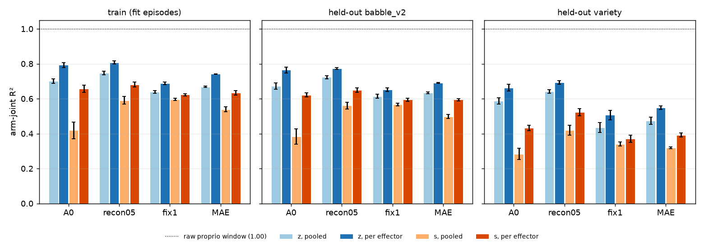

**Reading, by the rule.**

* **The representation, not the fit.**
  * The raw proprio window decodes the arm perfectly (R² 1.00 everywhere).
  * Every encoder is already low on its own fit episodes: train R² 0.62 to 0.68 on s and 0.69
    to 0.81 on z (per effector).
  * Train, CV and held-out babble_v2 agree within 0.03 to 0.10. The decoder generalises; there is
    little to recover in the fit.
* **The projector drops arm information.**
  * z is above s for every encoder, decoder and set.
  * The gap is largest for A0: per effector, 0.79 against 0.66 on train and 0.66 against 0.43
    on variety; pooled, 0.70 against 0.42 on train.
  * It is smallest for fix1: 0.69 against 0.62 per effector.
* **The open-loop floor contrast is mostly an effector effect.**
  * Pooled, A0's s is far below fix1's (0.38 against 0.57, held-out babble_v2), as the B-plan-0
    floor showed.
  * Per effector, the order flips: A0 is at 0.62 against fix1's 0.59 on held-out babble_v2, and
    0.43 against 0.37 on variety.
  * So A0's s encodes the arm about as well as fix1's, but in a way that differs by effector. One
    pooled map cannot read it, and the -0.124 rad floor half of the primary comes from that.
* **The reconstruction default does not help the arm readout of z.** fix1's z is the lowest of
  all encoders (0.69 per effector on train, against 0.74 to 0.81). Its gain over A0 is only in s,
  and only with a pooled decoder.
* **Variety is lower than babble_v2 for every encoder (by 0.08 to 0.23), but not for raw
  proprio.** The shift is in the representation: these encoders were pretrained on babble only.
* **Not tested here: a nonlinear readout.** The rule above is about linear decoders. A small MLP
  could read more from s, but the planner's latent cost is a plain squared distance in s, so the
  linear readout is the relevant one for it.

### B-plan-0, gallery: predictions against the ground truth (illustrative)

**Illustrations, not tests.** Seed 0 only, 4 episodes and 3 goals, chosen by fixed rules:
* the first two held-out episodes of each set in split order;
* the first goal of babble_v2 episodes 0 and 1 and of variety episode 0.

Command: `plan_test.py gallery`. Nothing here is a contrast.

**Open loop.** Rows are episodes. Columns are the four arm joints with the largest variance. Each
panel shows:
* the true angle (black);
* the decoded true state of A0 and fix1 (dashed: the readout ceiling);
* the decoded rollouts of their own predictors, started every 8 model steps and drawn as
  segments;
* copy (grey).

The legends give each line's RMS. The decoder is the pooled one of the open-loop part.

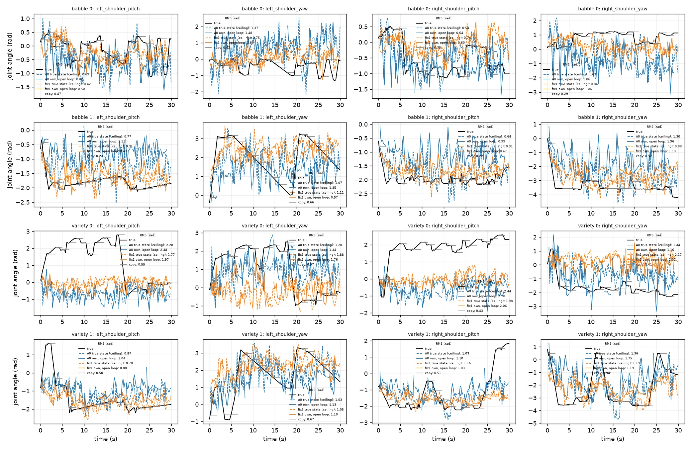

**Scatter.** Decoded against true joint angle at h1 and h8, all joints, the 1,600 open-loop starts
of the 200 held-out episodes, with y = x. The slope is the least-squares slope of decoded on true:
1 means no shrinkage, 0 means the mean only.

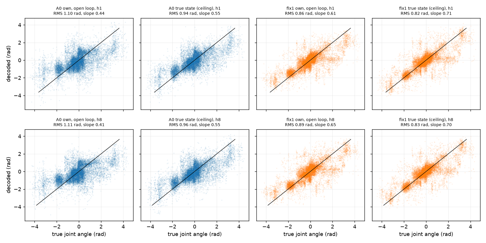

| seed 0, pooled decoder | RMS h1 (rad) | RMS h8 | slope h1 | slope h8 |
|---|---|---|---|---|
| A0 own predictor | 1.10 | 1.11 | 0.44 | 0.41 |
| A0 true state (ceiling) | 0.94 | 0.96 | 0.55 | 0.55 |
| fix1 own predictor | 0.86 | 0.89 | 0.61 | 0.65 |
| fix1 true state (ceiling) | 0.82 | 0.83 | 0.71 | 0.70 |

**Goals.** Each block is one goal:
* the first row is the recorded episode, whose last frame is the goal;
* then hold, random, own fix1 CEM (the first-run planner, not amendment 1) and replay, re-run in
  the restored scene;
* frames are one per model step (0.2 s), from the head camera.

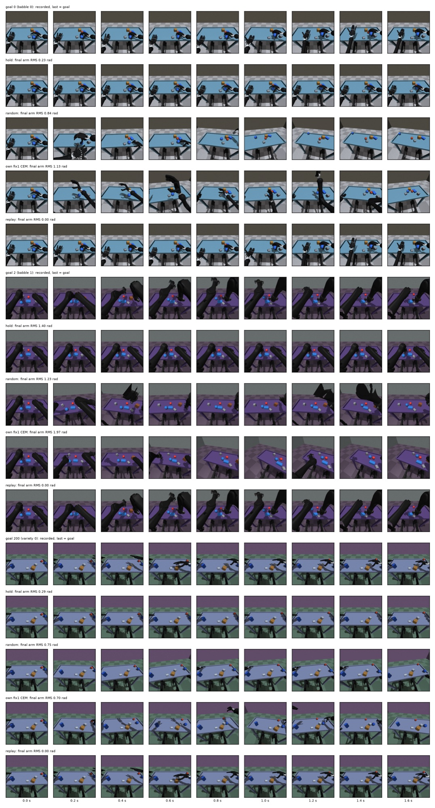

| goal | hold | random | own fix1 CEM | replay |
|---|---|---|---|---|
| 0 (babble_v2 episode 0) | 0.23 | 0.84 | 1.13 | 0.00 |
| 2 (babble_v2 episode 1) | 1.40 | 1.23 | 1.97 | 0.00 |
| 200 (variety episode 0) | 0.29 | 0.75 | 0.70 | 0.00 |

Final arm RMS to the goal, rad.

**What the gallery shows (illustrative, consistent with the tables above).**

* **The readout from s is the bottleneck, not the dynamics.**
  * fix1's own predictor adds little over its ceiling: 0.86 against 0.82 at h1, and 0.89
    against 0.83 at h8.
  * A0's adds more, 1.10 against 0.94: the excess of the open-loop table.
  * Both ceilings are far from the truth. In the time series, the decoded true state jitters
    from one model step to the next while the true angle is smooth or flat.
* **Shrinkage toward the mean.** Every slope is below 1, from 0.41 (A0 predicted, h8) to 0.71
  (fix1 ceiling). The ceilings already shrink (0.55 for A0, 0.70 for fix1), and A0's predictor
  shrinks further (0.44 and 0.41).
* **Large poses are missed.** In variety episode 0, both shoulder pitches sit near +2 rad for
  most of the episode, and both encoders' ceilings stay near 0 (RMS 1.8 to 2.4 rad). Plausibly
  these poses are rare or absent in babble_v2, the encoders' only pretraining data, which matches
  the variety drop in the decoder check. The babble_v2 joint range was not checked here.
* **Random and CEM rows tilt the camera, but not because the planner moves the body.**
  * The planner acts on the eight arm targets only. Every other joint, the torso and legs
    included, holds its target from before t0.
  * Both random and CEM draw new arm targets around the held ones with the data's full
    per-joint std, clipped to the data's range. They jump to them as steps, every model step
    (0.2 s).
  * The swings jolt the seated body through its held joints, so the head camera moves.
  * Replay makes similarly large but smooth arm motions (goal 2) and the camera stays steady.
  * So this follows from the sampling (large target jumps), not from the action space. The
    trust region of amendment 1 bounds exactly these jumps.
* **When the goal needs a large motion, CEM moves away from it.**
  * Goal 2 is far from the start: hold ends 1.40 rad away. CEM ends further away (1.97) than
    random (1.23).
  * On goal 0, CEM (1.13) is also worse than random (0.84).
  * On goal 200 it is about level with random (0.70 against 0.75), and all three are far
    behind hold (0.29).

### B-plan-0: first closed-loop run, a planner failure (post hoc, not the primary)

The first run reached 3,224 goal-configs before a spot preemption (GCP, n2-standard-32). The open-loop
part (a) is complete. The table covers the 133 goals that every planner and bar finished, described
post hoc. **No pre-registered contrast is computed on it.**

| planner | success < 0.10 rad | < 0.30 | < 0.50 | median final arm RMS (rad) |
|---|---|---|---|---|
| replay the true actions (ceiling) | 1.000 | 1.000 | 1.000 | 0.00 |
| hold the current targets | 0.045 | 0.504 | 0.654 | 0.30 |
| random actions (floor) | 0.000 | 0.023 | 0.128 | 0.70 |
| own A0 | 0.000 | 0.010 +- 0.004 | 0.048 +- 0.007 | 1.11 (1.09 to 1.13) |
| own recon05 | 0.000 | 0.000 | 0.038 +- 0.006 | 1.12 (1.08 to 1.15) |
| own fix1 | 0.000 | 0.003 +- 0.004 | 0.028 +- 0.007 | 1.15 (1.13 to 1.19) |
| ridge A0 | 0.000 | 0.000 | 0.043 +- 0.013 | 1.07 (1.02 to 1.10) |
| ridge fix1 | 0.000 | 0.003 +- 0.004 | 0.033 +- 0.004 | 1.11 (1.07 to 1.14) |
| ridge MAE | 0.000 | 0.003 +- 0.004 | 0.033 +- 0.004 | 1.07 (1.05 to 1.09) |

Planner rows: mean +- sd over 3 seeds; the median is the mean of the seeds' medians, with their
range. Bars have one run. From the final report (`scripts/plan_test.py report`).

**Reading.**

* **Restore is faithful.** Replay reaches every goal (median 0.00015 rad on the 20 gate goals).
* **Every planner ends further from the goal than random actions**, and far further than holding
  still.
* **Cause: the planner exploits model error.** CEM searched the whole range of arm targets in the
  data, with a wide std. Targets no encoder has seen get the lowest *predicted* latent cost, so
  the planner drives the arms there.
* **The primary is uninformative** (0% against 0%), and so is any contrast of success.
* **Time.** A goal-config took about 44 s per process with 30 processes, the same for the bars
  (no planning) as for the planners. The time goes into restoring, simulating and rendering, not
  into planning.

### B-plan-0, amendment 1 (written before any rerun)

**Why.** The planner above fails for every encoder, so the study cannot answer its question. This
amendment changes **only the planner** and adds a pilot gate. Nothing else changes:

* the goals and arms;
* the 0.10 rad success rule and the bars;
* the primary (fix1 - A0 success, own predictors, paired by seed and goal, MDD = 2.8 x combined
  SE), the secondary contrasts and the open-loop part (a).

The first run's goal results are a diagnosis only, and are never pooled with the rerun.

**Trust region.**

* The planner chooses per-chunk *changes* d_r of the eight arm targets. The targets are
  x_r = hold + d_1 + ... + d_r.
* Each component of d_r is bounded by +-sigma_Delta. sigma_Delta is the per-joint std of the change
  between consecutive chunks' mean arm targets, in the 100 babble_v2 pretraining episodes, per
  effector.
* CEM samples d with initial mean 0 and std sigma_Delta, clipped to +-sigma_Delta. The targets are
  also clipped to the data's range.

**Cost.** ||s_hat_H - g||^2 / ||s_0 - g||^2 + lambda x mean_r ||d_r / sigma_Delta||^2, with
**lambda = 0.1**, fixed now.

* The latent term is normalised by the start's own distance to the goal, so one lambda fits every
  encoder.
* The penalty favours small moves.

**Pilot gate, before the full run.**

* Run the first 40 goals (ids 0 to 39) with own A0 seed 0, own fix1 seed 0, hold and replay.
* **Pass** if own A0 or own fix1 reaches a **median final arm RMS of at most 0.9 x hold's** on those
  40 goals.
* The gate uses the median RMS, not success: at 0.10 rad, hold succeeds on 4.5% of goals, too few to
  read on 40.
* If neither passes, the study stops. The planner failure is the result, and there is no full run.

**Not part of the amendment: speed-ups that do not change results.** The right eye (privileged,
never a model input) is no longer rendered. The scene is restored once per goal and rewound for
every planner. Both are tested to give identical observations and results.

## B-rep-0: can the state s carry the arm? (pre-registered)

**Written before any code or run.** The B-plan-0 decoder check found the weak arm readout is in the
representation, and the projector drops arm information:

* per effector, s reaches R² 0.59 to 0.65 on held-out babble_v2 against 1.00 for the raw proprio
  window;
* z is above s for every encoder.

The planner's cost and every linear readout use s. The supervisor chose two fixes: reconstruct from
s, and several summary tokens instead of one.

**Recipe:** fix1's (B-fix-1) unless stated:

* cpu_tiny_a0 base, d = 128, V+P;
* babble_v2 pretraining set (n = 791), 10,000 steps x 16, checkpoints 0, 250, 1,000, 2,500, 5,000
  and 10,000, seeds 0 to 2;
* one masked pass (`mae_ratio` 0.75, `mae_proprio_ratio` 0.5), reconstruction weight 0.5, 0.1 x
  SIGReg.

**Baselines, not retrained:** the A0 (B-variety-0 `jepa-babble`) and fix1 (B-fix-1 `fix1-recon05`)
10,000-step checkpoints.

**Arms.**

| arm | change from fix1 |
|---|---|
| `recon-s` | the reconstruction decoder reads s (the projector output) instead of z; same masks and targets |
| `recon-s-allprop` (1b) | as recon-s, and the proprio reconstruction is scored on **every** channel (hidden and visible) against the clean input |
| `multi-z` | K = 4 summary tokens; s = the 4 projected tokens concatenated (512-d); reconstruction on z as in fix1 |
| `recon-s-multi-z` | both |

* **recon-s, one change only.** The decoder reads s, so the projector must keep what the
  reconstruction needs.
* **recon-s-allprop (1b), two changes**, added at the supervisor's request:
  * the decoder reads s;
  * the proprio reconstruction targets are every channel against the clean input, so the visible
    joint angles must also be decodable from s.
  * Its contrast with fix1 is **attributed to the pair**, not to either change. Its contrast with
    recon-s (reported, secondary) isolates the clean-target change.
  * Masks, pixel targets and the weight are unchanged.
* **multi-z, K = 4:** one summary token per sense group of this recipe (vision, proprio_body,
  vestibular, proprio_effector). The tie to a group is nominal. Every summary token attends to every
  token, with no attention mask: this tests one bottleneck token against four, not a factorised
  state.
  * **State.** One shared projector maps each token; s is the concatenation, 4 x 128 = 512-d. It is
    one vector because the planner's cost and the linear decoders need one. A set of tokens would
    also multiply the predictor's attention cost by 16.
  * **Predictor.** The same width (128), with an input map 512 -> 128 and an output map 128 -> 512.
    The next-state loss is on the 512-d s.
  * **SIGReg** is applied per token (128-d each) and averaged over the 4. The statistic then has
    fix1's dimension and sample count; on 512-d with 128 pooled samples it would be a different,
    weaker constraint.
  * **Reconstruction** stays on z. The decoder applies one shared first layer to every token and
    sums them, a linear map on the concatenated z with tied weights, so its size is unchanged.
  * **Size.** About +0.13M parameters on the 2.4M model (+5%), from the predictor's two maps and 3
    extra summary tokens and slots.
* **K = 1 is today's model**, bit for bit (tested).

**Measures** on every arm and the baselines, at 10,000 steps:

* **The decoder check of B-plan-0:**
  * ridge arm-joint decoders on s and on z, pooled and per effector;
  * fitted on every model step of the first 100 babble_v2 pretraining episodes;
  * R² on train, 5-fold episode-grouped CV, held-out babble_v2 and held-out variety.
* **Open loop with the own predictor:** decoded arm RMS at horizons 1 to 8 on B-plan-0's 1,600
  starts. The decoder is now **per effector** (B-plan-0 used one pooled decoder, which the decoder
  check showed hides A0's arm). Also the ceiling (the decoded true state) and copy.

**Primary, per arm against fix1 (four contrasts, each read on its own MDD; no multiplicity
correction):**

* The **per-effector R² of s on held-out babble_v2**, arm minus fix1:
  * paired by seed;
  * an episode bootstrap of the R² difference (-delta SSE / SST of the set, 300 draws, `rng(0)`);
  * MDD = 2.8 x combined SE.
* Read as **improved** (resolved positive), **no difference** or **worse**.

**Two bars, fixed now, before any run, and read separately:**

* **Fixed (readable): mean per-effector R² of s at or above 0.85**, on both train and held-out
  babble_v2.
  * This is the bar for "s carries the arm": well above every encoder today (0.59 to 0.65 held-out),
    near the raw window.
  * It is not the planning bar. R² 0.85 is an RMS of about 0.43 rad against the 1.11 rad constant,
    still above copy's 0.375 rad at horizon 8.
* **Useful for planning:** open-loop own-predictor arm RMS at horizon 8, decoded per effector,
  **below copy (0.375 rad)** on held-out babble_v2.
  * This needs a ceiling near R² 0.89 or more, plus a small prediction excess. An arm can be fixed
    and still not useful.

**Secondary.**

* The same R² with pooled decoders, on z, on train and on held-out variety.
* recon-s-allprop - recon-s, the same measure: the clean-target change alone.
* **multi-z only, capacity against structure:** the R² of the best single projected token (128-d),
  against fix1's s. A 512-d s gives the ridge 4 times the features, so a gain in s alone could be
  capacity.
* The open-loop excess over the per-effector ceiling, horizons 1 to 8.
* **The probe battery of B-fix-0/1**, to see whether the fix costs anything elsewhere:
  * contact AUROCs and the outcome battery, pre- and post-projector;
  * on held-out babble_v2, own-pretraining babble_v2 and held-out variety;
  * every checkpoint;
  * contrasts against fix1 and A0, paired by seed and episode.
  * For multi-z, post-projector is 512-d (stated with the result).
* **Reported, not judged:** the next-state loss and SIGReg curves, and training speed (seq/s).

**Expectation, so it can be wrong.**

* recon-s **improved** and probably fixed. The decoder that keeps proprio in z now acts on s.
* recon-s-allprop at least as good as recon-s. The visible arm angles are the easiest targets to
  keep, so the gain is small.
* multi-z **improved**, but most of the gain in s is capacity: its best single token is near
  fix1's s.
* recon-s-multi-z is the best of the three.
* No arm is useful for planning: the excess and copy's 0.375 rad leave little room.

**Not part of this study.** The planner retry (B-plan-0, amendment 1) is the follow-up, and only if
an arm is fixed.

**Compute.**

* n2-standard-32 spot (128 GB): 12 trainings at once (4 arms x 3 seeds) at 2 threads, about
  1.5 GB each, plus the frame cache (about 45 GB in all), as B-variety-0's 12 at once.
* Training about 50 to 65 min; evaluation about 50 to 65 min; setup about 15 min.
* About 2 to 2.5 h; about $1 to $1.50 at an estimated spot price; at most about $4.70 on demand for
  3 h.
* **Stop rule:** at the 1,000-step checkpoint, if training is slower than 1.5 x the estimate, the VM
  uploads what it has and stops, for re-costing.

### B-rep-0: results (GCP, n2-standard-32 spot, 12 trainings, 3 seeds; `scripts/rep_test.py report`)

**Null result. No arm moves the arm readout of s.**

* recon-s is slightly **worse** than fix1; the other three arms show **no difference**.
* No arm is **fixed** (per-effector R² of s >= 0.85), and none is **useful for planning** (beats
  copy at horizon 8).
* On the probe battery every arm is level with fix1 and above A0.

**Runs.**

* All 12 trainings reached 10,000 steps.
* Attempt 1 stopped on the stop rule, because of start-up, not training speed. Start-up was about
  8.7 min from launch to the first logged step (12 processes at once), against the 2 min assumed.
  The steady training rate was on the estimate.
* Attempt 2 used a 25 min deadline for 1,000 steps. Timeline (UTC): training 10:05 to 11:04;
  encode, fit, probe, decoder check and open loop 11:04 to 11:36; report 11:39.
* Training start-up grows faster than the number of concurrent processes. Launch to the first
  logged step was:
  * about 0.4 min with 3 at once (B-fix-1);
  * 5.6 to 8.7 min with 12 (B-variety-0; here);
  * about 7 min with 15 (B-fix-0).
* The likely cause is that every process reads all 791 episode files (header and action length)
  when it builds its dataset, on a shared disk. The logs have no timestamps inside that window, so
  this is not confirmed.
  * **Suggestion, not a change:** store episode lengths once (in the split or an index), so a
    process does not scan every file.
  * Stop rules now time the 1,000-step deadline from each run's first logged step, with a separate
    start-up cap.

**Corrections to the pre-registration.**

* **Model size.** The model has 7.9M parameters, not 2.4M; the reconstruction decoder is about
  6.5M of it, and A0 without it has 1.4M. multi-z's 132,480 extra parameters are **+1.7%**, not
  +5%.
* **multi-z costs about 12% per step.** At equal 12-way load: recon-s 52 seq/s, multi-z 46 seq/s.
  The end-of-run figures in the training table below were taken under varying load.

**Decoder check** (R², mean +- sd over 3 seeds; A0 and fix1 as in B-plan-0):

| encoder | s, per effector: train | held-out babble_v2 | held-out variety | z, per effector: held-out babble_v2 |
|---|---|---|---|---|
| raw proprio window | 1.000 | 1.000 | 1.000 | - |
| A0 | 0.658 +- 0.021 | 0.622 +- 0.012 | 0.433 +- 0.015 | 0.764 +- 0.017 |
| fix1 | 0.623 +- 0.006 | 0.594 +- 0.008 | 0.370 +- 0.020 | 0.651 +- 0.011 |
| recon-s | 0.608 +- 0.002 | 0.576 +- 0.004 | 0.323 +- 0.003 | 0.630 +- 0.007 |
| recon-s-allprop (1b) | 0.617 +- 0.008 | 0.589 +- 0.006 | 0.363 +- 0.022 | 0.647 +- 0.009 |
| multi-z | 0.618 +- 0.002 | 0.588 +- 0.003 | 0.340 +- 0.006 | 0.654 +- 0.001 |
| recon-s-multi-z | 0.609 +- 0.002 | 0.577 +- 0.001 | 0.324 +- 0.005 | 0.628 +- 0.013 |


**Primary:** per-effector R² of s, held-out babble_v2, arm - fix1 (paired by seed and episode;
combined SE, MDD):

| arm | contrast | reading | fixed |
|---|---|---|---|
| recon-s | -0.018 (0.004, MDD 0.012) | **worse** | no |
| recon-s-allprop (1b; attributed to the pair) | -0.005 (0.004, MDD 0.011) | no difference | no |
| multi-z | -0.006 (0.008, MDD 0.024) | no difference | no |
| recon-s-multi-z | -0.017 (0.006, MDD 0.018) | no difference | no |

Secondary contrasts:

* **The clean-target change alone** (recon-s-allprop - recon-s) is +0.013 by the R² means, about
  the size of recon-s's loss. Most of what 1b gains is undoing recon-s's small cost.
* **Best single projected token against fix1's s:**
  * multi-z: s3, 0.581, -0.013 (MDD 0.023), no difference;
  * recon-s-multi-z: s0, 0.572, -0.022 (MDD 0.019), worse.

**The four summary tokens are near-copies, not a per-sense structure.**

* In both multi-z arms, the per-token R² values of s0 to s3 agree to three decimals.
* Their held-out decoded arms correlate at 0.99994 to 0.99997 with each other, in every seed.
* They are not identical: the largest difference per row is 0.07 to 0.18 rad. So this is not a
  slicing bug (one block read four times would give identical predictions).
* The tokens and their slots are initialised separately (independent draws), so it is not an
  initialisation tie either.
* Every summary token attends to every token, with no mask (the nominal tie of the
  pre-registration). Per-token SIGReg makes each token isotropic, but nothing makes the tokens
  differ from each other. The training converged to four linear copies of one summary.
* The 512-d s therefore adds no readable arm over one token. A direct token cosine on a batch is
  not computed here; it needs a VM.

**Open loop** on held-out babble_v2, per-effector decoder (rad, mean +- sd over seeds):

| arm | ceiling h1 | ceiling h8 | own prediction h1 | own prediction h8 |
|---|---|---|---|---|
| A0 | 0.637 +- 0.014 | 0.650 +- 0.016 | 0.697 +- 0.004 | 0.723 +- 0.002 |
| fix1 | 0.660 +- 0.008 | 0.670 +- 0.008 | 0.689 +- 0.010 | 0.695 +- 0.003 |
| recon-s | 0.674 +- 0.003 | 0.685 +- 0.004 | 0.688 +- 0.011 | 0.706 +- 0.008 |
| recon-s-allprop | 0.666 +- 0.005 | 0.677 +- 0.005 | 0.686 +- 0.010 | 0.698 +- 0.010 |
| multi-z | 0.665 +- 0.002 | 0.674 +- 0.004 | 0.702 +- 0.013 | 0.714 +- 0.013 |
| recon-s-multi-z | 0.676 +- 0.001 | 0.684 +- 0.002 | 0.702 +- 0.006 | 0.725 +- 0.005 |
| copy (model-free) | 0.083 | 0.443 | | |

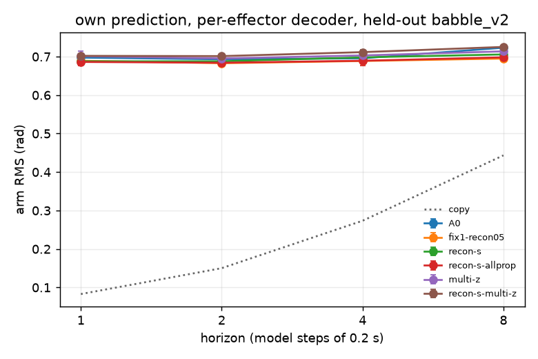

* **Copy is 0.443 rad at horizon 8 here, 0.375 in B-plan-0.** It is the same model-free baseline
  on the same starts (`openloop_ends`, `rng([set, episode])`), with no decoder involved. Only the
  set differs:
  * B-plan-0 pooled held-out babble_v2 and variety (800 starts each);
  * this table is held-out babble_v2 only, as pre-registered.
  * The pooled 0.375 implies about 0.31 rad on variety: the variety arms move less within 1.6 s.
* **The per-effector ceilings (0.64 to 0.69 rad) are below B-plan-0's pooled ones (0.73 to
  0.86).** B-plan-0's numbers were for both sets with one pooled decoder. A0 has the lowest
  ceiling here, as its per-effector R² is the highest.
* Every arm's prediction stays 0.25 rad or more above copy at horizon 8, and far above it at
  horizon 1.

**Probe battery** (secondary; 10,000 steps, arm - fix1 / arm - A0, contact AUROCs and outcome
battery, pre- and post-projector, three sets):

* **Against fix1:** no difference in 45 of 48 cells. The three resolved cells are all recon-s,
  contact AUROCs, small and negative:
  * pre -0.013 (held-out babble_v2);
  * pre -0.017 and post -0.028 (own-pretraining babble_v2).
* **Against A0:** every arm is above A0 on post-projector contact on every set (+0.08 to +0.12,
  resolved). It is also above A0 on post-projector outcome in most cells: the B-fix-0/1 gain of
  reconstruction is kept by every arm.
* **No arm costs anything elsewhere, and none gains.**

**Training** (reported, not judged; last 500 steps, seed means): next-state MSE 0.245 to 0.261
(fix1 0.257), with multi-z the lowest. Reconstruction loss is 0.41 for the z-decoded arms and 0.46
to 0.50 for the s-decoded ones: reading s is harder for the decoder.

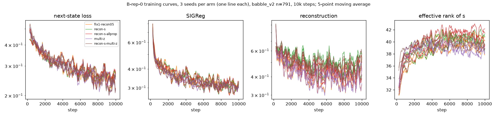

**Expectations against outcome.**

* recon-s improved and probably fixed: **wrong**. It is slightly worse. The projector keeps less of
  the arm when the decoder reads after it, not more.
* recon-s-allprop at least as good as recon-s: right, but it only returns to fix1's level.
* multi-z improved through capacity: **wrong**. The tokens collapse onto copies, so there is no
  extra capacity to use.
* No arm useful for planning: right.

**Reading.**

* **Every encoder sits near R² 0.6 on s and 0.63 to 0.76 on z** (per effector, held-out
  babble_v2), whatever the objective. The raw
  proprio window, which is part of the model's input, reaches 1.00.
* Neither moving the reconstruction to s nor widening the summary changes this.
* The loss of the arm happens **upstream of the summary**: in the proprio stem, in the fusion, or
  in how the summary pools the tokens. It is not in the projector alone. That is the next thing to
  locate.
* The arm-joint normalisation is not the cause. The input statistics stored with the checkpoints
  give the arm joints stds of 0.5 to 1.8 rad, and the input clip is +-10 std, far outside the joint
  range.

### B-rep-0, locate check: where is the arm lost? (post hoc; GCP e2-standard-8 spot)

**Question.** Every encoder reads the arm from s at R² about 0.6, while the raw proprio window reads
it at 1.00. Where along the path from input to state is the arm lost?

**Check.** For A0, fix1 and multi-z (10,000 steps, 3 seeds), the same ridge arm decoders as the
decoder check were applied at every stage of the proprio_body sense, from one forward pass
(`planning.encode_parts`; command `rep_test.py locate`):

* the normalised model input (last step, and the 4-step window);
* the stem token, before the fusion;
* the same token after the fusion ("fused");
* the summary z;
* the state s.

Each stage was decoded pooled and per effector, and scored on train, 5-fold episode CV, held-out
babble_v2 and held-out variety. For multi-z the mean pairwise cosine between its 4 tokens is also
given.

| encoder | stage | per effector: train | held-out babble_v2 | held-out variety | pooled: held-out babble_v2 |
|---|---|---|---|---|---|
| all | normalised input (last step or window) | 1.000 | 1.000 | 1.000 | 1.000 |
| A0 | stem | 0.975 +- 0.003 | 0.966 +- 0.005 | 0.943 +- 0.004 | 0.952 +- 0.005 |
| A0 | fused | 0.935 +- 0.009 | **0.920 +- 0.012** | 0.874 +- 0.017 | 0.880 +- 0.014 |
| A0 | z | 0.793 +- 0.014 | 0.764 +- 0.017 | 0.663 +- 0.019 | 0.672 +- 0.017 |
| A0 | s | 0.658 +- 0.021 | 0.622 +- 0.012 | 0.433 +- 0.015 | 0.384 +- 0.044 |
| fix1 | stem | 0.927 +- 0.004 | 0.912 +- 0.004 | 0.873 +- 0.007 | 0.874 +- 0.006 |
| fix1 | fused | 0.818 +- 0.012 | 0.789 +- 0.010 | 0.700 +- 0.020 | 0.718 +- 0.014 |
| fix1 | z | 0.688 +- 0.007 | 0.651 +- 0.011 | 0.507 +- 0.027 | 0.613 +- 0.012 |
| fix1 | s | 0.623 +- 0.006 | 0.594 +- 0.008 | 0.370 +- 0.020 | 0.566 +- 0.008 |
| multi-z | stem | 0.921 +- 0.003 | 0.904 +- 0.003 | 0.855 +- 0.013 | 0.866 +- 0.004 |
| multi-z | fused | 0.810 +- 0.001 | 0.780 +- 0.004 | 0.692 +- 0.006 | 0.707 +- 0.005 |
| multi-z | z | 0.696 +- 0.002 | 0.654 +- 0.001 | 0.494 +- 0.014 | 0.621 +- 0.001 |
| multi-z | s | 0.618 +- 0.002 | 0.588 +- 0.003 | 0.340 +- 0.006 | 0.562 +- 0.004 |

multi-z's token cosine is 0.999 +- 0.000 for z and 1.000 +- 0.000 for s: its four tokens are
copies. This confirms the B-rep-0 inference from the decoder predictions.

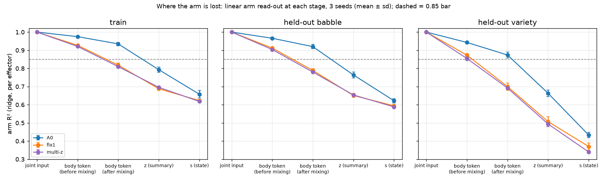

**Reading** (per effector, held-out babble_v2).

* **The arm leaks at every stage; there is no single bottleneck.**
  * A0: 1.00, then 0.97, 0.92, 0.76 and 0.62.
  * fix1: 1.00, then 0.91, 0.79, 0.65 and 0.59.
  * multi-z is within 0.01 of fix1 at every stage.
* **The largest single step is the summary pooling (fused -> z)**, but not by much:
  * A0: fused -> z -0.156, z -> s -0.142, stem -> fused -0.046;
  * fix1: fused -> z -0.138, stem -> fused -0.123, z -> s -0.057.
  * The projector costs A0 almost as much as the pooling, and costs fix1 little, as in B-fix-0/1.
* **fix1 and multi-z lose more already at the stem (0.91 against 0.97) and in the fusion.** Their
  stem and fusion are trained on inputs with half the proprio channels hidden
  (`mae_proprio_ratio` 0.5). That is a plausible cause, but untested here: the reconstruction
  objective is the other difference from A0.
* **The fused body token holds more of the arm than z or s, in every encoder.** A0's (0.92
  held-out, 0.935 train) clears the B-rep-0 "fixed" bar of 0.85, which no z or s reached.
* **The effector dependence and the variety drop both grow along the path.**
  * A0's pooled-decoder loss against per-effector is 0.01 at the stem, 0.04 fused, 0.09 at z and
    0.24 at s.
  * Its held-out variety loss against babble_v2 is 0.02 at the stem, 0.05 fused, 0.10 at z and
    0.19 at s.
  * The later stages mix in what differs between effectors and between data sets.

**Run note.** The VM ran all 9 jobs at once on 8 vCPUs, not the planned 7. The script's process
count came out 0, and GNU `xargs -P 0` means unlimited. The cause is GNU `nproc`, which honours
`OMP_NUM_THREADS`: the script exported it as 1, so `nproc` returned 1, and `nproc - 1` = 0. The
earlier decoder-check VM had the same bug ("decoder processes: 0"). Results are unaffected; later
scripts count CPUs with `nproc --all`.

### B-rep-0, design step (a): linear dynamics on the fused tokens (post hoc; GCP e2-standard-8 spot)

**Question.** The locate check found the fused sense tokens hold more of the arm than z or s. Can
a linear predictor on them beat copy at horizon 8? Post hoc, no training: the existing A0 and
fix1 10,000-step checkpoints, 3 seeds each.

**Method** (`rep_test.py tokens-dyn`). Three feature sets from `encode_parts`:

* (i) s, the baseline;
* (ii) the fused proprio_body token;
* (iii) every fused sense token concatenated (`fused_all`, 7 x 128).

For each feature set:

* **Fit**, on every model step of the 100 babble_v2 pretraining episodes, with the strength chosen
  by 5-fold episode CV on those episodes only:
  * a ridge dynamics head `x_{t+1} = W [x_t, a_t, 1]`;
  * per-effector ridge arm decoders on the true features.
* **Roll out** open loop to h8 from B-plan-0's starts on both held-out sets (8 per episode,
  1,600 in all), with the true action chunks.
* **Decode** the arm from:
  * the rollout;
  * the true features (the ceiling);
  * the start's features held (feature copy).

Lines are per-effector arm R² against the true arm at each horizon.

**Pre-registered bar** (in the code PR before any run): (ii) or (iii) beats the **model-free arm
copy** (`q_{t+h} = q_t`, B-rep-0's copy) at h8 on held-out babble_v2.

* The contrast is paired by seed, with an episode bootstrap.
* It must be resolved positive (above MDD = 2.8 x combined SE), with the rollout ahead in 3 of 3
  seeds.
* The bar is read per encoder; either encoder passing counts.

**Reproduction check.** s's ceiling gives an arm RMS of 0.637 / 0.650 rad (A0) and 0.661 /
0.670 (fix1) at h1 / h8, and the arm copy 0.083 / 0.443. These match B-rep-0's open loop.

**Results, as pre-registered.**

| encoder | features | rollout h8 | arm copy h8 | rollout - arm copy (combined SE, MDD) | every seed | passes |
|---|---|---|---|---|---|---|
| A0 | s | 0.668 +- 0.023 | 0.767 | -0.098 (0.041, 0.116) | no | no |
| A0 | fused | 0.961 +- 0.005 | 0.767 | +0.195 (0.019, 0.054) | yes | **yes** |
| A0 | fused_all | 0.975 +- 0.003 | 0.767 | +0.209 (0.019, 0.053) | yes | **yes** |
| fix1 | s | 0.642 +- 0.014 | 0.767 | -0.125 (0.040, 0.112) | no | no |
| fix1 | fused | 0.885 +- 0.010 | 0.767 | +0.119 (0.024, 0.066) | yes | **yes** |
| fix1 | fused_all | 0.903 +- 0.024 | 0.767 | +0.136 (0.028, 0.080) | yes | **yes** |

**(1) The pre-registered bar passed** for the fused body token and for all fused tokens, on both
encoders. s does not pass.

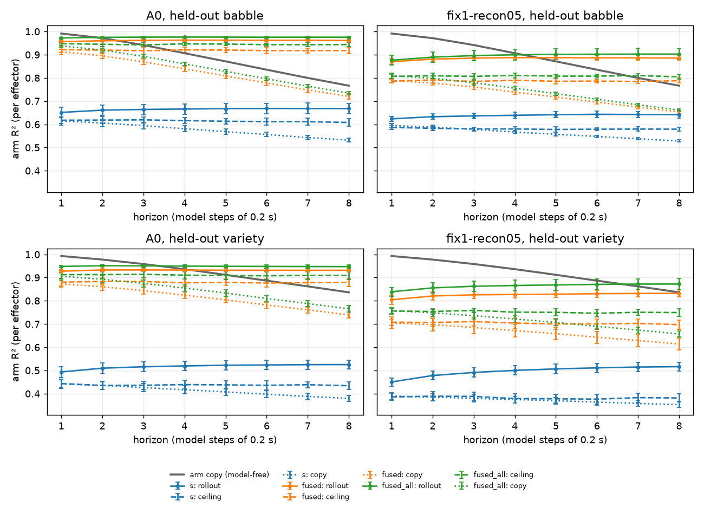

**A red flag in that result.**

* Every rollout beats its own ceiling. For example, A0 fused is 0.961 against 0.918 from decoding
  the true features, and its R² rises with the horizon.
* The actions are joint position targets (`docs/data-generation.md`), and the ridge head sees each
  chunk.
* So part of the rollout's skill is the arm going where it is commanded. Two model-free baselines
  that also see the actions were added after the results; they are **not pre-registered**
  (`rep_test.py tokens-base`).

**The two baselines that see the actions.**

* **Action copy:** the arm at t+h is the last commanded arm target of chunk h. The recorded
  normalised action is mapped back to radians through the arm actuators' control ranges. There is
  no fit, and no gravity feed-forward: the recorded target leaves it out.
* **Arm+action ridge:** a ridge dynamics head on [true arm q_t, the chunk's arm targets], with the
  same fit episodes and folds, rolled out open loop.

| set | arm copy h1 / h8 | action copy h1 / h8 | arm+action ridge h1 / h8 | best rollout h8 (A0 fused_all) |
|---|---|---|---|---|
| held-out babble_v2 | 0.991 / 0.767 | 0.996 / **0.997** | 0.999 / **0.997** | 0.975 +- 0.003 |
| held-out variety | 0.993 / 0.836 | 0.967 / **0.958** | 0.993 / **0.963** | 0.947 +- 0.007 |

Rollout minus each baseline at h8 on held-out babble_v2 (paired by seed, episode bootstrap;
added after the results, not pre-registered):

| encoder | features | - action copy | - arm+action ridge |
|---|---|---|---|
| A0 | fused | -0.035 (0.006, MDD 0.016), resolved | -0.036 (0.006, MDD 0.016), resolved |
| A0 | fused_all | -0.021 (0.004, MDD 0.010), resolved | -0.022 (0.004, MDD 0.010), resolved |
| fix1 | fused | -0.111 (0.016, MDD 0.046), resolved | -0.112 (0.016, MDD 0.045), resolved |
| fix1 | fused_all | -0.094 (0.022, MDD 0.061), resolved | -0.094 (0.022, MDD 0.061), resolved |

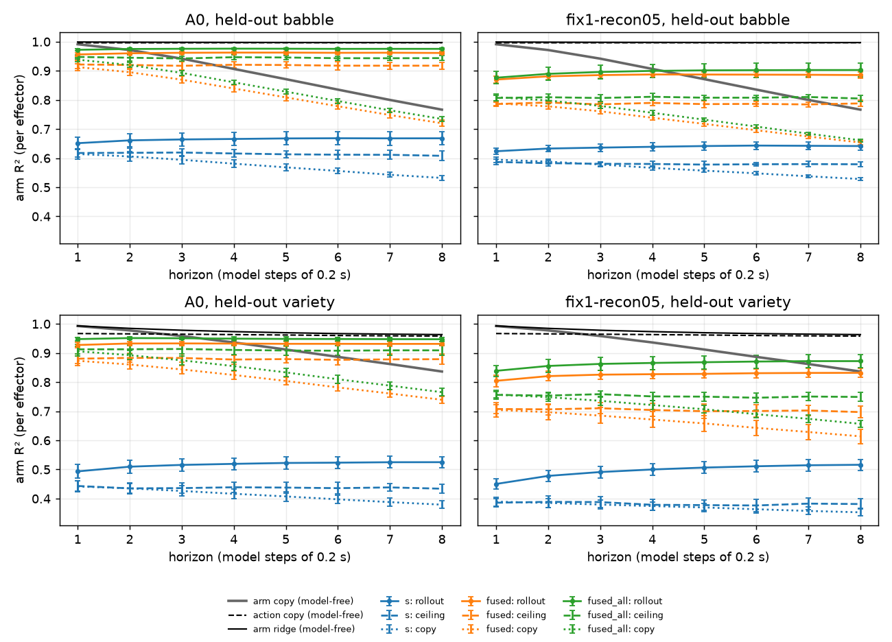

**(2) On these data the arm goes where it is commanded.**

* "The arm at t+h = the commanded target" alone reaches R² 0.997 on held-out babble_v2 and 0.958
  on variety at h8.
* A ridge on the true arm and the targets adds nothing on babble_v2 and little on variety.
* So predicting the arm from the actions is near-trivial, and **every learned state is below
  "arm = commanded target"**, by resolved margins: 0.02 to 0.04 for A0, 0.09 to 0.11 for fix1.
* The rollouts' gain over the arm copy and over their own ceiling is mostly the action passed
  through the linear head.

**(3) What this shows.**

* **The fused tokens keep the arm; s loses it.** A0's fused tokens reach 0.975 at h8, against
  0.997 for the commanded target. s reaches 0.67.
* **The arm-goal benchmark cannot show what a world model adds.** The arm reaches its commanded
  targets, so a goal given as arm joint positions can be reached without any model, by setting
  the targets to the goal. B-plan-0's closed-loop goals are scored on exactly these arm joint
  positions (success is final arm RMS under 0.10 rad). A planner that uses a learned model can
  at best match "targets = goal" on them, not beat it.

## B-skip-0: do skip connections let s keep the arm? (pre-registered; results)

**A representation test, not a planning test.** Two skip connections were added as options
(`scripts/skip_test.py`). The arms use fix1's recipe (B-rep-0's data and schedule: babble_v2,
10,000 steps x 16, seeds 0 to 2):

* **skip-z** (`model.skip_tokens`): `z = summary + W [fused sense tokens] + b`.
  * W and b start at zero, created without a random draw, so step 0 is fix1.
  * One 896 -> 128 map: 114,816 parameters, +1.5% on 7.9M.
* **skip-proj** (`model.skip_projector`): `s = projector(z) + z`. No new parameters.
* **skip-both:** both.

Controls, not retrained: fix1 and A0 at 10,000 steps.

**Pre-registered (in the code PR, before any run).**

* **Primary:** the per-effector arm R² of s on held-out babble_v2 (decoder-check protocol). Each
  skip arm minus fix1, paired by seed with an episode bootstrap, MDD = 2.8 x combined SE.
  * **"Keeps the arm"** if the gain is above the MDD and positive in each of the 3 seeds.
  * Also reported: the fraction closed of the gap from fix1's s to fix1's fused-sense-token
    ceiling (the locate check's `fused_all`).
* **Secondary, not judged:**
  * the locate stages;
  * the ridge open loop on s and on the fused tokens, against the arm and action copies;
  * the probe battery;
  * the training curves;
  * the sense reliance of s.
* **Out of scope:** arm-goal planning success, which can be solved without a model (design
  step (a)).

**Run.** GCP n2-standard-32 spot, 9 trainings at once. Timeline (UTC):

* training 09:15 to 10:10;
* evaluation 10:10 to 10:42;
* done at 10:44.

All stop rules passed (timed per job from its own output).

### B-skip-0: results

**(1) Pre-registered result: no arm improves s.** All three are within +-0.004 of fix1, with MDDs
of 0.018 to 0.028. None keeps the arm, and none closes any of the gap.

| arm | per-effector R² of s, held-out babble_v2 | arm - fix1 (combined SE, MDD) | positive in every seed | keeps the arm | gap closed |
|---|---|---|---|---|---|
| fix1 (control) | 0.594 +- 0.008 | - | - | - | - |
| skip-z | 0.590 +- 0.011 | -0.004 (0.007, 0.018) | no | **no** | -0.02 |
| skip-proj | 0.590 +- 0.000 | -0.003 (0.007, 0.018) | no | **no** | -0.02 |
| skip-both | 0.593 +- 0.007 | -0.001 (0.010, 0.028) | no | **no** | 0.00 |

The gap is from fix1's s (0.594) to fix1's fused sense tokens (0.817, the same protocol).

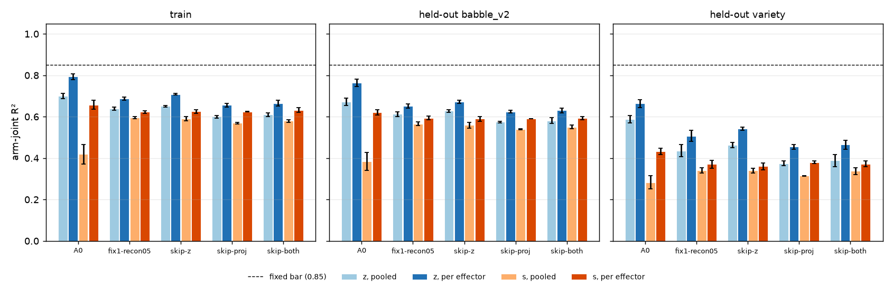

**(2) Reading.**

* Architectural shortcuts alone do not keep the arm in s.
  * A direct linear path from the fused tokens (which hold 0.82 of the arm) into z does not carry
    it through to s.
  * Neither does a residual around the projector.
* *Interpretation, not tested here:* the loss of the arm in s looks driven by the objective (what
  next-state prediction and SIGReg reward in s), not by a lack of capacity or of a path.

**(3) Secondaries.**

* **Locate stages** (per effector, held-out babble_v2):

  | encoder | stem | fused | fused_all | z | s |
  |---|---|---|---|---|---|
  | fix1 | 0.912 | 0.789 | 0.817 | 0.651 | 0.594 |
  | skip-z | 0.905 | 0.800 | 0.790 | **0.672** | 0.590 |
  | skip-proj | 0.897 | 0.751 | 0.792 | 0.624 | 0.590 |
  | skip-both | 0.896 | 0.747 | 0.736 | 0.630 | 0.593 |

  * skip-z raises z slightly (0.651 to 0.672), but s does not move.
  * skip-proj and skip-both lose a little at the fused body token and at z. Their s is unchanged.
* **skip-both is unstable on all fused tokens.**
  * The locate check's CV R² of its `fused_all` is -0.14 +- 0.84, from one seed's folds.
  * Its held-out `fused_all` is lower and more variable (0.736 +- 0.048).
  * The fused-token rollout's margin over the arm copy does not resolve for skip-both `fused_all`
    (+0.051, MDD 0.165). It resolves for every other arm and feature set.
* **Ridge open loop** (held-out babble_v2, h8):
  * s stays below the arm copy for every arm (-0.13 to -0.14, resolved), as for fix1.
  * The fused-token rollouts stay below "arm = commanded target", by -0.10 to -0.18, resolved.
  * The skips change neither by much.
* **Probe battery** against fix1 (contact AUROCs, outcome battery; pre and post; three sets).
  Mostly level, with these resolved cells:
  * skip-both post-projector contact: +0.034 on held-out babble_v2, +0.025 on own-pretraining
    babble_v2, +0.026 on held-out variety;
  * skip-proj: post contact +0.019 (variety), and pre contact -0.033 (own-pretraining).
  * Every arm stays above A0 on post-projector contact (+0.10 to +0.15, resolved).
* **Sense reliance of s** (how far removing a sense moves s; held-out babble_v2):

  | encoder | proprio_body | proprio_effector | vestibular | vision |
  |---|---|---|---|---|
  | A0 | 0.669 +- 0.018 | 0.693 +- 0.046 | 0.058 +- 0.004 | 0.109 +- 0.043 |
  | fix1 | 0.289 +- 0.010 | 0.724 +- 0.005 | 0.048 +- 0.001 | 0.064 +- 0.012 |
  | skip-z | 0.241 +- 0.008 | 0.644 +- 0.003 | 0.064 +- 0.017 | **0.217 +- 0.036** |
  | skip-proj | 0.242 +- 0.009 | 0.732 +- 0.017 | 0.049 +- 0.002 | 0.048 +- 0.001 |
  | skip-both | 0.274 +- 0.020 | 0.745 +- 0.010 | 0.079 +- 0.018 | **0.819 +- 0.451** |

  * skip-z's s uses vision more than fix1's (0.22 against 0.06). s did not become proprio-only.
  * skip-both's 0.82 +- 0.45 comes from one outlier seed. It matches the `fused_all` instability
    above.
* **Training** (reported, not judged):
  * skip-proj and skip-both start with a higher next-state loss (about 0.75 against 0.5 at the
    first log) and end slightly higher (0.278 and 0.273 against fix1's 0.257, last 500 steps).
  * Their effective rank of s stays higher (about 47 against about 40).
  * SIGReg and reconstruction curves overlap fix1's.
  * Throughput was 62 seq/s under 9-way load. fix1's 82 seq/s was measured under 3-way load, so
    the two are not comparable.

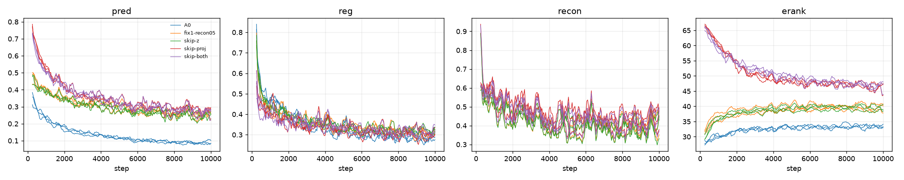

## B-pusht-0: our sensory layer against LeWorldModel on Push-T, at a matched tiny size (pre-registered)

**Written before any code or run.** LeWorldModel (LeWM, arXiv 2603.19312) is the JEPA our `sigreg`
objective follows. On Push-T it reports 96.0 +- 2.8% planning success, and 86.0 +- 7.5% with a
decoder loss added. This study runs LeWM's own code and our model on the same Push-T data, on CPU,
at one tiny size and one training budget. It evaluates all of them with LeWM's planning protocol.
It asks two questions:

* Does our model plan as well as LeWM at equal size and budget?
* Does our reconstruction default (fix1) hurt planning?

It does not reproduce LeWM's published size; that is on hold. **The comparison is relative:** the
arms match in size, data and training budget, and the budget is far below LeWM's. Absolute success
rates are therefore expected well below LeWM's 96%. Only the contrasts between arms are read.

**Pinned sources.**

* `lucas-maes/le-wm` at commit `8edfeb3` (MIT): training, model and evaluation code.
* `stable-worldmodel` 0.1.1 (git `15a5538`, MIT): the environment `swm/PushT-v1`, the World
  evaluator, the CEM solver and the success rule.
* `stable-pretraining`: the version that install resolves, recorded at run time.
* Data: HF `quentinll/lewm-pusht`, `pusht_expert_train` (18,685 expert episodes, 2,336,736
  steps, 125 on average, as read from the file; the paper says 20,000 of about 196; 10 Hz; MIT). It is converted by phd-a's converter into our episodes and into a 64 px file in
  LeWM's own format. **Both models see identical 64 px frames**: our stored frames are decoded,
  then resized to 64 px over the full frame, with no crop and no jitter.

**Arms** (3 seeds each):

| arm | code | input | objective |
|---|---|---|---|
| (i) LeWM-tiny | LeWM's `train.py`, with the overrides below | pixels | next-embedding MSE + 0.09 x SIGReg (theirs) |
| (ii) ours A0, pixels | `sensorium` | pixels | `sigreg`, `recon_weight = 0` |
| (iii) ours A0, pixels + agent | `sensorium` | pixels + agent x, y, vx, vy (proprio) | `sigreg`, `recon_weight = 0` |
| (iv) ours fix1, pixels | `sensorium` | pixels | `sigreg` + reconstruction 0.5, one masked pass (the default) |

* **LeWM-tiny overrides,** recorded exactly in the code PR and the run logs:
  * `img_size` 64; encoder `patch_size` 8;
  * ViT `hidden_size` 128, with 3 layers, 4 heads and `intermediate_size` 512 (through `vit_hf`'s
    config keywords);
  * `embed_dim` 128;
  * predictor depth 2, 4 heads, `dim_head` 32, `mlp_dim` 512;
  * projector and `pred_proj` hidden 256;
  * *Corrected before any run, when the parameters were counted:* first listed as 4 layers and
    hidden 512. That gives LeWM-tiny 1.76M parameters against our 1.21M, 0.69 of it, outside the
    25% bar. With 3 layers and hidden 256 it has 1,427,054, and ours 1,214,016 to 1,233,344 (0.85
    to 0.86 of it). The predictors are the same size (593,920; the same AdaLN design).
  * `trainer.accelerator` cpu, `precision` 32.
  * Every other value is LeWM's: SIGReg 0.09 with 1,024 projections; history 3; frame-skip 5;
    AdamW 5e-5; their scheduler and their 90/10 clip split (seed 3072).
* **Ours:** the `cpu_tiny` widths (dim 128; the vision ViT at 64 px, patch 8, dim 64, 2 layers;
  fusion 2; predictor 2).
  * Sequences of 4 model steps, so each sample is 3 context frames + 1 target, as LeWM's.
  * One model step is 5 env steps (substeps 5), so an action chunk is LeWM's action block of 5.
  * SIGReg is per time step (batch 128 is large enough).
  * Our own learning rate and schedule.
* **Size** (planning model): LeWM-tiny 1,427,054; ours 1,214,016 (pixels), 1,233,344 (pixels +
  agent). Within 25% of each other, as required.
  * Reconstruction adds a decoder to (iv) that the planner never uses. It is counted separately.
* **Training data: a fixed subset of 2,000 episodes** of `pusht_expert_train` (about 250,000
  steps), the same for every arm.
  * The subset is drawn once with `rng(0)` from the 18,685, and written in both formats.
  * LeWM's own clip split (90/10, Generator seed 3072, over the subset file) defines the training
    and validation clips of every arm: 190,550 training and 21,172 validation clips.
  * Our sequence ends on LeWM's clip frames t, t+5, t+10, t+15 when it starts at t - 4, since our
    window of 5 observations ends on each frame. The training clips that start in an episode's
    first 4 steps (about 4%) cannot be taken by our windows. Their count is logged and reported,
    and our arms draw from the rest.
  * LeWM's `cfg.seed` (3072) seeds both its split and its loader order, so it is kept. The run
    seed (0, 1, 2) is set as the global torch, numpy and Python seed before LeWM's `run()`. The
    initial weights' checksum is logged per seed, to check that the seeds differ.
* **Matched budget:** every run sees **2,048,000 training clips**: 16,000 steps of batch 128, about
  10.7 epochs of the subset's training clips (about 191,000).
  * This is far below LeWM's 10 epochs of the full file (about 17.8M clips).

**The data are in-distribution for evaluation** (found by the converter, stated before any run):

* Push-T's 18,685 episodes are 185 expert demonstrations, each replayed about 101 times with noise.
  In file order, the episode lengths form 183 runs of 101 consecutive equal-length episodes (two
  are 202 long), and 185 x 101 = 18,685, as DINO-WM's "expert trajectories replayed with noise".
* Every validation clip has near-duplicate siblings in training: validation loss measures fit to
  the 185 demonstrations, not generalisation.
* LeWM's evaluation draws its start-goal pairs from the same file, so starts and goals lie on
  training demonstrations, and success rates are in-distribution.
* This holds for every arm alike, so the comparison stays fair; absolute rates are not
  generalisation.
* The 2,000-episode subset covers all 183 runs (about 11 replays each).

**Evaluation: LeWM's protocol, through stable-worldmodel's own World evaluator** (`eval.py` at
`8edfeb3`, config `pusht.yaml`):

* **Pairs:**
  * **Primary: 200 start-goal pairs drawn with `rng(43)`.**
  * **Published-comparable secondary: LeWM's 50 pairs, `rng(42)`, reported in full.**
  * Both are drawn from the full file, as LeWM's evaluation does, so most pairs come
    from episodes outside the 2,000 used for training.
  * The goal is the dataset state 25 env steps later, with a budget of 50 env steps.
* **Planner:** CEM, 300 samples, 30 elites, 30 iterations, initial variance 1, horizon 5 planning
  steps (25 env steps).
* **Execution, resolved from the code:**
  * `WorldModelPolicy` keeps `receding_horizon` = 5 planned steps x `action_block` 5 = 25 env
    steps, and replans when they are used up.
  * With horizon 5, the full planned sequence is executed (two plans per episode).
* **Success:** `eval_state`, agent + block position error under 20 (of 512) and block angle error
  under pi/9.
* **Frames at evaluation:** the environment renders at 224 px, as the source data. Every arm
  receives the training pipeline's 64 px frames: the bilinear upscale to 256, then resize to 64 over
  the full frame. Only the video compression of the stored episodes is absent.
* **Plugging in our model:** our model enters the same evaluator as a cost model. The solver calls
  `get_cost(info, candidates)`; our wrapper encodes the history and the goal, rolls out our own
  predictor over the candidate action chunks, and returns the squared distance of the final
  predicted state to the goal's state, exactly as LeWM's `criterion`. Our model gets our own image
  transform (64 px, as in training) in place of the ImageNet normalisation.
* **Validation of the evaluator, before the arms:** LeWM's published Push-T checkpoint
  (`quentinll/lewm-pusht`, at its native 224 px, CPU) is run through the same evaluator on our VM,
  on **LeWM's 50-pair protocol** (where its 96% comes from). It must give a success rate within 2
  binomial SE of 96%. If not, the environment or versions differ from the paper's, and that is
  reported before any arm is read.

**Primary.** Planning success rate per arm on the **200 primary pairs** (mean over 3 seeds of the
success fraction), and two contrasts:

* **(ii) - (i):** ours against LeWM at equal size and budget. The seeds of the two codebases are
  unrelated, so seed variance is unpaired. The bootstrap resamples the 200 pairs, shared by both.
* **(iv) - (ii):** does reconstruction hurt planning? The same codebase and seeds, so paired by
  seed and by pair.
* **MDD = 2.8 x combined SE.** Read as **better**, **worse** or **no difference**.
* **Expected resolution, stated now:**
  * 200 pairs x 3 seeds = 600 trials per arm give a binomial SE of about 2 points per arm at 50%
    success.
  * With LeWM's seed spread (sd about 3 to 7 points, Table 5 and Table 7), the MDD of a
    difference is about 8 to 11 points: unpaired (ii) - (i) at the top of that range, and paired
    (iv) - (ii) lower, since the shared pairs cancel.
  * So a 10-point effect such as LeWM's decoder cost is resolvable.
  * On the 50-pair secondary (150 trials per arm) the MDD is about 15 points.

**Secondary.**

* Every arm and contrast on **LeWM's 50 pairs** (`rng(42)`), the published-comparable numbers.
* (iii) - (ii): does agent proprio help planning?
* **Object pose from the state** (our arm-in-s question, on an object). Ridge probes of the block's
  x, y and angle (as sin and cos) from each arm's planning state (s for ours; LeWM's projected
  embedding):
  * per arm and seed, with episode-grouped 5-fold CV on 400 episodes (one state per model step);
  * R² per target, and the same from z / the CLS token before the projector.
* **Training curves for every seed:** prediction loss, SIGReg and (iv) reconstruction against
  samples seen. Also held-out prediction loss on LeWM's validation clips, each model in its own
  units.
* Wall-clock throughput per arm (clips/s), under the load it ran at.

**Expectation, so it can be wrong.**

* (ii) ~ (i): the two objectives are the same family.
* (iv) <= (ii), as in LeWM's Table 7, but probably not resolved.
* (iii) >= (ii).
* The block pose is better read from z than from s, as the arm was in H1.

**Compute** (CPU only; the estimate is in the brief to the lead).

* **Training:** about 3.5 to 4.5 h per run at 2 threads (2,048,000 clips at an estimated 130 to 160
  clips/s). 12 runs at once on one 48-vCPU spot VM (about 3 vCPU and 2 GB each): about 5 h, about
  $2.5, estimated.
* **Evaluation:** 12 models x (200 + 50) pairs. Two plans per episode, each 30 CEM iterations of
  300 rollouts of 5 steps through a tiny predictor: about 2 to 3 s per episode, about 15 min per
  model. About 3 h of 4-thread processes on a 16-vCPU spot VM, about $0.3.
* **Validation anchor:** LeWM's published 224 px checkpoint on 50 pairs, about 30 to 60 min at 8
  threads, under $0.2. It is skipped, and reported, if its measured cost would pass $2.
* **Total about $3 to $4.5, estimated.**
* **Stop rule:** if the measured throughput of the first 1,000 steps puts the total above $10, the
  run stops for re-costing. It is timed from each run's first logged step.

### B-pusht-0: results (GCP, n2-highcpu-48 spot; `scripts/pusht_eval.py report`)

<!-- SKELETON: filled from runs/pusht/report.txt and stage.log once the run finishes. -->

**Runs.** [timeline from stage.log.] All 12 runs passed 1,000 steps by 00:50 UTC. Speeds at 26 min,
12 runs sharing 48 vCPUs: our arms 200 to 280 sequences/s (a0-pix and a0-pix-agent about 3,200
steps, fix1-pix about 2,450); LeWM-tiny 0.7 steps/s (about 1,050 steps), the bottleneck. On that first
VM, LeWM-tiny's initial weights differed by seed (checksums 34160.74, 34135.36, 34164.88); see the
preemption note for the relaunch. [Final throughput; the count of LeWM training clips our
windows could not take (`weights.log`); cost.]

**Validation anchor.** LeWM's published checkpoint (224 px), 50 pairs, `rng(42)`, through our
driver: [success] against the published 96.0% (binomial SE [se]). [Inside / outside 2 SE.]

**Primary: planning success on the 200 pairs (`rng(43)`)**, mean +- sd over 3 seeds:

| arm | success |
|---|---|
| (i) LeWM-tiny | |
| (ii) ours A0, pixels | |
| (iii) ours A0, pixels + agent | |
| (iv) ours fix1, pixels | |

| contrast | value (seed SE, pair SE, combined, MDD) | reading |
|---|---|---|
| (ii) - (i), seeds unpaired, pairs shared | | |
| (iv) - (ii), paired | | |

**Secondary.**

* LeWM's 50 pairs (`rng(42)`), every arm and contrast: [table].
* (iii) - (ii): [value].
* **Block pose from the state** (episode-grouped 5-fold ridge R², 400 episodes outside the
  training subset): [table of x, y, sin, cos per arm, for the state and for the layer before the
  projector].
* **Training curves**, every seed of every arm: [figure `pusht_curves.png`].

**Run notes** (for the write-up):

* The first launch stopped in its dry run: stable-pretraining 0.1.8's `Manager` replaces any
  Lightning logger with its own RegistryLogger, so LeWM-tiny's metrics are written under its cache
  (`runs/<date>/<time>/<id>/metrics.csv`), not `lewm_logs/<run>/`. The relaunch finds that CSV from
  each training log and copies it. LeWM-tiny's curves come from there. (`lewm_launch.py`'s docstring
  to be corrected in this PR.)
* **One spot preemption, 03:32 UTC.** Our 9 runs had finished (all at 16,000 steps); the 3
  LeWM-tiny runs were near step 8,000. LeWM's per-epoch files hold weights only, and resuming through
  stable-pretraining's `Manager` would drop the optimizer state, so LeWM-tiny was retrained from
  scratch on a relaunched VM, which then ran the whole evaluation. That relaunch (about 03:45 UTC)
  stopped itself two minutes into training on a launcher bug (its 1,000-step rule misread the
  LeWM-tiny runs' start times), so it was relaunched again at about 04:00 UTC; nothing trained in the
  false start was used. Our arms were
  trained once, on the first VM. The interrupted LeWM-tiny logs are kept apart and not used.
  The relaunched seeds start from the same initial weights as on the first VM (checksums
  34160.738281, 34135.363281, 34164.882812): the seeding is deterministic.
* The dry run measured LeWM-tiny at 0.72 steps/s alone on 2 threads: 16,000 steps take about 6.2 h,
  against the 4 to 5 h estimated. The machine's hard limit was raised to 18 h; the $10 stop rule is
  unchanged.

**Caveats** (from the pre-registration, and one found at launch):

* **Wall-clock speeds are within-VM only.** Our arms and LeWM-tiny trained on different VMs (the
  preemption), so their throughputs are not compared.
* **LeWM-tiny's seeds differ only in their initial weights.** stable-pretraining's `Manager` seeds
  itself to 0 after the model is built (the run seed is set before). The three LeWM-tiny runs start
  from different weights (checksums logged), but share the loader order and every random draw during
  training. Their seed spread is therefore an underestimate of a fully reseeded one; our arms are
  reseeded fully.

* The comparison is relative: the arms match in size, data and budget, far below LeWM's.
* The evaluation is in-distribution: Push-T's episodes are 185 demonstrations replayed with noise,
  and the pairs come from the same file.
* At evaluation the environment renders frames live, without the stored episodes' video
  compression; every arm is affected alike.

**Reading.** [After the numbers.]

## GPU smoke test (prepared, not run)

`sensorium.model.gpu_smoke` measures, on one GPU, in three phases so a slow run says why:
(1) loader throughput for each `--workers` setting, cold (every pick decodes an episode) and
warm; (2) forward + backward + AdamW on one resident batch, fp32 and bf16, with seconds per
step, peak memory and GPU utilisation (`nvidia-smi` sampled each second by a thread); (3) the
real loop for `--minutes` at batch 128, bf16, logging loss, std, effective rank, sequences/s,
utilisation and memory. It writes `report.json` with the H100-hours per run the slowest
measured stage implies for 20 and 100 epochs of a 5M-step pool.

```sh
uvx modal run scripts/modal_gpu_smoke.py                   # Modal, H100 (SMOKE_GPU=A100-80GB for an A100)
scripts/gpu_smoke_ssh.sh root@<host> -p <port>             # any rented box with SSH (Vast.ai ...)
uv run python -m sensorium.model.gpu_smoke configs/model/cpu_tiny.toml --device cpu --minutes 0.2 \
    --batch-size 4 --workers 0 2 --paths 'data/sample_h1/humanoid/*.npz'     # CPU rehearsal
```

Only the CPU rehearsal has run. Untested until a GPU run: CUDA, bf16 on CUDA, `pin_memory`,
`nvidia-smi` sampling (its parser is unit-tested on a sample line), peak memory at batch 128
(not estimated; if it runs out, `--batch-size 64`), the Modal image and the Modal API calls (read
from the Modal docs, not executed), and the torch wheel's CUDA build on Modal's hosts (driver CUDA
13.0 per the Modal docs; torch 2.14.1 from PyPI bundles CUDA 13 libraries in the lock).

**Cost of one smoke run** (about 25 minutes: 3 for the loader and compute phases, 15 for
the timed run, the rest start-up and image build; 8 cores, 32 GiB):

| Where | Price used | Estimate |
|---|---|---|
| Modal, H100 (`H100!`, no H200 upgrade) | $0.001097/s, CPU $0.0000131/core-s, memory $0.00000222/GiB-s (modal.com/pricing, read 2026-10-14) | GPU $1.65 + CPU $0.16 + memory $0.11 = **about $1.9**; covered by the Starter plan's $30 monthly credit (a card on file is needed for GPUs) |
| Modal, A100 80GB | $0.000694/s | **about $1.3** |
| Vast.ai A100 80GB spot | $0.47 to $0.67/h (Vast.ai marketplace, 2026-09/10, not re-checked) | 25 min run + about 15 min set-up and sample upload = 40 min: **$0.31 to $0.45**; marketplace hosts vary in reliability and bandwidth |
| Vast.ai H100 spot | $1.33 to $2.00/h (Vast.ai marketplace) | **$0.89 to $1.33** |

An A100 run measures A100 throughput; the plan's "H100-eq hours" assume 1 H100-eq = 1.75
A100-h, which the smoke test can check if run on both. Modal's per-second billing
and free credit make it the cheaper way to learn *whether* the pipeline runs; Vast is cheaper for
anything repeated.

## Next

* **B-variety-0** is done (n = 791 matched): MAE variety harms (-0.030 on babbling, -0.028 on the
  variety set, both resolved), JEPA no effect and below its floor everywhere; the supervised ceiling
  also drops on variety data (-0.073), mostly tip position. Results above.
* **B-scale-0** is done (verdict: no effect of data volume on the JEPA; MAE resolves above its floor;
  results above).

* **B-ft-curve** (pre-registered above): the label-efficiency curve from scratch, `long-jepa` at 1,000
  and 10,000 steps and `long-mae` at 10,000 steps, 7 budgets x 3 seeds, on GCP.

* **B-teach-long** is done (pre-registered verdict: null; see its results above). Heavy training no
  longer runs on the Mac.
* **Dropped:** proprio dropout 50%. At 1,000 steps it is -0.178 +- 0.037 against the uniform arm
  (above its 0.105 MDD) and partly collapses the state (B-conseq-0); it is not part of any further run.
* **Held:** the scale curve (c-none on 25 / 50 / 100 episodes, width 256) and the masked-patch
  autoencoder. Reason: no encoder has yet beaten its random-init floor on any probe set (B-conseq-0,
  B-exp-0), so a curve over data size or a new objective family cannot be read until one does.
* Touch-change-weighted loss (`model.surprise = touch`) is the one lead of B-conseq-0 (+0.036 +- 0.022
  over its twin, below the 0.063 MDD): at n = 6 it is +0.032 +- 0.020 (MDD 0.056), and the input +
  target arm `a-both` is no better than the baseline (see the n = 6 section above).
* **Parked: touch-change weighting** (`model.surprise = touch`) and the input + target arm. Same sign
  four times (+0.036 +- 0.022 and +0.032 +- 0.020 on random play, +0.079 +- 0.026 and +0.043 +- 0.023
  on S2b), **never resolved**, the arm sits at its floor (+0.012 +- 0.017) with a flat curve, and every
  arm on random play is at or below the floor, so how the encoder learns cannot be read until it
  learns at all. Reopen only once an objective clearly beats its floor. Effective rank of the
  `a-*` checkpoints (mean over 6 seeds, steps 250 / 1,000): `a-base` 37.2 / 40.2, `a-touch` 35.4 / 40.0,
  `a-both` 36.2 / 36.7, flat while the probe is flat (`scripts/collapse_retrofit.py --objective`).
* The S2b hand-experiment study (`scripts/s2b_test.py`); the hidden-property probe is parked (no range at
  this scale, even for a supervised ceiling), as is the response-based version.
* Run the GPU smoke test above (supervisor's compute decision): throughput, utilisation, memory,
  and a first look at rank at B = 128 for both objectives (`model.objective`).
* The token-level variant (later brief); the DINOv2 stem option.
* Taxel coordinates as layout metadata from Track A, for a geometric touch stem shared by hands and
  pincers.
